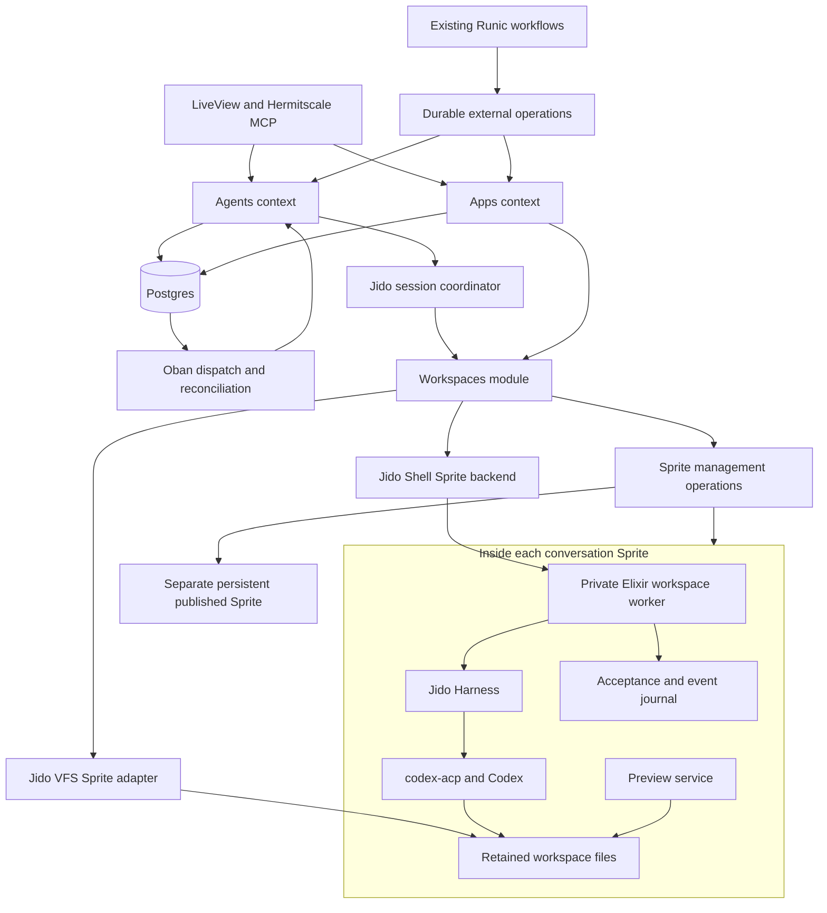

# Hermitscale Agents and Apps Software Design

Status: Implemented; current contracts and verification are recorded in [the implementation notes](agent-apps-implementation.md)\
Date: October 12, 2026  
Repository baseline: `5cdc6f2`  
Audience: Product and engineering

Hermitscale will let users run coding tasks, collaborate with agents through chat, build and publish web apps, and connect those activities to workflows. Use **Jido agents for active coordination, Jido Shell for remote commands, Jido VFS for workspace files, and Jido Harness for the coding-agent runtime**. Codex remains the first coding provider. Fly.io Sprites provide isolated Linux workspaces and hosted application environments.

Hermitscale owns authorization, durable task history, workflow continuation, approvals, deployment records, and the user experience. The default workspace lifecycle remains **create → work → sleep → resume** on one retained Sprite per conversation. Completing work releases compute activity; deleting files is a separate retention decision. Published app environments use separate persistent Sprites.

This document preserves the original design and delivery plan for chat, workflow execution, workspaces, apps, publication, and support automation. The complete implementation is described in [the implementation notes](agent-apps-implementation.md), including the distinction between automated fixture evidence and live service execution. The [runtime simplification research](research/2026-10-12-jido-runtime-simplification.md) records the inspected package revisions and evidence behind the original qualification gates. This design supersedes the direct-runner recommendation in the [earlier assessment](research/2026-10-12-jido-agents-apps-assessment.md).

## Design decisions and ownership

| Responsibility | Implementation | Hermitscale-owned behavior |
| --- | --- | --- |
| Active conversation coordination | `Jido.Agent`, actions, signals, and `Jido.AgentServer` in Phoenix | Product state transitions, authority, durable intent, and recovery decisions. |
| Coding-agent process and protocol | `jido_harness` in an Elixir worker inside the conversation Sprite | Private worker control, durable acceptance/events, and capability qualification. |
| Remote command sessions | `jido_shell` with its Sprite backend | Authorized attachment, execution leases, deadlines, and verified termination. |
| Workspace files | `jido_vfs` with its Sprite adapter | Scoped access, artifact selection, retention, and controlled checkpoint recovery. |
| Chat and coding workflow steps | One `Agents` interface and one worker protocol | Durable workflow waiting and input occurrence identity. |
| Durable dispatch and recovery | Existing Postgres records and Oban jobs | Operation identity, reconciliation, review decisions, and accepted results. |
| Workflow graphs | Existing Runic engine and node catalog | Definition-compatible replay, collection lineage, and external-operation continuation. |
| Preview and published environments | `Apps` using shared `Workspaces` operations | Access, release verification, data preservation, and deployment history. |

These packages provide real primitives, but they are not a preassembled remote durable agent platform. Harness does not depend on Jido core or Shell, and its documented execution model launches a local ACP executable. The remote connection and restart protocol remain a small Hermitscale implementation. [Harness architecture](https://github.com/agentjido/jido_harness/blob/2cea7100174de3aae3ece358612f2405a175217f/guides/reference/architecture.md)

Use core Jido coordination without adding an outer model loop around Codex. `jido_ai` can later power a support agent that chooses among evidence tools; it is a separate product capability. Keep the existing Runic workflow engine, Postgres records, and Oban jobs. Do not add `jido_runic`, `jido_workspace`, or a second workflow scheduler in the initial slice.

Use a single remote worker implementation and a single product event history. Package-specific handles stay inside the implementation. Callers do not choose between raw Codex, Harness, or Shell execution paths. A missing required upstream capability becomes a qualification decision before shipping that feature.

### Runtime identities

| Name | Meaning and lifetime |
| --- | --- |
| Agent session / conversation | Durable Hermitscale record shared by chat and workflows; owns one retained editing workspace. |
| Agent turn | One admitted request with its own operation key, execution actor, budget, evidence, and outcome. |
| Jido coordinator | Disposable Phoenix-side process for active coordination; reconstructed from committed product state. |
| Workspace worker | Separately deployed Elixir process on a Sprite; owns private control and the local acceptance/event journal. |
| Harness session | Worker-local runtime resource; its ID is not the conversation ID or a durable recovery guarantee. |
| Provider conversation | Codex's retained conversation reference, loaded only through a qualified provider continuation path. |
| Workspace | Durable Hermitscale resource mapping to retained Sprite files; process shutdown does not delete it. |
| Published environment | App-owned workspace and data with an independently recorded active deployment. |

## Product scope

The design supports four experiences:

1. A workflow starts a coding task, waits for its result, publishes a branch, creates a PR, and sends a notification.
2. A user starts a conversation, watches progress, reviews changes, and continues later in the same workspace.
3. A user builds an app through chat, opens a retained preview, and publishes a recorded version.
4. A ticket starts an investigation, produces a tested fix or explanation, and prepares an appropriate response.

Start with one repository per conversation, organization-owned connections, OpenAI API billing, private previews, and reviewed publication. New-app conversations may begin without a repository; initialize one before ordinary coding work. Suitable small published apps can use SQLite on their persistent Sprite filesystem.

General production availability guarantees, horizontal scaling, native custom domains, personal connections, subscription-funded model access, and additional coding providers are later work. Harness supporting a provider does not make that provider supported by Hermitscale. Browser authentication and the visual workflow editor are also work items; the current frontend is the Phoenix scaffold.

### Coding workflows

A coding task accepts instructions, repository or app, a resolved starting commit, recipe, selected connections, budget, and expected result contract. Provision and check out only when creating the conversation. Follow-ups resume existing files, uncommitted changes, dependencies, caches, and provider history. Moving to a new source revision is explicit.

Independent workflow occurrences create separate conversations unless the graph explicitly continues an authorized session. Allow one active turn and one agent writer per editing workspace. Serialize human intervention with workflow-owned work. Closing the browser does not cancel a turn; reopening replays persisted history. Archiving changes visibility, closing prevents new turns, and neither deletes the workspace.

The agent prepares changes and evidence. A separate publication operation commits an explicit change manifest and pushes a branch; the GitHub PR action uses that verified remote branch. Exactly one operation owns each external effect. A later direct-publication policy may let the agent publish, but the graph must then consume its reconciled result rather than publish again.

### Ad hoc chat

A user selects a repository or starts an app, chooses allowed connections, and submits a turn. The conversation displays messages, command activity, files, checks, reviews, and usage. A workflow-created conversation opens in the same view and uses the same continuation rules.

Follow-ups enqueue a new durable turn after the active turn settles; they do not depend on an in-memory Harness queue. The first release supports stop and a later follow-up, with mid-turn steering deferred until a qualified provider supports it. A stop request stays visible until termination is confirmed. An interrupted turn retains its partial evidence and files so the user can inspect them before continuing.

### Apps and previews

An App has stable identity, repository, recipe, environments, deployment history, and workflows. Build combines chat, preview, and changes. Preview URLs and files remain with the conversation, although processes can sleep. Sharing expiry removes access without deleting files. Publication builds and activates a version in a separate persistent app environment; further editing cannot change the running release.

Multiple conversations can work on an App through separate editing workspaces. Each published environment has one active release and its own data. Promotion checks the expected current deployment so competing conversations cannot silently overwrite each other's publication.

### Support and maintenance

For support work, resolve the app, deployed revision, and permitted evidence from a verified subscription or server-owned mapping. Customer text cannot select another organization or authorize production changes. Outcomes distinguish explanation, workaround, reproduced defect, proposed fix, verified deployment, and blocked investigation. Draft replies for review initially. A reply claims a fix is live only after deployment and defect-specific verification; deployment approval and response approval are separate decisions.

## Existing foundation

| Existing capability | Reuse and extension |
| --- | --- |
| WorkOS-backed `Auth`, `Accounts.Scope`, and `Authorization` | Keep verified organization and acting-member identity; add agent, app, and review permissions. |
| Organization-owned WorkOS Pipes connections | Select accounts per session; add remote credential delivery and renewal. |
| Runic compilation, execution, and replay | Add durable external waiting while preserving definition and occurrence identity. |
| Versioned node catalog and expression context | Add typed agent/app operations with JSON results and secret-free references. |
| Linear and GitHub webhook triggers and clients | Reuse signed ingestion, deduplication, and provider actions; add publication reconciliation. |
| OpenAI Responses action | Retain direct model calls independently of coding-agent execution. |
| Oban, Postgres, and PubSub | Persist intent and dispatch jobs together; broadcast only after persistence. |

Slack, the selected ticket provider, browser auth, chat, Apps, Sprite integration, and external-operation waiting remain new work. See [integrations](integrations.md), [node authoring](node-authoring-kit.md), [workflow context](../lib/hermitscale/workflows.ex), [execution identity](../lib/hermitscale/integrations/execution_context.ex), and [router](../lib/hermitscale_web/router.ex).

## Architecture and package placement



The diagram is proposed composition, not a claim of a built-in Harness/Shell transport. Keep the authenticated control connection separate from the app listener. No public preview route exposes worker methods, and no conversation Sprite receives the fleet management token. Sprites provide the operating-system isolation; a Jido process, local shell, or VFS path prefix does not isolate untrusted code.

### Control plane

`Hermitscale.Agents` is the public deep module for sessions, turns, history, approvals, cancellation, and publication. Internally, a Jido session coordinator handles active signals and actions: prepare workspace, start or reconnect to work, accept evidence, request review, cancel, and release activity. Its state is a working projection of durable records. Reconstruct it from those records after failure; do not make a Jido mailbox or snapshot the source of truth.

Jido separates immutable agent state from the supervised runtime and its directives; actions may themselves perform I/O. Use those primitives for coordination without duplicating Codex reasoning. Supervision alone does not preserve a pending external effect. [Jido core loop](https://github.com/agentjido/jido/blob/v2.4.0/guides/core-loop.md), [persistence implementation](https://github.com/agentjido/jido/blob/v2.4.0/lib/jido/persist.ex)

Oban owns durable dispatch and bounded reconciliation. The Jido coordinator owns active interaction. They use the same admitted operation and fencing generation; neither independently retries model work. On startup, reconciliation inspects the existing worker operation before creating another coordinator. Stop idle coordinators and transports without changing stored conversation state. Reuse the existing scheduler for due work.

`Workspaces` owns allocation, retained identity, authorized execution, leases, task holds, recovery, and deletion. Shell and VFS are private implementation details. A small Sprite management adapter handles operations not provided or qualified by those packages, such as allocation reconciliation, services, holds, and explicit deletion. Use `Req` for Hermitscale's HTTP calls; test transitive transport behavior before adoption.

`Apps` owns preview access, release verification, promotion, and published data. It may request an agent conversation; Agents does not call Apps. Workspaces does not depend on either caller or Runic. Workflow continuation remains in Workflows. Entrypoints call public contexts instead of editing their tables or invoking package clients directly.

The coordinator's actions call these existing product owners. Keep actions small enough to test state transitions without starting Codex, while leaving authority and durable transitions in the owning context:

| Coordinator responsibility | Owning interface |
| --- | --- |
| Prepare or resume admitted work | `Workspaces` validates the lease and returns the retained workspace and worker status. |
| Start or reconnect to a turn | The private worker client inspects the operation and dispatches only admitted commands. |
| Accept progress and results | `Agents` persists redacted events and verified outcomes before notifying subscribers. |
| Request or answer a review | `Reviews` records the exact request/decision; `Agents` revalidates it before worker delivery. |
| Cancel and settle | `Agents` records cancellation or completion; `Workspaces` verifies writer termination and releases activity. |

Long model turns run in the workspace worker. Jido actions and Oban jobs perform bounded coordination steps; they do not hold a database transaction open while waiting for the model. A runtime signal can prompt reconciliation, but durable records establish what work remains.

### Inside the conversation Sprite

Install a small, separately packaged **Elixir workspace worker** containing Harness and Hermitscale's local journal/control code. Harness runs the local Codex ACP executable there, next to the checkout. Harness owns provider process supervision and protocol translation; Hermitscale owns the versioned remote control interface and its integration tests.

The worker owns only durable command acceptance, fencing checks, Harness calls, event export, and bounded activity cleanup. It does not own organization permissions, workflow state, publication policy, or fleet credentials. Start it as a managed Sprite service so cold boots can re-establish the control endpoint. A control-bridge disconnect does not itself cancel an admitted turn; explicit cancellation and lease expiry govern its lifetime. The preview uses the app HTTP listener; control uses a private local socket reached through authenticated Sprite transport.

Shell attaches to an already provisioned Sprite for setup, commands, and the control bridge. Prove bidirectional messaging, reconnect, and subprocess termination in phase 0; Shell command support alone does not prove this transport. VFS handles bounded file reads/writes and artifact transfer. Use actual Sprite execution for builds and package installation; the default in-memory virtual shell is not the Linux build environment.

Keep installations and caches between turns. Recipe manifests pin worker, provider, ACP adapter, toolchain, and build/start commands without embedding credentials. Published environments install only their app and required management commands, not the coding runtime. Retain a native Codex integration only as a fallback decision if Harness cannot satisfy required capabilities; do not build both paths speculatively.

### Command and file access

All workspace access resolves an authorized Hermitscale workspace ID to server-owned Sprite configuration. Callers cannot supply a raw Sprite name, fleet token, or unrestricted transport request. Shell and VFS use the same workspace identity, recipe paths, and admitted operation.

| Operation | Execution path and policy |
| --- | --- |
| Coding tools | Harness/provider processes work inside the conversation Sprite under its configured filesystem and network restrictions. |
| Setup, builds, tests, and release commands | Workspaces invokes the Sprite Shell backend under a bounded lease; commands record exit status and bounded evidence. |
| Live file reads and artifact collection | Workspaces invokes VFS with path/size checks and explicit activity authorization when the operation wakes compute. |
| File writes | Require the workspace's admitted writer; UI edits, Shell commands, and agent tools cannot independently mutate the same checkout. |
| Historical diff, log, or artifact reads | Serve persisted evidence without connecting to VFS or waking a Sprite. |
| Checkpoint and version operations | Use exclusive Workspaces recovery, with writers stopped; version reads cannot masquerade as passive file reads. |

Bound transfer size and export selection independently of provider defaults. A path supplied by a tool or user does not grant access outside the selected workspace. Retention maintenance must not race with active writes, data backups, or export operations.

## Package qualification

The proposed versions below identify inspected sources, not a resolved dependency set. Verify releases and lock exact compatible versions or Git revisions during the spike; do not depend on moving branches.

| Package | Checked baseline | Adoption constraint |
| --- | --- | --- |
| `jido` | Released 2.4.0 | Active agent coordination only; Postgres remains authoritative. |
| `jido_shell` | Source revision `3c9af797d1f2c852e2b182e77509fafc5b51f86b`, manifest 3.0.0 | Qualify a pinned Git dependency; a matching Hex release was not found during research. |
| `jido_vfs` | Released 1.0.1; Sprite implementation reviewed separately in the research note | Verify the selected release includes the inspected behavior and is compatible with Shell. |
| `jido_harness` | Source revision `2cea7100174de3aae3ece358612f2405a175217f`, manifest 3.0.0-rc.1 | Pre-release candidate; keep in the worker's separate Mix project. Requires Elixir `~> 1.19` and a C++17 build toolchain. |

Hermitscale currently declares Elixir `~> 1.18`; building the worker with a pinned newer runtime avoids forcing a host upgrade just to evaluate Harness. Pin its native helper build and test the target Linux architecture. Manifests alone do not establish dependency resolution, runtime compatibility, or production readiness. [Harness manifest](https://github.com/agentjido/jido_harness/blob/2cea7100174de3aae3ece358612f2405a175217f/mix.exs), [package research](research/2026-10-12-jido-runtime-simplification.md)

Three constraints shape the implementation:

- **Harness capability coverage:** v3 uses ACP. Current profiles lack steering and structured-output support, and native events omitted by the ACP adapter cannot be recovered from its raw event field. Use interactive sessions for both chat and workflows, show only verified controls, validate result artifacts in Hermitscale, and prove session loading and approval behavior with the pinned Codex adapter. Do not silently accept a weaker result contract. [Provider capabilities](https://github.com/agentjido/jido_harness/blob/2cea7100174de3aae3ece358612f2405a175217f/guides/providers.md)
- **Shell resource ownership:** attach with `create: false`. The inspected Sprite backend can destroy Sprites it creates on teardown. Cancellation and network-policy enforcement also need verification; the inspected implementation can report success when the SDK lacks a policy operation. Refuse execution when required isolation cannot be established. [Sprite backend](https://github.com/agentjido/jido_shell/blob/3c9af797d1f2c852e2b182e77509fafc5b51f86b/lib/jido_shell/backend/sprite.ex)
- **VFS recovery effects:** the inspected Sprite `read_version` path temporarily restores the whole Sprite. Never use it as a harmless historical file read on an active workspace or published database. Route checkpoint creation, restore, and any such version reads through exclusive Workspaces recovery; prefer exported artifacts for history browsing. [VFS Sprite implementation](https://github.com/agentjido/jido_vfs/blob/276fbe4dcb025a87e7b33b2b23b84c0209dbd026/lib/jido_vfs/adapter/sprite.ex)

Harness retains runtime events for consumers, but runs and sessions do not survive BEAM/host restart. Its replay journal is not the durable product history or the worker's acceptance journal. Jido state persistence similarly does not recover arbitrary remote effects or outstanding permission handles. [Harness scope](https://github.com/agentjido/jido_harness/blob/2cea7100174de3aae3ece358612f2405a175217f/README.md), [Jido runtime state](https://github.com/agentjido/jido/blob/v2.4.0/lib/jido/agent_server/state.ex)

## Implementation map

Add files as each slice needs them, rather than scaffolding a complete framework. Each Elixir file defines one module. Representative placement:

```text
lib/hermitscale/
  agents.ex                          # public sessions, turns, history, and cancellation
  agents/session_agent.ex            # Jido coordination over durable product state
  agents/actions/                    # admitted product actions, added as needed
  agents/events.ex                   # persistence, deduplication, and history replay
  agents/publication.ex              # verified branch publication
  agents/reconcile_worker.ex         # Oban recovery from durable intent
  workspaces.ex                      # retained resources, execution, recovery, deletion
  workspaces/sprites.ex              # required management operations through Req
  workspaces/shell.ex                 # Shell configuration and attachment policy
  workspaces/files.ex                 # scoped VFS operations and recovery guards
  workspaces/worker_client.ex         # small private worker protocol
  workspaces/recovery.ex              # exclusive restore and journal reconciliation
  workspaces/retention.ex             # protections, exports, and deletion eligibility
  apps.ex                            # app and environment interface
  apps/previews.ex                    # preview configuration and access grants
  apps/releases.ex                   # verified activation and data-preserving rollback
  apps/data.ex                       # recipe-specific backup and recovery policy
  workflows/external_operations.ex   # durable wait and terminal handoff to Runic
  workflows/external_operation_worker.ex # dispatch and durable terminal handoff
  integrations/execution_access.ex   # credential delivery and renewal
  integrations/inference_gateway.ex  # fixed upstream, expiry, and model metering
  integrations/deliveries.ex          # external effect intent and reconciliation
  mcp/server.ex                      # ExMCP handler for scoped product tools
  reviews.ex                         # action-bound decisions
  artifacts.ex                       # authorized stored evidence
  usage.ex                           # compute, storage, and model accounting

lib/hermitscale_web/
  router.ex                          # shared authenticated route scope
  user_auth.ex                       # browser/LiveView bridge to existing WorkOS auth
  live/agent_live.ex                  # conversation, reviews, evidence, and changes
  live/app_live.ex                    # app overview, build, and deployments
  mcp.ex                             # bearer-authenticated ExMCP HTTP mount
  app_gateway.ex                     # isolated preview/app origin and routing

workspace_worker/                    # separate Linux Elixir release
  mix.exs                            # pinned Harness and worker dependencies
  lib/hermitscale_worker/control.ex   # validated local protocol
  lib/hermitscale_worker/execution.ex # Harness session integration
  lib/hermitscale_worker/journal.ex   # acceptance, event cursor, and recovery
  lib/hermitscale_worker/activity.ex  # lease expiry, activity reports, and cleanup
  test/                              # restart, duplicate command, and control contracts

priv/workspace_protocol/v1/          # shared command/event schemas and fixtures
priv/workspace_recipes/              # versioned setup, build, start, backup manifests
```

Schemas, migrations, LiveViews, and individual workers enter with their feature. Keep existing catalog, compiler, authorization, connection selection, and replay changes in their current modules. The public contexts remain the test surface; internal package adapters translate real policy or transport differences rather than mirroring every upstream function.

All user-facing operations take verified `current_scope` first. Jobs persist actor/resource identifiers, reconstruct scope, and revalidate authority. Mutations return an accepted domain record or operation ID with status; reads return stored history without connecting to a Sprite. Exact function signatures are implementation decisions. Primary operations are:

| Module | Interface responsibilities |
| --- | --- |
| `Agents` | Start session, submit turn, answer review/input, cancel turn, list events, publish branch. |
| `Workspaces` | Ensure retained workspace, execute admitted work, release activity, request recovery/deletion, inspect stored state. |
| `Apps` | Create app, ensure preview, request deployment, inspect deployment, request data recovery. |
| `Reviews` | Request, decide, and revalidate a digest-bound action; decisions never execute effects themselves. |
| `ExternalOperations` | Admit workflow work, reconcile it, and durably accept one terminal result for its occurrence. |
| `ExecutionAccess` | Authorize, issue, renew, and revoke remote capabilities with actual provider scope/expiry. |
| `Deliveries` | Record external mutation intent and known/uncertain results; the effect owner reconciles provider state. |
| `Artifacts` | Record evidence metadata and authorize bounded reads/downloads. |
| `Usage` | Reserve execution budgets, record deduplicated usage, and summarize compute/storage/model cost separately. |

An accepted mutation returns a stable ID and current status, not a promise of completed remote work. A rejected admission returns an actionable error without dispatch. Each owner controls its own state transitions; avoid a universal operation engine or package-shaped interfaces in LiveViews and workflow nodes.

## Durable records and execution

Postgres is authoritative for product state. Add records with the feature that needs them. Framework session IDs are internal references; Hermitscale session and operation IDs remain stable across process restarts.

| Record | Owner | Required identity and state |
| --- | --- | --- |
| Session | Agents | Organization, initiator, visibility, app/workflow references, workspace, provider conversation reference, selected accounts, policy, lifecycle. |
| Turn | Agents | Session, verified execution actor, immutable input, operation key, deadline/budget, status, cancellation intent, result references. |
| Event | Agents | Session/turn, stable worker source identity, product sequence, type, redacted payload, timestamp. |
| Workspace | Workspaces | Organization, conversation/environment owner, Sprite ID, recipe/worker versions, source revision, resource state, observed compute state, retention policy. |
| Execution lease | Workspaces | Workspace, admitted operation, fencing generation, allowed activity, deadline, renewal state. |
| Retention protection | Workspaces | Workspace, owning resource/operation, reason and release condition; independent of compute activity. |
| Checkpoint | Workspaces | Workspace, provider checkpoint reference, purpose, revisions, journal cursor, exposure classification, retention. |
| Approval | Reviews | Exact action/target digest, eligible approvers, expiry, policy revision, decision and verified actor. |
| External operation | Workflows | Run, definition/node identity, input occurrence, target turn/deployment/review, status, result and consumption state. |
| App and environment | Apps | Organization, source and recipe; environment purpose, workspace, configuration/access/data profile, active deployment. |
| Deployment | Apps | Environment, source/artifact/configuration versions, expected prior deployment, verification evidence, activation state. |
| Artifact | Artifacts | Organization/owner, digest, content type, bounded size, private storage location, retention. |
| Delivery | Integrations | Stable effect key, exact payload digest, provider result reference, known/uncertain outcome. |
| Usage entry | Usage | Owning operation/workspace, category, measured interval/quantity, deduplication key, rate version, reconciliation state. |

Every record has an organization or enforced same-organization parent. Database constraints enforce relationships and uniqueness; context authorization controls access. Sessions are private to their initiator by default, with explicit sharing and workflow review policy. Artifacts inherit authorization and use private object storage for large content. Never persist scopes, PIDs, client objects, credentials, or secret-bearing references in workflow facts or events.

Approvals bind the exact action, target revision or content digest, eligible approvers, expiry, decision actor, and policy revision. Changed content or revoked authority requires a fresh decision. Worker events supply evidence and cannot grant permissions or approve deployment.

Enforce uniqueness for turn/command/effect keys and event source identities. Serialize turn admission per session and writer admission per workspace. Each record has one owning writer; other modules use its interface. Retention protections let domain owners preserve pending work without Workspaces querying its callers' private tables.

### Turn execution

An accepted turn follows one path for chat and workflow use:

1. Validate authority and parameters; atomically persist the turn, stable operation key, and Oban dispatch job.
2. Admit one execution lease with a fencing generation. Create a workspace only if absent; otherwise inspect and resume its retained state.
3. Start/reconstruct the Jido coordinator and connect to the worker. Revalidate credentials and ask for the existing operation before dispatching new work.
4. The worker journals command acceptance before calling Harness. Repeated IDs return known state; stale generations are rejected. A crash between acceptance and completion is uncertain work to reconcile, not permission to rerun.
5. Stream normalized events into bounded, redacted worker journal entries. Persist and deduplicate them in Postgres before acknowledging and broadcasting. Use the worker's stable source cursor independently of Harness's in-memory cursor.
6. Verify result artifacts, revisions, and check evidence. Agent-authored summaries are not proof of tests, remote publication, or deployment. Persist the terminal outcome before notifying workflow continuation.
7. Release holds, credentials eligible for revocation, and idle transports. Retain files and conversation history.

A new fencing generation takes effect only after the worker stops or confirms completion of the previous writer. Merely rejecting future old-generation commands does not stop an already running process. Durable cancellation records intent first and remains pending until remote termination or another terminal outcome is known. Do not blindly retry paid work or external mutations through both Oban and the agent runtime.

Coalesce text events and cap raw diagnostics, artifact sizes, and retained journals. Give each external mutation a stable key, payload digest, and known or uncertain result. Reconcile a lost PR, push, deployment, or message response against the provider before retrying. When the provider offers no reliable reconciliation, require operator review instead of risking duplicate delivery.

If durable acceptance cannot be written, do not launch the command. A later persistence failure or replay gap produces an explicit incomplete-history/interrupted state, never an acknowledgement of evidence that was not stored. Expected transport/provider failures are actionable outcomes; broken internal invariants fail visibly under supervision. Restarting reconciles durable intent rather than replaying effects automatically.

### Private worker protocol

Define a small versioned wire contract in `priv/workspace_protocol/v1/`, used by the host client and separate worker release. Encode validated JSON messages and explicit schema versions; keep Jido structs, PIDs, native Harness objects, and provider-specific option bags out of the wire contract.

Every mutating command carries a workspace ID, turn/operation ID, distinct command ID, fencing generation, payload digest, and deadline. A transport retry repeats the same command ID and payload; approval, cancellation, and a later turn use their own IDs. Reusing an ID for different content is rejected. The authenticated control channel establishes authority; supplied identifiers alone do not.

| Command family | Contract |
| --- | --- |
| Inspect operation | Report durable acceptance, last stored event cursor, known runtime association, and known/uncertain terminal state. |
| Start turn | Persist acceptance once, then start/load the qualified provider conversation and execute the admitted turn. |
| Answer input or approval | Accept an authorized response for the current continuation; reject stale or mismatched provider handles. |
| Request cancellation | Record the command and interrupt the active runtime; return intent separately from confirmed termination. |
| Read/acknowledge events | Export bounded batches after a cursor; prune acknowledged data only under retention policy. |

Persist worker events before export. The host acknowledges only committed Postgres events and then broadcasts to LiveView subscribers. Preserve cursor identity across ordinary worker restart. Checkpoint recovery establishes a new journal epoch before accepting new work so restored sequence numbers cannot collide with newer evidence; deduplicate source events by workspace, epoch, and sequence. Keep user-visible history monotonic instead of rewinding it to the checkpoint.

The host admits only compatible worker/protocol versions. Recipe upgrades are explicit and occur while no writer is active; an upgrade must preserve the local journal and provider history. Unsupported command versions fail before dispatch rather than silently dropping required fields.

## Lifecycle, sleep, and recovery

Turn states are queued, provisioning, running, waiting for input/approval, interrupted, succeeded, failed, and cancelled. Cancellation intent and uncertain remote status remain visible until resolved. A session is open, archived, or closed. Workspace retention and last-observed compute state are separate: sleeping does not mean failed or deleted.

An execution lease authorizes a bounded operation. Workspaces owns the corresponding Sprite task hold and renews it only for authorized activity. The worker reports progress and stops local work at its lease deadline; it does not receive fleet credentials to renew holds itself. A retention protection prevents deletion without keeping compute awake. Hold expiry is the crash fallback. [Sprite task holds](https://docs.fly.io/sprites/keeping-sprites-running)

| Situation | Required behavior |
| --- | --- |
| Healthy follow-up | Wake the same Sprite and preserve checkout, dependencies, caches, preview data, and provider history. |
| Browser disconnect | Continue authorized work; reload history from Postgres on reconnect. |
| History/status view | Use stored state; no Sprite exec, live preview mount, health probe, or renewed hold. |
| Terminal turn | Persist evidence, attempt a bounded final flush, release activity, and retain storage. |
| Human wait | Persist exact review/input and continuation identity, establish recoverability, then release activity. Revalidate an answer before resuming. |
| Phoenix restart | Reconstruct coordination from durable records and reconcile the existing worker operation. |
| Worker restart or Sprite cold boot | Inspect journal and provider history; resume only when supported and proven, otherwise report interruption. |
| Missing or revoked authority | Deny new execution and renewal; stop eligible work and reconcile already-issued credentials. |
| Lost external-effect response | Preserve uncertainty and inspect provider state before another mutation. |
| Deadline or model budget exceeded | Request and verify termination, retain partial evidence, and let compute sleep. |
| Unexpected workspace deletion | Preserve history and exports; reconstruct only by explicit decision with disclosed local data loss. |

A saved approval record does not preserve a live ACP permission request. Prove whether the pinned provider can reconstruct the continuation after sleep or process loss. If it cannot, mark the turn interrupted and request an authorized continuation; never forward an obsolete permission ID or advertise transparent recovery.

Close unused control, tail, WebSocket, SSE, HMR, and preview connections after bounded inactivity. No permanent poller is needed for each conversation. Reconcile active or uncertain operations with bounded backoff; use stored state or verified non-waking management reads for idle inventory. Real app requests and explicitly due jobs may wake compute. Always-on workloads are an explicit operating policy with visible costs.

### Checkpoints and retention

Ordinary sleep preserves files without a restore or reinstall. Checkpoints are recovery points before risky edits, dependency changes, or migrations. Restore requires an exclusive lease, stopped writers, credential/network-policy revalidation, and reconciliation against newer Postgres history. A restored filesystem cannot undo a PR, publication, or customer message; keep external-effect history and fence restored commands. [Sprite persistence and recovery](https://fly.io/sprites/checkpoint-restore/)

Retain completed and archived conversations by default. Explicit deletion or a configured storage retention rule checks active/waiting work, preview protections, pins, published data, and required exports under a deletion lock. Reject new leases during deletion. Deleting a conversation does not delete a published environment. Sharing expiry and compute/model limits do not imply storage deletion.

Prune expendable caches and old outputs separately from workspaces and data. Checkpoints can retain blocks after files are removed; measure retained usage instead of counting every snapshot as a full copy. Export required source, data backups, and recovery metadata before deleting a Sprite. Native checkpoints tied to the deleted Sprite are not an independent backup.

## Workflow integration

Keep the existing Runic engine. Jido coordinates an agent operation behind `Agents`; it does not replace the graph, occurrence lineage, or replay contract. The current catalog callback treats ordinary values as completed output, including an error tuple; explicit failures use `SingleOutput.Result.failure/1`. Returning a pending marker or job ID would incorrectly finish the node. [Node result contract](node-authoring-kit.md#outputs-skips-and-failures)

Add a specialized external-operation path:

1. Persist dispatch intent with a key containing run ID, node definition identity, and input occurrence identity. Attempts reuse the key; deliberate reruns create a new one.
2. Record the occurrence as waiting without producing a successful output fact. Outstanding operations prevent run completion.
3. Dispatch through Agents, Apps, or Reviews outside the workflow callback and database transaction.
4. Persist terminal evidence and a durable notification, then apply it through Runic's supported continuation mechanism for the matching definition and occurrence.
5. Mark the operation consumed only after workflow acceptance is durable. Reconcile duplicate notifications and crash windows before applying again.

Prove the exact continuation mechanism against the pinned Runic revision. Do not invent engine log events, mutate graph internals, poll indefinitely in a callback, or replace waiting with a success payload. If continuation cannot be established, ship chat first and use separately linked start/completion workflows with that limitation visible.

The initial flow remains `Linear trigger → coding task → publish branch → GitHub PR → notification`. Keep the proposed `agents.codex.run` catalog ID for the first provider, implemented through Harness; its name does not expose the runtime internals. Later operations cover previews, deployment, bounded logs, and reviews. Preserve existing single-provider `connection` fields; add a validated agent `connection_set` for multiple accounts, resolved outside expressions.

### Catalog operations and results

Names below are proposed catalog IDs. Each operation uses its owning context and the existing node configuration/validation conventions.

| Operation | Input | Verified output |
| --- | --- | --- |
| `agents.codex.run` | Instructions, repository/app, resolved revision, recipe, connection set, policy, result schema. | Session/workspace, outcome, summary, artifacts, checks, proposed publication details. |
| `agents.publish_branch` | Workspace/patch, expected source revision, explicit change manifest, publication policy. | Repository, pushed branch, commit SHA. |
| Existing GitHub PR action | Verified remote head, base, title, body, draft flag. | Reconciled provider PR ID and URL. |
| `apps.preview.create` | Authorized app/workspace, source revision, preview configuration. | Preview ID, access-controlled URL, verification state. |
| `apps.deploy` | Environment, artifact, expected active deployment, required approval. | Deployment ID, served revision, verification evidence. |
| `apps.logs.read` | Environment/deployment, time range, correlation filters. | Bounded redacted evidence; any live collection requires explicit wake authorization. |
| `reviews.request` | Exact action/target digest and reviewer policy. | Durable approval/rejection for that action. |
| Selected ticket reply action | Ticket, exact approved body, delivery key. | Provider message ID and reconciled delivery state. |

The result contains session/workspace IDs, outcome, verified base revision, artifact/check evidence references, and an agent-authored summary. Validate any requested JSON result schema in Hermitscale because current Harness profiles do not enforce it. Invalid or incomplete output is not success; repair attempts need an explicit bounded policy. PR/deployment IDs appear only after their owning operations confirm them.

For example, a successful coding turn can return the following product result. The summary is agent-authored; the revision and check/artifact references come from recorded evidence:

```json
{
  "session_id": "session_example",
  "workspace_id": "workspace_example",
  "outcome": "changes_prepared",
  "base_sha": "verified_source_commit",
  "patch_artifact_id": "artifact_example",
  "checks": [{"name": "test_suite", "status": "passed", "evidence_id": "check_example"}],
  "summary": "Prepared a fix for the reported validation error."
}
```

The graph receives JSON facts and non-secret resource references. Jido signals and Harness completion events remain internal and cannot directly complete a workflow node. A failed turn maps to the existing explicit failure contract; a human wait remains pending rather than returning a successful draft result.

## Connections and execution authority

Reuse existing authorization and connection selection. Revalidate membership, selected accounts, resource permissions, and policy at admission, resume, renewal, review, and publication. An internal task lease cannot narrow a provider token's actual scope or shorten its expiry. Do not label broad OAuth/PAT credentials repository-restricted because the UI selected a repository.

Use direct provider CLIs, APIs, or provider MCP servers for provider work. Hermitscale selects and authorizes accounts, while its own MCP remains focused on Hermitscale resources. Do not build provider proxy tools into the product MCP.

For OpenAI, start with organization API billing. Keep long-lived model keys outside repository-controlled processes using an authenticated, fixed-destination inference gateway with expiring capabilities and server-side metering. Prove compatibility with the pinned ACP/provider path. Add repository-scoped GitHub App tokens where existing grants are too broad; that authentication path is additional work. Published apps receive a separate runtime access profile.

Never place fleet credentials, refresh tokens, or durable model keys in recipes, shared caches, Git remotes, generated bundles, workflow facts, or inherited test environments. Short-lived credentials delivered to a Sprite retain their real provider exposure until expiry/revocation. Refresh only for authorized work. Checkpoints inherit the sensitivity of captured files; sanitize transient credentials where possible and never treat a restore as renewed authorization.

| Access profile | Initial behavior |
| --- | --- |
| Source checkout and investigation | Selected account and permitted repository; give only the access needed for the task. |
| Publication | Revalidate actor, approved manifest, remote repository/branch, and actual write grant when publishing. |
| Model inference | Expiring gateway capability tied to the operation, allowed upstream/model policy, and metered budget. |
| Provider investigation tools | Selected direct provider connection with its actual scopes and expiry; avoid expanding access from ticket or repository content. |
| Hermitscale tools | Organization/resource/action capability checked on each call through the public contexts. |
| Published application | Separate environment profile containing only runtime capabilities; no editing-session credentials. |

An account becoming unavailable is an explicit operation outcome. Stop renewal and new work when authority is revoked; reconcile any already-completed effect instead of claiming revocation undid it. Session persistence never implies credential renewal.

## Apps, previews, and publication

Recipes declare setup, build, start, HTTP port, health route, data location, backup, and verification commands. Use managed Sprite services; persistent service definitions support cold wake. Reserve the app HTTP listener for the preview or published service. Keep origins private behind an authorized gateway and serve generated content on a separate registrable domain from Hermitscale's UI. Validate cookies, iframe permissions, assets, redirects, uploads, and WebSockets. [Sprite services](https://docs.fly.io/sprites/concepts/services)

Stable URLs map to app environments and verified deployment records. Public access is an explicit publication choice; app authentication remains the app's or a configured access layer's responsibility. A preview is not a published release. Sharing grants control access independently of retention. Load live previews only on deliberate use and suspend abandoned connections.

### Persistent data

Support SQLite for a single serving Sprite with modest write concurrency and no automatic failover requirement. Keep the database, WAL, uploads, and other mutable data outside versioned code releases. Editing/preview data stays separate from published data; use synthetic or sanitized investigation data. Code publication never copies a preview database over customer data. Use external databases when concurrency or availability requirements exceed this profile.

Create consistent SQLite backups using its online backup interface or a validated clean stop. Export backups outside the Sprite and test restoration. A Sprite snapshot and a SQLite WAL checkpoint are different operations; neither replaces an independent backup. Schedule necessary backups from Hermitscale, skipping unchanged data where supported and attributing deliberate backup wakes to the data policy. [SQLite backups](https://sqlite.org/backup.html)

### Release procedure

Apps uses the same Workspaces allocation, Shell command, VFS transfer, lease, and recovery interfaces as Agents. Published environments use bounded recipe commands and a durable release marker; they do not need a Harness session or an active coding coordinator. Keep release state in Apps and the environment marker so interrupted activation can be inspected before another command is attempted.

1. Freeze source commit, artifact digest, recipe/configuration versions, expected active deployment, and required approval.
2. Build/test in an editing or build workspace; export a checksummed artifact excluding worker state, credentials, and preview data.
3. Acquire the published environment's release lease. Create its Sprite on first publication; reuse it thereafter. Stage code in a versioned directory while retaining data.
4. Validate the staged release, perform required backups, and pause writes for bounded migration/service switching where the recipe requires it.
5. Activate, verify served revision and acceptance checks, then record promotion against the expected prior deployment. Gate traffic during an unverified switch.
6. On success, release the gate and hold. On failure, restore compatible code against current data, or stay in maintenance and request recovery if the schema prevents rollback.

Serialize promotion and data maintenance. Reconcile remote activation and the Postgres record using the actual served revision and release marker after uncertain responses. A stale task cannot overwrite a newer release. Code rollback preserves later customer writes; restoring the whole Sprite or database requires a separate explicit data-recovery decision.

The small-app profile permits maintenance windows and prohibits automatic destructive migrations. Replacement environments remain an option for stateless/external-database apps. Moving a SQLite app to another Sprite requires a verified data transfer, fenced writes, and explicit cutover; a fresh machine per release is not the default.

## Hermitscale MCP

Use ExMCP for HTTP transport and protocol negotiation. Its handler delegates to the existing product interfaces; Hermitscale retains capability validation, current actor permissions, resource restrictions, call budgets and mutation idempotency. Mount `/mcp` in a token-authenticated router scope outside the browser and JSON-only API pipelines so ExMCP handles JSON/SSE negotiation. Support stateless `server/discover` and legacy `initialize` sessions, bind sessions to the capability and organization, and revalidate the bearer on every request.

Expose the public product interfaces through a small authenticated tool surface. Initial tools cover workflow listing/inspection, definition validation and creation, run start/status, app inspection, preview requests, bounded logs, and deployment requests. Add conversation inspection/continuation when the caller has explicit authority. Tool names such as `workflows.validate`, `runs.start`, `apps.preview`, and `deployments.request` describe product operations, not package internals.

Mutations require idempotency keys, return durable resource/operation IDs, and obey the same review policies as the UI and workflow nodes. Scope each capability to the organization, selected resources, and allowed actions. Apply execution-depth and budget limits so an agent cannot recursively start unlimited workflows or conversations. Generated definitions pass the existing compiler, validation, and account-selection rules before activation.

Resolve read requests from stored state where possible. A tool that starts a preview, collects live logs, or executes workspace work makes the wake explicit. Reading a ticket, repository instruction, or model response never grants authority to publish an app, send a customer reply, or activate a workflow.

## Phoenix UI and authentication

Add browser authentication using the existing WorkOS identity model; do not create local identity tables. The router currently has no authenticated LiveView session. Place proposed `/agents`, `/agents/:id`, `/apps`, and app build/deployment screens in `scope "/", HermitscaleWeb`, through `[:browser, :require_authenticated_user]`, inside one `live_session :require_authenticated_user`. Its mount hook verifies membership and assigns `current_scope` so HTTP entry and LiveView reconnect enforce the active organization.

| Screen | Route | Main behavior |
| --- | --- | --- |
| Conversations | `/agents` | List authorized sessions and stored status; start or reopen work. |
| Conversation | `/agents/:id` | Stream persisted history, review evidence, answer input/reviews, stop and continue. |
| Apps | `/apps` | List authorized apps and recorded deployment state. |
| App overview | `/apps/:id` | Environments, activity, deployments, and attached workflows. |
| App build | `/apps/:id/build` | Shared conversation UI, changes, and deliberately loaded preview. |
| Deployment | `/apps/:id/deployments/:deployment_id` | Exact source/artifact, verification, activation state, and permitted recovery controls. |

Keep public landing/auth callback routes in the appropriate browser scope; verify the callback transaction before establishing a session. Control/MCP routes use token authentication, and webhooks verify signatures. Generated app traffic goes through the isolated gateway. Every LiveView starts with `Layouts.app` and passes `current_scope`; context calls use that scope first. Templates derive the user from `@current_scope.user`. Use streamed/paginated history, `to_form`, and existing input/icon components.

Show messages, commands, changed files, evidence, reviews, usage, and stop/continue controls supported by the qualified runtime. Distinguish sleeping, waiting, interrupted, failed, and deleted states. Show storage retention separately from activity. Preserve keyboard access and accessible streaming status without announcing every token. Do not display unimplemented steering controls or wake previews merely to show history.

## Observability, limits, and validation

Correlate organization, app/environment, workflow occurrence, session, turn, workspace, and external-effect IDs. Persist bounded diagnostic batches during activity so sleeping resources can be investigated without live tails. Track provisioning/resume latency, turn duration, holds and wake reasons, interruption, uncertain operations, deployment verification, and delivery reconciliation.

Account for active compute, retained storage/checkpoints/backups, and model inference separately. Use measured usage and versioned rates; reconcile estimates with provider billing. Sleeping can stop compute while storage remains billable. History reads need neither model inference nor a Sprite wake. Attribute backup wakes and any future Jido AI inference separately. Execution budgets pause work; storage deletion follows its own visible policy.

Test through public contexts and the worker protocol. Use fake Sprite management, recorded Shell/VFS behavior, and a deterministic Harness/ACP fixture for failure injection. Test our policy and integration rather than reproducing upstream suites. ExUnit processes use supervision and message synchronization, not sleeps. Run targeted tests followed by `mix precommit`; the separate worker project also needs its own compile/test checks once introduced. Real provider smoke tests are explicit integration checks.

Keep context tests in `test/hermitscale/agents/`, `workspaces/`, `apps/`, and `workflows/`; authorization/credential tests extend the existing integration suite. LiveView tests exercise the same public contexts through stable element IDs. `workspace_worker/test/` owns local acceptance, replay, cancellation, and Harness interaction contracts. Both runtimes consume the shared protocol fixtures. Generate migrations with `mix ecto.gen.migration` as each schema is introduced.

| Acceptance area | Required evidence |
| --- | --- |
| Package composition | Resolve pinned dependencies, build Linux worker/native helper, and run Codex through Harness in a real Sprite. |
| Authority | Deny cross-organization sessions/artifacts/URLs and revoked actors; no credential leaks in events, exports, or generated apps. |
| Chat and recovery | Browser/Phoenix/worker restart preserves history; uncertain work never starts a duplicate turn. |
| Persistent workspace | Complete, sleep, and resume with the same checkout, edits, dependencies, caches, and preview data. |
| Idle behavior | History reads emit no remote work; abandoned previews/control streams close and holds expire. |
| Runtime controls | Required events, cancellation, usage, file/check evidence, result validation, and provider session loading work on the pinned versions. |
| Human waits | Prove sleep/resume continuation or report interruption; stale/revoked approvals cannot execute. |
| Shell/VFS policy | Teardown retains attached Sprites; required network policy is enforced; cancellation stops writers; historical reads cannot restore active data. |
| Checkpoint recovery | Exclusive restore fences old work, preserves external-effect history, and revalidates credentials. |
| Workflow waiting | Pending work blocks completion; duplicate terminal events resume one occurrence; identical mapped inputs remain distinct. |
| Publication and delivery | Lost responses reconcile branch/PR/message state; approvals bind exact artifacts or final message bodies. |
| Apps and SQLite | Preview isolation, concurrent promotion detection, failed activation, sleep persistence, independent backup restore, and code rollback preserving customer writes. |
| Retention and costs | Completion/archive retain files; deletion checks protections/exports; compute, storage, and model usage stay separate. |

## Delivery plan

| Phase | Deliverables | Exit condition |
| --- | --- | --- |
| 0 Package composition and recovery spike | Pin packages/provider/runtime; prove private remote transport, inference gateway auth, approvals, cancellation, journal recovery, sleep, and Runic continuation. | Required runtime behavior demonstrated with package reuse; unresolved capabilities produce explicit scope decisions. |
| 1 Chat and persistent workspaces | Browser auth, Agents/Jido coordinator, Shell/VFS integration, Harness worker, durable history/reviews, credentials, budgets, retention UI. | Submit, inspect, cancel, sleep, resume, and recover one conversation without reprovisioning or duplicate work. |
| 2 Workflow coding operations | Durable external waiting, coding node, branch publication, PR reconciliation, selected notification integration. | Trigger → coding task → PR → notification survives retries and restarts. |
| 3 Apps and previews | App registry, isolated gateway, sharing, persistent environments, verified release activation, SQLite recipe/backups. | Chat builds an app; upgrades and sleep preserve published data. |
| 4 Support and Hermitscale MCP | One ticket provider, verified evidence mapping, reviewed replies, product MCP. | Accurate investigation, tested fix/preview, and a reply consistent with verified release state. |
| Later expansion | Additional qualified providers, optional Jido AI support agent, automatic policies, broader recipes and hosting promises. | Each capability passes its own authorization, recovery, and operating criteria. |

The first slice is authenticated submit → durable turn → retained Sprite → Harness events → verified result → sleep → follow-up. Build it before adding the workflow editor or a general agent-provider configuration layer.

### Qualification decisions

| Question | Required decision/evidence | Shipping dependency |
| --- | --- | --- |
| Do the selected packages compose? | Resolve fixed Shell/VFS/core revisions and build the separately pinned Harness worker for Linux; record the supported recipe. | First executable slice. |
| Does private remote control work? | Prove bidirectional messages, reconnect, deadlines, and verified cancellation. Use a small Sprite transport adapter if Shell cannot carry control; retain the same worker protocol. | Chat and background turns. |
| Does Harness expose required behavior? | Demonstrate events, usage, provider conversation loading, result evidence, and interactive approval handling with the pinned ACP adapter. | First supported coding provider. |
| Can a human wait survive process loss? | Demonstrate recovery, or explicitly ship interrupted-turn continuation. Reconsider the native provider integration only if an essential requirement cannot be met. | Advertised continuation behavior. |
| Can Runic accept durable external completion? | Prove definition/occurrence identity and one durable result acceptance after duplicates and crashes. | Single resumable workflow graph; chat can ship independently. |
| What is the pilot hosting/data promise? | Select one frontend and one SQLite recipe, backup freshness/restore targets, maintenance policy, and availability expectations. | Published apps. |
| Which integrations and limits ship? | Select notification/ticket providers, actual connection scopes, retention periods, and compute/storage/model allowances. | Corresponding product phase. |

The architecture uses Jido for active coordination, Shell and VFS for workspace operations, and Harness for coding execution. Qualification settles the concrete versions and supported behavior; it does not require a second agent framework, a replacement workflow engine, or another conversation-history implementation.
