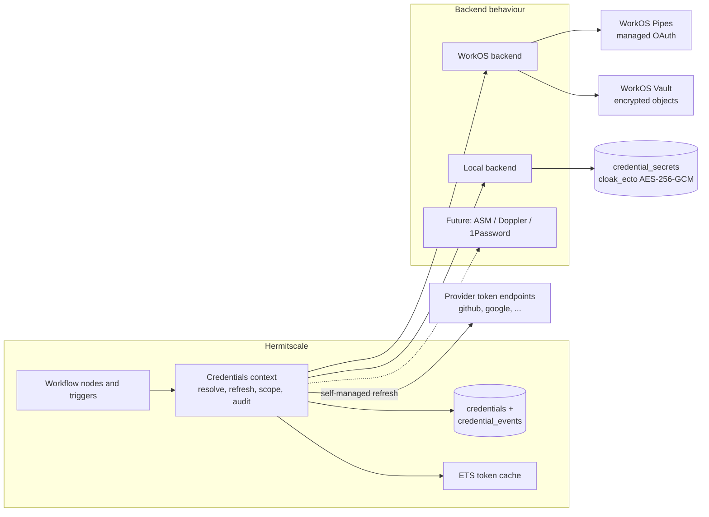
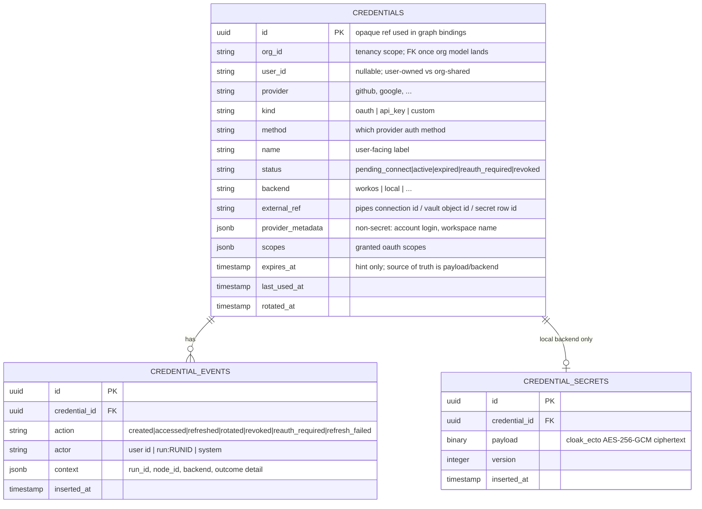
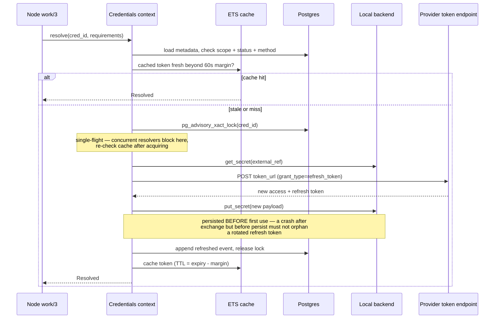
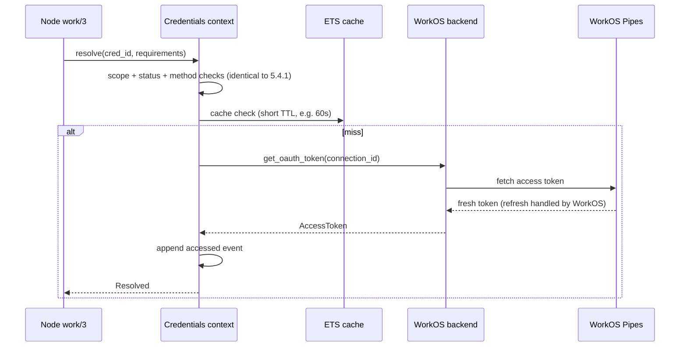

# Pluggable Credential Management — Design Document

| | |
|---|---|
| **Status** | Draft |
| **Authors** | Galad Dirie |
| **Reviewers** | [name(s)] |
| **Last updated** | 2026-07-06 |
| **Related docs** | TODO.md ("Think about credentials — right now we are optimized for oauth, what about api keys, or integrations that have both ex. github") |

---

## 1. TL;DR

Hermitscale currently resolves third-party credentials through a per-provider, config-injected
store (`:google_oauth_credential_store`); only Google OAuth is supported, nothing is persisted,
nothing is encrypted, and no access is audited. This design introduces a `Hermitscale.Credentials`
context that splits **credential metadata** (always in app Postgres, uniform and queryable) from
**secret material** (held by a pluggable backend behind a small `Credentials.Backend` behaviour
with optional capabilities). Two backends ship first: **WorkOS** (Pipes for managed third-party
OAuth, Vault for API keys and custom secrets) for the hosted product, and **Local**
(Postgres + `cloak_ecto` encryption + `assent` OAuth flows) for open-source/self-hosted
deployments. The shared layer above the backends owns refresh orchestration, tenancy scoping,
status lifecycle, and audit — so those behave identically no matter which backend holds the bytes,
and later backends (AWS Secrets Manager, Doppler, 1Password) only need to implement three
storage callbacks.

---

## 2. Context & Problem

### 2.1 Background

Credential handling today (all paths verified in the codebase):

- **Provider behaviour** — `lib/hermitscale/integrations/provider.ex` defines
  `provider_id/0`, `fetch_token(ref, scopes)`, and `network_domains/0`. Providers are
  discovered via module introspection and cached in `:persistent_term`.
- **One provider exists** — `lib/hermitscale/integrations/google/oauth.ex` implements
  `google.oauth`: it checks expiry against a 60-second margin and refreshes against Google's
  token endpoint. It resolves opaque credential IDs through a store injected via
  `Application.get_env(:hermitscale, :google_oauth_credential_store)`.
- **Graphs bind credentials by reference** — `lib/hermitscale/workflows/credentials.ex`
  reads `graph.definition["credentials"]["providers"][provider_id]` (with node-local
  overrides) and resolves once at run start for steps, per poll/connect for triggers. Node
  specs declare `requires: [credentials: [...]]` with provider + scopes.
- **Generic HTTP auth exists** — `lib/hermitscale/http.ex` already accepts `:bearer`,
  `:basic`, and raw tokens, but nothing manages the secrets that feed it.

What does **not** exist: persistent credential storage, any encryption at rest (webhook
shared secrets sit plaintext in `workflow_triggers.config`), API key support, a tenancy
model (the `Run.owner` string is unused), and any audit trail for credential access.

### 2.2 Problem statement

Three concrete gaps:

1. **Shape**: the system models exactly one credential kind (a Google OAuth access token).
   Integrations that use API keys, or that support both (GitHub: OAuth app tokens, PATs,
   GitHub App installation tokens), cannot be represented.
2. **Storage**: there is no storage at all — every deployment must invent its own store and
   wire it through a provider-specific config key, one key per provider. That doesn't scale
   past one provider and gives self-hosters nothing out of the box.
3. **Deployment split**: the hosted product wants to lean on WorkOS (Pipes handles OAuth
   flows, refresh, and encrypted token storage as a service), while the open-source
   distribution must be fully self-contained on Phoenix + Postgres. Today there is no seam
   these two implementations could both plug into.

### 2.3 Why now

Webhook triggers just landed and the integration surface is about to widen (GitHub is the
named next case). Every new provider added before this seam exists deepens the
one-config-key-per-provider pattern and makes the eventual migration bigger.

---

## 3. Goals & Non-goals

### 3.1 Goals

- **Config-only backend swap.** Choosing WorkOS vs. Local (vs. future backends) is a
  `config/runtime.exs` change; zero call sites change. Verified by running the same
  workflow suite against both backends.
- **First-class credential kinds.** API keys, OAuth token pairs, and multi-field custom
  secrets (e.g., basic auth, email+token) are all storable, rotatable, and revocable. A
  provider may accept multiple auth methods and a node declares which it accepts.
- **Encryption at rest in every backend.** Secret material never appears plaintext in the
  app database, logs, run events, or telemetry. A `pg_dump` of the self-hosted database
  yields no usable secrets.
- **Correct OAuth refresh under concurrency.** Refresh is single-flight per credential
  (no thundering herd across nodes of one run, or across BEAM nodes), handles rotating
  refresh tokens without loss, and a failed refresh transitions the credential to
  `:reauth_required` with an emitted event — never a silent retry loop.
- **Uniform audit.** Every create/access/refresh/rotate/revoke is recorded in an
  append-only `credential_events` table and emitted as `:telemetry`, identically across
  backends.
- **Non-breaking migration.** The existing `Provider.fetch_token/2` call sites and the
  `google.oauth` provider keep working through a shim until nodes migrate.

### 3.2 Non-goals

- **Building the user/org auth system.** The scoping model here is forward-compatible
  with one (scope columns exist from day one) but designing authentication/authorization
  for hermitscale itself is a separate effort. Until it lands, enforcement degrades to
  org-level defaults.
- **Issuing hermitscale's own API keys to callers.** WorkOS also sells "API Key
  Management" for issuing keys to *your* customers for *your* API — that's inbound auth,
  a different concern from storing outbound third-party credentials. It can slot in later
  behind the trigger auth layer; this doc is outbound-only.
- **Infrastructure secrets.** Database URLs, `SECRET_KEY_BASE`, the Cloak master key —
  those stay in deploy-time configuration, not in this system (this system depends on them).
- **Credential management UI.** The context exposes everything a UI needs
  (list/create/connect/revoke, status, events); the UI itself is a follow-up.

### 3.3 Success criteria

- Both first-party backends pass one shared `Credentials.BackendCase` conformance test
  suite.
- GitHub is integratable with either a PAT or an OAuth connection using the same node,
  with the binding choosing the credential.
- Zero plaintext secrets in the database or logs (checked by a test that greps a dump and
  captured logs after exercising every operation).
- Refresh failure produces a `:reauth_required` credential and an event within one
  resolve cycle — no workflow silently reuses a dead token.

---

## 4. Overview

### 4.1 Approach

The design has three layers.

**The `Hermitscale.Credentials` context (shared layer)** is the only API the rest of the
app calls: `create/2`, `resolve/2`, `rotate/2`, `revoke/1`, `list/2`, `connect/3`. It owns
everything that must behave identically across backends: the metadata record, tenancy
scoping checks, the credential status lifecycle, OAuth refresh orchestration
(expiry-margin checks, single-flight locking, refresh-token rotation), short-TTL access
token caching, and audit emission. Workflow nodes never see a backend.

**The `Credentials.Backend` behaviour (the seam)** is deliberately small: three required
callbacks for secret material (`put_secret/2`, `get_secret/2`, `delete_secret/2`) plus a
`capabilities/0` declaration. Backends that natively manage the OAuth lifecycle — WorkOS
Pipes runs the authorization flow, stores the refresh token, and returns always-fresh
access tokens — declare the `:managed_oauth` capability and implement three optional
callbacks (`connect_config/2`, `get_oauth_token/2`, `disconnect/2`). For backends without
that capability, the shared layer provides the OAuth lifecycle itself on top of the three
storage primitives, using per-provider metadata (token endpoints, refresh semantics). This
is what makes a pure secret store like AWS Secrets Manager a complete, functional backend
with ~three callbacks.

**Metadata stays home.** Every credential has a row in hermitscale's Postgres
(`credentials` table): scope, provider, kind, auth method, status, non-secret provider
metadata, and an opaque `external_ref` pointing at wherever the backend put the secret
material. This split is load-bearing: listing, binding validation, scoping, status, and
audit are uniform queries against the app database regardless of backend, and the backend
interface shrinks to "hold bytes securely, and optionally run OAuth."

### 4.2 System diagram



### 4.3 Key design decisions

- **Metadata in app Postgres, secrets in the backend.** Uniform querying/scoping/audit
  with the smallest possible backend contract. The alternative (backend owns everything)
  makes every list/filter/status operation a backend capability and was rejected (§6.1).
- **Capability-based behaviour, not a fat interface.** Required core: 3 storage callbacks.
  Optional: `:managed_oauth`. The shared layer supplies fallback implementations of every
  optional capability, so the least capable backend is still fully functional and the most
  capable backend (WorkOS) isn't forced through a lossy generic path.
- **`backend` is a column on the credential, not a global.** Config sets the *default*
  backend for new credentials; each credential records which backend holds its material.
  This makes hybrid deployments work (e.g., hosted prod using Pipes for providers it
  supports and Local for ones it doesn't) and makes backend migration a per-credential
  re-encrypt-and-repoint operation instead of a big bang.
- **Encryption is a backend obligation, not a shared layer above.** The contract states
  secret material must be encrypted at rest; each backend satisfies it natively (WorkOS:
  AES-256 in Pipes/Vault; Local: `cloak_ecto`). Double-encrypting above the backend was
  rejected — it breaks managed refresh (Pipes must read the refresh token to use it) and
  adds a second key-management problem for near-zero gain (§6.2).
- **Credentials resolve to a generic auth shape, not always a bearer token.**
  `resolve/2` returns `%Resolved{auth: {:bearer, _} | {:header, _, _} | {:basic, _, _} | {:fields, %{}}}`,
  which maps 1:1 onto what `Hermitscale.HTTP` already accepts. This is what makes API keys
  and OAuth uniform at the call site, and lets GitHub-style providers accept several methods.
- **Nodes receive a lazy fetch, not a token value.** Long runs outlive access tokens. The
  compiled `deps` map carries a zero-arg closure over `Credentials.resolve/2` rather than a
  materialized token, so each `work/3` invocation gets a fresh-enough token from the cache
  or a refresh.

---

## 5. Detailed Design

### 5.1 Components

#### 5.1.1 `Hermitscale.Credentials` (context / shared layer)

**Responsibility.** Single public API for credential lifecycle and resolution; owner of all
backend-agnostic behavior.

**Owns.** `credentials` and `credential_events` tables; status lifecycle
(`:pending_connect → :active → :expired | :reauth_required | :revoked`); refresh
orchestration; scoping enforcement; the ETS token cache; telemetry/audit emission.

**Depends on.** The configured backend module(s); the provider registry; Postgres.

**Public API.**

```elixir
Credentials.create(scope, %{provider: "github", kind: :api_key, name: "CI PAT",
                            payload: %SecretPayload.ApiKey{key: "ghp_..."}})
Credentials.connect(scope, provider, opts)   # begin an OAuth connect; returns url or widget config
Credentials.resolve(credential_id, %{scopes: [...], methods: [:oauth, :api_key]})
Credentials.rotate(credential_id, new_payload, opts)  # opts may include grace: {:hours, 24}
Credentials.revoke(credential_id)
Credentials.list(scope, filters)
```

#### 5.1.2 `Hermitscale.Credentials.Backend` (behaviour)

**Responsibility.** Hold secret material encrypted; optionally run a managed OAuth
lifecycle.

```elixir
defmodule Hermitscale.Credentials.Backend do
  alias Hermitscale.Credentials.{AccessToken, SecretPayload}

  @type external_ref :: String.t()
  @type ctx :: %{scope: map(), credential_id: String.t(), provider: String.t()}
  @type capability :: :managed_oauth | :secret_versions | :native_audit

  @callback capabilities() :: [capability()]

  # Required — secret material. `put_secret` on an existing ref writes a new version
  # where the backend supports :secret_versions, else overwrites atomically.
  @callback put_secret(SecretPayload.t(), ctx()) :: {:ok, external_ref()} | {:error, term()}
  @callback get_secret(external_ref(), ctx()) :: {:ok, SecretPayload.t()} | {:error, :not_found | term()}
  @callback delete_secret(external_ref(), ctx()) :: :ok | {:error, term()}

  # Optional — :managed_oauth capability (backend owns flow + refresh)
  @callback connect_config(provider :: String.t(), ctx()) :: {:ok, map()} | {:error, term()}
  @callback get_oauth_token(external_ref(), ctx()) ::
              {:ok, AccessToken.t()} | {:error, :reauth_required} | {:error, term()}
  @callback disconnect(external_ref(), ctx()) :: :ok | {:error, term()}

  @optional_callbacks connect_config: 2, get_oauth_token: 2, disconnect: 2
end
```

`ctx` always carries the tenancy scope and credential id so backends can bind material to
the tenant cryptographically (WorkOS Vault key context; Local key derivation context; ASM
tags later).

#### 5.1.3 Secret payload and resolved shapes

```elixir
# What backends store/return. Implements Inspect to redact all secret fields.
defmodule Hermitscale.Credentials.SecretPayload do
  @type t ::
          %__MODULE__.ApiKey{key: String.t()}
        | %__MODULE__.OAuthToken{access_token: String.t(), refresh_token: String.t() | nil,
                                 expires_at: DateTime.t() | nil, scopes: [String.t()]}
        | %__MODULE__.Custom{fields: %{String.t() => String.t()}}
end

# What resolve/2 returns to call sites; feeds Hermitscale.HTTP unchanged.
defmodule Hermitscale.Credentials.Resolved do
  defstruct [:credential_id, :provider, :method, :auth, :scopes, :expires_at]
  @type auth ::
          {:bearer, String.t()}
        | {:header, name :: String.t(), value :: String.t()}
        | {:basic, user :: String.t(), pass :: String.t()}
        | {:fields, %{String.t() => String.t()}}
end
```

#### 5.1.4 Provider registry (evolves `Integrations.Provider`)

The existing behaviour keeps `provider_id/0` and `network_domains/0` and gains a static
descriptor consumed by the shared layer:

```elixir
@callback spec() :: %{
  id: String.t(),                       # "github"
  methods: %{                           # auth methods this provider supports
    oauth: %{authorize_url: String.t(), token_url: String.t(),
             default_scopes: [String.t()], refresh: :standard | :rotating | :none,
             pipes_provider: String.t() | nil},   # mapping onto WorkOS Pipes, if supported
    api_key: %{auth: {:header, "Authorization", "Bearer {key}"} | {:header, name, tpl}}
  },
  revoke: (SecretPayload.t() -> :ok | {:error, term()}) | nil   # optional upstream revocation
}
```

Storage/refresh logic moves *out* of provider modules into the shared layer;
`Google.OAuth.fetch_token/2` becomes a thin shim over `Credentials.resolve/2` until node
call sites migrate. `refresh: :rotating` flags providers (GitHub App user tokens, some
others) whose refresh responses invalidate the old refresh token — see §5.4.1.

**Node requirements** generalize from provider-only to provider+methods:

```elixir
requires: [credentials: [%{provider: "github", methods: [:oauth, :api_key],
                           scopes: ["repo"]}]]   # scopes checked only for oauth credentials
```

Graph bindings stay `{provider, credential_id}`; validation now checks the bound
credential's method is in the node's accepted list (and scopes cover, for OAuth).

#### 5.1.5 `Backends.WorkOS` (hosted production)

- **OAuth** → Pipes. Declares `:managed_oauth`. `connect_config/2` returns the
  Pipes widget configuration for the frontend; a Pipes connection event finalizes the
  credential row (`external_ref` = Pipes connection id, status `:active`).
  `get_oauth_token/2` calls the Pipes token fetch — WorkOS guarantees freshness and does
  the refresh server-side; refresh tokens never touch hermitscale. A Pipes
  "reauthorization needed" response maps to `{:error, :reauth_required}`.
- **API keys / custom payloads** → Vault objects. `put_secret/2` creates a Vault object
  with key context `%{"org_id" => ..., "credential_id" => ...}` — Vault derives a unique
  encryption key per context (contexts are ≤10 string pairs), so revoking a tenant's key
  context cryptographically disables decryption of that tenant's secrets. Vault's object
  versioning backs `:secret_versions`.
- **Transport.** REST via `Req` (no `:workos` dependency in `mix.exs` today; community
  Elixir SDK coverage of Pipes/Vault must be verified before adopting one — tracked in
  §10.2).

#### 5.1.6 `Backends.Local` (open-source / self-hosted)

- **Storage** → a `credential_secrets` table whose `payload` column is a
  `Cloak.Ecto.Map`-encrypted field (AES-256-GCM via `cloak_ecto`). Rows carry a `version`
  integer to back `:secret_versions` (previous version retained through rotation grace
  windows, then deleted).
- **Master key** → `CLOAK_KEY` from the environment (or fetched from a KMS at boot in
  `runtime.exs`). Cloak's multi-key support handles master-key rotation: add the new key,
  run the re-encryption migration, retire the old.
- **OAuth flows** → the app runs the authorization dance itself using `assent`
  (well-maintained, multi-provider, PKCE support). `Credentials.connect/3` returns the
  authorization URL; the callback controller exchanges the code and writes an
  `%OAuthToken{}` payload via `put_secret/2`. The backend does **not** declare
  `:managed_oauth` — refresh belongs to the shared layer (§5.4.1), keeping this backend
  pure storage.
- **Notably absent: Guardian.** Guardian issues/verifies *your own* JWTs (session auth).
  Storing third-party credentials needs none of that; listing it would invite misuse.
  New deps for this backend: `cloak`, `cloak_ecto`, `assent`.

### 5.2 Data model



Lifecycle: OAuth credentials are created `:pending_connect` and flip to `:active` when the
flow completes (Pipes event or assent callback). `expires_at` on the row is a display hint;
freshness decisions always use the payload/backend. Revocation marks the row `:revoked`,
calls the provider's `revoke` hook if present, then deletes secret material — the metadata
row and its events are retained for audit. `credential_events` is append-only,
insert-only at the database level (no update/delete grants).

### 5.3 Interfaces / APIs

Covered in §5.1 (public context API, backend behaviour, payload/resolved types, provider
spec). The only workflow-facing change: compiled node `deps` carry
`%{credentials: %{"github" => fetch_fn}}` where `fetch_fn` is a zero-arg closure over
`Credentials.resolve/2` — replacing the materialized token map resolved once at run start.

### 5.4 Key flows

#### 5.4.1 Resolve with self-managed refresh (Local backend), incl. rotating refresh tokens



The advisory lock is Postgres-level, so single-flight holds across BEAM nodes, not just
within one VM. On `invalid_grant` (or provider-equivalent), the context sets status
`:reauth_required`, appends a `refresh_failed` event, and returns
`{:error, :reauth_required}` — the run fails that node with an actionable error instead of
retrying a dead refresh token.

#### 5.4.2 Resolve via WorkOS Pipes (managed OAuth)



Same call site, same audit, same cache — the refresh machinery is simply absent because the
backend declared `:managed_oauth`. The short cache TTL keeps per-node-execution latency off
the WorkOS API and rides out brief API blips.

**Connect flow (both backends), in prose:** `Credentials.connect(scope, "github", opts)`
creates a `:pending_connect` row, then asks the backend: WorkOS returns Pipes widget config
for the frontend and the credential activates on the connection event/callback; Local
returns an `assent` authorization URL and the OAuth callback controller activates it. API
key creation is synchronous: `Credentials.create/2` validates the payload shape against the
provider spec, calls `put_secret/2`, and the row is born `:active`.

### 5.5 Dependencies

| Dependency | Type | Hard / soft | Notes |
|---|---|---|---|
| Postgres | DB | Hard | Metadata + events (all deployments); secrets (Local backend) |
| WorkOS Pipes API | HTTPS | Hard for WorkOS-backed OAuth resolves | Cache softens blips; outage blocks refresh-needing resolves |
| WorkOS Vault API | HTTPS | Hard for WorkOS-backed API key resolves | Same |
| Provider token endpoints | HTTPS | Hard for Local-backed OAuth refresh | Per-provider (Google, GitHub, ...) |
| `cloak` / `cloak_ecto` | Library | Hard (Local backend) | AES-256-GCM at rest |
| `assent` | Library | Hard (Local backend) | OAuth authorization flows |
| `req` | Library | Hard | Already a dependency; WorkOS REST transport |

---

## 6. Alternatives Considered

### 6.1 Alternative: fat interface — backends own the full credential model

**What it is.** One large behaviour where every backend implements listing, scoping,
status, OAuth lifecycle, rotation, and audit; hermitscale stores nothing.

**Why it was tempting.** Maximum delegation — WorkOS genuinely can own most of this, and
the app layer would be thin.

**Why rejected.** Every other backend pays the full price: AWS Secrets Manager or Doppler
would need bespoke implementations of listing-by-tenant, OAuth refresh, scope filtering,
and audit — most of which they can't natively express — so each new backend becomes a
project instead of an afternoon. Cross-backend queries ("list this org's credentials")
become fan-outs. The metadata/material split keeps the swappable surface at "hold bytes,
optionally run OAuth," which is the part that actually differs between backends.

### 6.2 Alternative: shared encryption layer above all backends

**What it is.** The app encrypts every payload (Cloak) before it reaches any backend;
backends store ciphertext only.

**Why it was tempting.** Uniform, provable at-rest guarantees regardless of backend
quality; backends become trivially simple.

**Why rejected.** It breaks the best backend: WorkOS Pipes must read refresh tokens to
perform managed refresh, and Vault's per-context key derivation and revocation are exactly
the features being paid for — feeding them opaque ciphertext discards them. It also makes
the app's Cloak master key a single point of failure *in every deployment including
hosted*, recreating the key-management burden WorkOS was meant to absorb. Encryption as a
per-backend contractual obligation gets the same guarantee without the lossy middleman.
(A `Cloak`-wrapping decorator backend remains possible later for a backend with weak
native encryption — composition, not a mandatory layer.)

### 6.3 Alternative: do nothing / extend the config-injected store pattern

**What it is.** Keep `:google_oauth_credential_store`-style config keys, adding one per
provider and a parallel one per API-key provider.

**Why it was tempting.** Zero migration; the pattern demonstrably works for one provider.

**Why rejected.** It's N config keys × M deployments with no shared refresh logic, no
storage for self-hosters, no encryption story, no audit, and no API key model — each gap
re-solved per provider. The TODO that prompted this doc is the first casualty (GitHub
needs two auth methods through one seam).

---

## 7. Cross-cutting Concerns

### 7.1 Security

**Trust boundaries.** Secret material crosses exactly two: app ↔ backend (TLS; WorkOS API
key or Postgres TLS) and app ↔ provider token endpoints (TLS). Graph definitions, run
inputs, and run events sit *outside* the boundary — they carry credential IDs only, never
material (already true today; preserved).

**At rest.** WorkOS: AES-256 (Pipes) and per-context derived keys (Vault). Local:
AES-256-GCM via `cloak_ecto`; the master key lives in the environment/KMS, never the DB.
Metadata rows contain no secret fields by construction.

**In memory / in logs.** All payload structs implement `Inspect` to redact secret fields,
so crash reports and `Logger` metadata can't leak them (extends the existing webhook
header redaction). Telemetry events carry IDs and outcomes, never material. BEAM crash
dumps are disabled in production releases (`ERL_CRASH_DUMP_SECONDS=0`).

**Attack surface notes.** The OAuth callback (Local) validates `state` via `assent`'s
session params; timing-safe comparison (`Plug.Crypto.secure_compare/2`, already the house
pattern) applies to any secret comparison. Revocation attempts upstream invalidation via
the provider `revoke` hook, so a revoked-in-hermitscale key is dead at the provider too
where the provider supports it.

### 7.2 Privacy & data handling

Provider metadata may include account identifiers (GitHub login, Google email) — stored in
`provider_metadata`, visible only within the owning scope, deleted with the credential.
Tokens themselves can grant access to user PII at providers; retention is
"until revoked/rotated," and revocation deletes material immediately.

### 7.3 Observability

**Telemetry.** `[:hermitscale, :credentials, EVENT]` for `resolve`, `refresh`, `rotate`,
`revoke`, `create`, with `%{backend, provider, outcome}` metadata.

**Metrics that matter.** Refresh failure rate per provider (leading indicator of a
provider-side change), count of `:reauth_required` credentials (user-facing breakage),
resolve latency p99 split by cache hit/miss, backend API error rate.

**Audit.** `credential_events` is the queryable trail (who/what/when per credential);
WorkOS-native audit logs are supplementary, not the source of truth.

### 7.4 Reliability & failure modes

| Failure | Detection | Behavior | Recovery |
|---|---|---|---|
| WorkOS API down | Backend error rate metric | Cached tokens serve until TTL; then resolves fail with retriable error; node retry policy applies | Automatic on WorkOS recovery |
| Provider token endpoint down (Local refresh) | Refresh failure telemetry | Existing token used until true expiry; then retriable failure (status unchanged — not `:reauth_required` for transient errors) | Automatic |
| Refresh token invalid (`invalid_grant`) | `refresh_failed` event | Status → `:reauth_required`; resolves fail actionably; UI prompts reconnect | Manual re-auth by user |
| Cloak master key lost (Local) | Decryption errors at resolve | All local secrets unrecoverable — metadata intact, users must re-enter/reconnect | Manual; **key backup is a deployment requirement**, documented in self-host guide |
| Concurrent refresh race (rotating refresh tokens) | — | Prevented: Postgres advisory lock + persist-before-use ordering (§5.4.1) | N/A |
| Backend row/object missing (`external_ref` dangling) | `:not_found` from backend | Credential auto-flagged `:reauth_required` + event | Manual reconnect |

### 7.5 Performance & scale

Resolve is the hot path (once per node execution at worst). The ETS cache makes the common
case a local read; misses cost one backend round-trip (WorkOS) or one DB read + possible
refresh (Local). Advisory locks serialize only same-credential refreshes. No bottleneck
expected below thousands of concurrent runs; the first scaling lever is cache TTL.

### 7.6 Cost

WorkOS Pipes/Vault pricing applies per connection/object for the hosted product —
verify current pricing against expected connection counts before GA (open question,
§10.2). Local backend cost is a table.

---

## 8. Operations

**Deployment.** No new services. Local backend adds `CLOAK_KEY` (generation + backup
documented in the self-host guide); WorkOS backend adds `WORKOS_API_KEY` +
`WORKOS_CLIENT_ID`. Migrations: `credentials`, `credential_events`, `credential_secrets`.

**Testing.** One shared `Credentials.BackendCase` conformance suite run against every
backend (Local against a real Postgres; WorkOS against `Req.Test` stubs, plus a manual
smoke checklist against a WorkOS staging environment). Property test on the refresh
single-flight (N concurrent resolves → exactly one token-endpoint call). The
grep-the-dump-and-logs leak test from §3.3.

**Ownership.** [Owning team / on-call — fill in.]

---

## 9. Migration / Rollback

Small and additive — nothing replaces a production system yet.

1. Ship context + Local backend + migrations; `google.oauth` provider's
   `fetch_token/2` becomes a shim over `Credentials.resolve/2`; the
   `:google_oauth_credential_store` config key keeps working (a `LegacyStore` adapter
   wraps it as a read-only backend) with a deprecation log.
2. Ship WorkOS backend behind config; hosted environment flips default backend.
3. Migrate node specs to `provider + methods` requirements (backward compatible —
   provider-only requirements imply `methods: [:oauth]`).
4. Remove the legacy config key once no deployment references it.

Rollback at any step is config-level (point default backend back / re-enable legacy key);
step 1's schema additions are inert if unused.

---

## 10. Risks & Open Questions

### 10.1 Risks

| Risk | Likelihood | Impact | Mitigation |
|---|---|---|---|
| WorkOS Pipes doesn't support a provider hermitscale needs | M | M | Per-credential `backend` column: fall back to Local backend for that provider, even in hosted prod |
| Pipes API surface shifts (young product) | M | M | All WorkOS calls isolated in one backend module; conformance suite catches contract drift |
| No org/user model yet — scoping unenforceable end-to-end | H | M | Scope columns + checks ship now with a single default org; enforcement tightens when auth lands, no schema change |
| Cloak key mismanagement by self-hosters | M | H | Loud docs, boot-time key validation, key-backup check in a `mix hermitscale.doctor` task |
| Refresh-token rotation edge cases per provider | M | M | `refresh: :rotating` flag + persist-before-use ordering; per-provider integration tests |

### 10.2 Open questions

- **WorkOS Pipes provider coverage + pricing.** Enumerate hermitscale's target
  integrations against the current Pipes catalog and pricing before committing the hosted
  default. *Resolve by: checking the Pipes dashboard/docs against the integration roadmap. Owner: Galad.*
- **Elixir transport for WorkOS.** Direct `Req` client vs. community SDK — depends on
  whether any SDK covers Pipes/Vault. *Owner: Galad.*
- **Rotation grace window semantics.** Should `rotate/3` keep the previous API key version
  resolvable for a window (dual-secret rollover), and is that per-provider? *Decide during
  Local backend implementation.*
- **Trigger config secrets.** Webhook shared secrets currently live plaintext in
  `workflow_triggers.config` — should they migrate into this system as `:custom`
  credentials? Natural follow-up, out of scope here.

---

## 11. Appendices

### Appendix B — References

- [WorkOS Pipes docs](https://workos.com/docs/pipes) — managed third-party OAuth: widget connect flow, backend token fetch, automatic refresh, AES-256 at rest
- [WorkOS Vault docs](https://workos.com/docs/vault) — encrypted key-value objects, per-key-context encryption keys (≤10 string pairs), rotation/revocation, BYOK
- [WorkOS Pipes announcement](https://workos.com/blog/workos-pipes-third-party-integrations)
- [WorkOS API key management changelog](https://workos.com/changelog/api-key-management) — the *inbound* keys product noted in §3.2 non-goals
- `TODO.md` line 1 — the prompting gap (API keys; GitHub's multiple auth methods)
