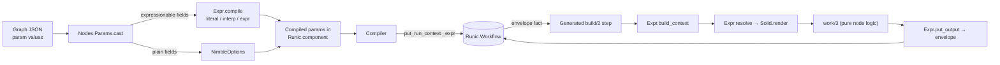
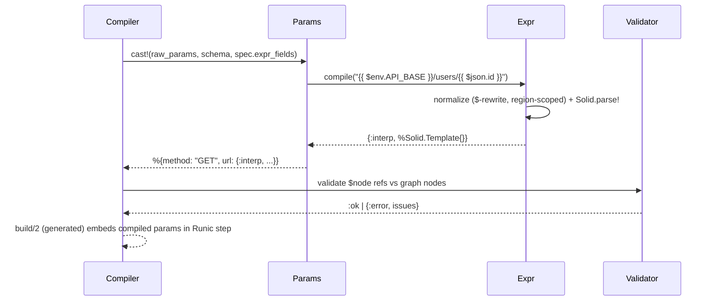
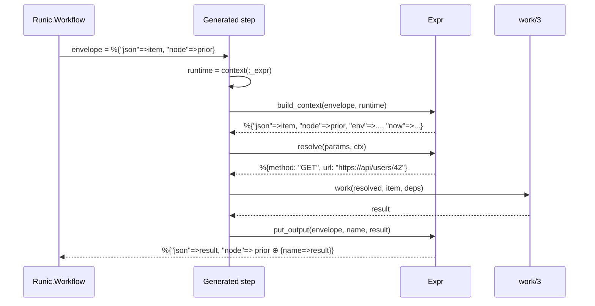
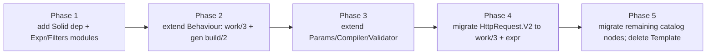

# Workflow Expression System — Design Document

| | |
|---|---|
| **Status** | Draft |
| **Authors** | Galad Dirie |
| **Reviewers** | [name(s)] |
| **Last updated** | 2026-06-28 |
| **Related docs** | Runic (https://github.com/zblanco/runic) · Solid (https://solid.hexdocs.pm/readme.html) · `lib/hermitscale/workflows/template.ex` (system being replaced) |

---

## 1. TL;DR

We are replacing `Hermitscale.Workflows.Template` — a regex-based interpolator that only understands `{{ $.path }}` accessors against a single input map — with an **n8n-style expression system** backed by [Solid](https://solid.hexdocs.pm/readme.html) (a Liquid template engine for Elixir). Workflow param fields will accept expressions like `{{ $json.email }}`, `{{ $node["fetch_user"].json.body.id }}`, and `{{ $env.API_BASE }}/users/{{ $json.id }}`, evaluated at runtime against the data flowing through the `Runic` DAG. The expression layer is **sandboxed by construction** — Liquid has no `eval`, no filesystem, no arbitrary code — which is exactly the constraint a low-code workflow tool wants. The plumbing that makes expressions work (context assembly, the cross-node "envelope", type preservation) is generated centrally by the `Nodes.Behaviour` macro, so node authors write only pure `work/3` logic and get expressions for free.

---

## 2. Context & Problem

### 2.1 Background

Hermitscale compiles JSON workflow graphs into `Runic.Workflow` structs (`Workflows.Compiler`). Each graph node names a catalog node module (`Nodes.Behaviour` implementors such as `HttpRequest.V2`), whose `build/2` returns a Runic component (`Runic.step`, `Runic.map`, …). Params are validated against a `NimbleOptions` schema by `Nodes.Params`, and policy/topology are applied by the compiler.

Today, dynamic field values are handled by `Workflows.Template.render/2`:

- Syntax is limited to JSON accessors: `{{ $.sku }}`, `{{ $.items.0.sku }}`.
- It resolves **only against the single input map** handed to the step — there is no way to reference another node's output, run metadata, environment, or the clock.
- Every value is stringified, so an expression can never return an integer, list, or map.
- It is invoked **manually inside each node's `build/2`** (see `HttpRequest.V2` line 30: `Template.render!(^url_template, input)`), so every node re-implements the same plumbing and any node that forgets it silently loses interpolation.

### 2.2 Problem statement

Workflow authors cannot express the dynamic data references that an n8n-style builder requires: "use the id from the HTTP node two steps back", "read the API base from an environment variable", "send this field as a real number, not a quoted string". The current template engine is too narrow (single input, string-only) and the integration is too manual (per-node, easily skipped). We need a richer, type-preserving, **centrally-enforced** expression layer that stays sandboxed.

### 2.3 Why now

The catalog/compiler foundation (durable Runic workflows, the node authoring kit, credential resolution) has just landed. The expression layer is the next dependency for a usable visual builder, and retrofitting it after dozens of catalog nodes exist would mean editing every `build/2`. Doing it now lets the `Behaviour` macro own the plumbing before the node count grows.

---

## 3. Goals & Non-goals

### 3.1 Goals

- **n8n-familiar syntax.** Support `{{ … }}` interpolation with the `$json`, `$node["Name"]`, `$vars`, `$env`, `$workflow`, `$execution`, `$now`, `$today` namespaces.
- **Sandboxed evaluation.** No arbitrary code execution; expressions cannot touch the filesystem, network, or other templates. Liquid's restricted object+filter grammar is the entire surface.
- **Type preservation.** A field that is exactly one expression (`{{ $json.count }}`) returns the native value (integer, map, list); a field that mixes literals and expressions returns a string.
- **Centrally enforced plumbing.** Node authors implement a pure `work/3`; the `Behaviour` macro generates the `build/2` that resolves params, assembles context, and threads the cross-node envelope. No node can break the `$node` chain.
- **Compile-time validation.** Expression syntax is parsed once at graph-compile time (errors surface at save/compile, not at run). `$node["X"]` references are statically checked against the graph's nodes by the `Validator`.
- **Drop-in replacement.** `Workflows.Template` is removed; `HttpRequest.V2` and future nodes use the new system with no per-node interpolation code.

### 3.2 Non-goals

- **Arbitrary JavaScript / general computation.** n8n allows raw JS in expressions; we deliberately do not. The sandbox is the point. Authors who need real logic write a catalog node.
- **Backward compatibility with `{{ $.path }}` syntax.** The old single-input JSON-pointer form is replaced, not aliased. Existing graphs (if any) are migrated (§9). The richer `$json` namespace supersedes the bare `$.` root.
- **A visual expression builder / autocomplete UI.** This doc covers the evaluation engine only; the front-end editor is separate work.
- **Per-item streaming semantics beyond what Runic already models.** We map onto Runic's existing `step`/`map`/`reduce`/`join` primitives; we do not introduce a new execution model.

### 3.3 Success criteria

- `HttpRequest.V2` builds a URL from `{{ $env.API_BASE }}/users/{{ $json.id }}` and a downstream node reads `{{ $node["http_request"].json.body.email }}` — both pass through compiler and run.
- A `{{ $json.count | to_number }}` field arrives at the node as an Elixir integer.
- A graph referencing a non-existent `$node["typo"]` fails `Validator.validate/1` at compile time.
- Zero `Template.render` call sites remain; node authors who implement only `work/3` get working expressions.

---

## 4. Overview

### 4.1 Approach

n8n expressions are three things glued together: a **delimiter syntax** (`{{ … }}`), a **variable namespace** (`$json`, `$node`, `$now`, …), and an **evaluator** (V8/JS). We keep the first, re-create the second on top of Runic primitives, and replace the third with Liquid's restricted grammar via Solid. The replacement *is* the value proposition: deterministic, serializable, no `eval`.

The variable namespace splits cleanly across Runic primitives **by lifetime**:

- **Per-item, dynamic** (`$json`, `$binary`, `$itemIndex`) → the input fact the Runic step receives.
- **Per-run, static** (`$vars`, `$env`, `$workflow`, `$execution`) → Runic `context/1` / `put_run_context` (scoped by name, not part of the workflow hash, not serialized).
- **Cross-node** (`$node["X"].json`, `$items(...)`) → an **envelope** threaded through facts, because Runic's dataflow only hands a node its parents' output, not arbitrary ancestors.
- **Clock** (`$now`, `$today`) → computed at render time.

Three modules carry the design: **`Expr`** (compile + render, type preservation, the `$`-rewrite), **`Expr.Filters`** (n8n-flavored Liquid filters), and an extended **`Nodes.Behaviour`** that adds a `work/3` callback and generates `build/2` per node `kind`. `Params` learns to compile expressionable fields; the `Compiler` seeds the envelope and run context; the `Validator` gains a `$node` static-analysis pass.

### 4.2 System diagram



### 4.3 Key design decisions

- **Solid/Liquid as the engine, not a custom DSL.** Liquid gives delimiters, dotted/bracket variable access, and a filter pipeline essentially for free, and its lack of `eval` is the sandbox we want. We add ~5 custom filters for n8n-isms (`to_json`, `to_number`, …).
- **Plumbing lives in the `Behaviour` macro, not in `build/2`.** Expression resolution is a cross-cutting concern. The macro knows `kind` and `requires` statically, so it generates a kind-appropriate `build/2` and unrolls `requires` into literal `context/1` calls. Authors implement pure `work/3`. `build/2` remains `defoverridable` as an escape hatch.
- **Two render paths for type preservation.** "Whole field is one expression" → a focused object evaluator that returns native types; "string with expressions" → `Solid.render!` returning a binary. This matches n8n's own behavior and is unavoidable since Liquid always renders to iodata.
- **`$`-prefix rewrite is region-scoped.** Solid does strict Liquid lexing and `$` is not a legal identifier char. We rewrite `$ident → ident` **only inside `{{ }}`/`` regions**, never in literal text (so an OData `?$top=5` in a URL survives).
- **`$node` via an envelope fact, not global mutable state.** Each generated step emits `%{"json" => result, "node" => %{...prior outputs}}`. This is the only way to give a node access to non-parent ancestors within Runic's parent-only dataflow.
- **Validation is split by what's knowable when.** Syntax + `$node` reference existence are checked at compile time; value types of expression fields are deferred to run time (the value doesn't exist at compile time). Expressionable fields are marked in the spec, not in the `NimbleOptions` schema (which rejects unknown keys).

---

## 5. Detailed Design

### 5.1 Components

#### 5.1.1 `Hermitscale.Workflows.Expr`

**Responsibility.** Compile a raw param value into a tagged, pre-parsed form at graph-compile time, and render it against a runtime context at run time.

**Owns.** The compiled-value representation, the `$`-rewrite, the type-preserving object evaluator, context assembly, and the envelope protocol.

**Depends on.** `Solid`, `Expr.Filters`, `Jason` (for `to_json` round-trips).

**Notes.** Compiled values are tagged:

```elixir
@type compiled ::
        {:literal, term()}              # no expression — passed through untouched
        | {:interp, Solid.Template.t()} # mixed literal/expression — renders to a string
        | {:expr, source :: String.t()} # lone expression — type-preserving native value
```

`compile/1`: non-binary → `{:literal, v}`; binary without `{{`/`{%` → `{:literal, v}`; a single whole-string `{{ … }}` → `{:expr, inner}`; anything else → `{:interp, Solid.parse!(normalized, tags: safe_tags)}`. `normalize/1` applies the region-scoped `$`-rewrite. `render/2` dispatches on the tag. `build_context/2` produces the Solid context map from the envelope (`$json`, `$item`, `$node`) and the per-run runtime map (`$vars`, `$env`, `$workflow`, `$execution`, `$now`, `$today`). `put_output/3` re-wraps a node result into the envelope under the node name.

The `{:expr, src}` path reimplements a **subset** of Liquid's object grammar — dotted/bracket access plus a filter pipeline — precisely so it can return native types. Full Liquid semantics (`for`, `if`, default chains) are only available in the `{:interp, …}` path, which always yields a string. This split is deliberate and matches n8n.

> **Rejected alternative for type preservation:** introspecting `%Solid.Template{}`'s parsed parts to detect a lone object and pull its value. This couples us to Solid's internal AST shape, which is version-dependent (currently v1.3.2). Avoided.

#### 5.1.2 `Hermitscale.Workflows.Expr.Filters`

**Responsibility.** Expose n8n-style helpers as Liquid filters, called by Solid as `Module.fun(value, args...)`.

**Owns.** `to_json/1`, `from_json/1`, `to_number/1`, `is_empty/1`, `uuid/1`, plus any future additions. Liquid's built-ins (`upcase`, `downcase`, `default`, `date`, `plus`/`minus`, `size`, `join`, `split`, `first`/`last`, `replace`, `truncate`) already cover most of n8n's string/number/array surface.

**Depends on.** `Jason`; a UUID source (`Ecto.UUID` or `:crypto`).

#### 5.1.3 `Hermitscale.Workflows.Nodes.Behaviour` (extended)

**Responsibility.** Generate compile-time-validated specs **and** a kind-appropriate `build/2` from a pure `work/3` callback.

**Owns.** A new `expr: [atoms]` option (stored in the spec as `expr_fields`), a new `@callback work(params, item, deps) :: term()`, and the `__gen_build__/1` AST generator. `build/2` becomes `defoverridable`.

**Depends on.** `Runic`, `Expr`, `NimbleOptions`, `Policy`.

**Notes.** Two constraints force the plumbing into the macro rather than a generic compiler wrapper:

1. **`context/1` is a compile-time AST rewrite.** Runic's `context(:_expr)` only works when it appears *literally* inside the `fn` handed to `Runic.step` — it cannot hide behind a helper. So whoever fetches run context must emit that call inside the generated step.
2. **Context differs by `kind`.** For `:step`, `$json` is the input fact. For `:map`, `$json` should be the *current element*. For `:reduce`, element vs. accumulator. For `:join`, multiple parents. A single dumb wrapper can't be correct; the generator branches on `kind` (which the spec already carries).

`requires` keys are unrolled at macro-expansion time into a literal map of `context/1` calls — you cannot loop over keys at runtime and call a macro.

#### 5.1.4 `Hermitscale.Workflows.Nodes.Params` (extended)

**Responsibility.** Split a node's raw params into expressionable and plain fields; compile the former via `Expr.compile`, validate the latter via `NimbleOptions` exactly as today.

**Owns.** The `cast/3` arity that takes `expr_fields`. Output is an atom-keyed map mixing validated literals and tagged compiled values.

**Notes.** Expressionable fields accept **either** a literal or an expression and defer their type check to run time. Plain fields are unchanged.

#### 5.1.5 `Hermitscale.Workflows.Compiler` (extended)

**Responsibility.** Pass `spec.expr_fields` into `Params.cast!/3`, seed the per-run `_expr` context, and start runs with a wrapped envelope fact.

**Notes.** The envelope contract: facts are `%{"json" => …, "node" => …}` and `_expr` lives under the global run context key. Single change at `Params.cast!` call site; the rest is run-start wiring (`put_run_context` + `react_until_satisfied(%{"json" => input, "node" => %{}})`).

#### 5.1.6 `Hermitscale.Workflows.Validator` (extended)

**Responsibility.** Add a pass that extracts `$node["X"]` references from each compiled `{:interp,_}`/`{:expr,_}` and checks them against the graph's node set (and optionally against connectivity), folding violations into the existing topo/connection checks.

**Notes.** This is what makes "expression references a node that doesn't exist / isn't upstream" a compile-time error, matching n8n's save-time validation.

### 5.2 Data model

No new persistent state. The only new in-memory structures are the **compiled param** tagged tuple (`{:literal|:interp|:expr, …}`, embedded in the compiled `Runic.Workflow`) and the **envelope** fact (`%{"json" => term, "node" => %{name => %{"json" => term}}}`) that flows between nodes at run time. Run-scoped `_expr` data lives in Runic's `context`, which is intentionally *not* part of the serialized workflow hash.

### 5.3 Interfaces / APIs

Node-author contract — implement `work/3`, get expressions for free:

```elixir
defmodule Hermitscale.Workflows.Nodes.HttpRequest.V2 do
  use Hermitscale.Workflows.Nodes.Behaviour,
    id: "http_request", version: 2, kind: :step,
    requires: [credentials: []],
    expr: [:url],                       # which params accept expressions
    params: [
      method: [type: {:in, ~w(GET POST PUT PATCH DELETE)}, required: true],
      url:    [type: :string, required: true]
    ]

  @impl true
  def work(%{method: method, url: url}, _item, %{credentials: creds}) do
    # params arrive RESOLVED; requires arrive FETCHED; result is auto-wrapped.
    Hermitscale.HTTP.request(method, url, auth: creds) |> handle()
  end
end
```

Expression surface available in any expressionable field:

```
{{ $json.email }}                                   # current item
{{ $node["http_request"].json.body.id }}            # cross-node
{{ $env.API_BASE }}/users/{{ $json.id }}            # mixed → string
{{ $json.count | to_number }}                       # lone expr → integer
{{ $json.items | size }}   {{ $now }}   {{ $vars.region | upcase }}
```

### 5.4 Key flows

#### 5.4.1 Compile a graph node with an expression



#### 5.4.2 Run a step: resolve, work, re-wrap



The `:map`/`:reduce` generated clauses differ only in **what `build_context` points `$json` at** (the current element / the accumulator), which is exactly the part that cannot be made generic.

### 5.5 Dependencies

| Dependency | Type | Hard / soft | Notes |
|---|---|---|---|
| `Solid` (Liquid engine) | Hex library (**new dep**) | Hard | Parsing + rendering. Pin a version; `{:expr,_}` path avoids its internal AST. |
| `Runic` `~> 0.1.0-alpha.8` | Hex library (existing) | Hard | `step`/`map`/`reduce`/`join`, `context/1`, `put_run_context`. Alpha — API may shift. |
| `NimbleOptions` | via existing params system | Hard | Plain-field validation (unchanged). |
| `Jason` `~> 1.2` | existing | Hard | `to_json`/`from_json` filters. |

---

## 6. Alternatives Considered

### 6.1 Alternative: Extend the existing regex `Template`

**What it is.** Grow `Workflows.Template` to support `$node`, `$env`, filters, and type preservation with more regexes and a hand-rolled accessor walker.

**Why it was tempting.** No new dependency; the code already exists and is small.

**Why rejected.** We'd be reimplementing a template language one regex at a time — filters, escaping, nested access, error reporting. Solid already solves all of it, is sandboxed, and is battle-tested. Extending the regex engine trades a one-line dep for an open-ended maintenance burden and a worse author experience.

### 6.2 Alternative: Embed a real scripting language (Lua / JS via a port)

**What it is.** Match n8n literally — let authors write arbitrary expressions in an embedded interpreter.

**Why it was tempting.** Maximum expressive power; exact n8n parity.

**Why rejected.** It reintroduces the sandbox problem we're explicitly trying to avoid (resource limits, injection, non-determinism, serialization). For a low-code catalog tool, arbitrary computation belongs in a catalog node, not an inline field. Liquid's restricted grammar is a feature, not a limitation.

### 6.3 Alternative: Resolve expressions inside each node's `build/2` (the v1 sketch)

**What it is.** Keep `build/2` as the integration point and call `Expr.resolve`/`put_output`/`build_context` by hand in every node, as `HttpRequest.V2` does with `Template.render!` today.

**Why it was tempting.** No macro magic; each node is fully explicit and self-contained.

**Why rejected.** It's per-node boilerplate for a cross-cutting concern. A node that forgets `put_output` silently breaks the `$node` chain for everything downstream — a failure mode that's invisible until a later node reads a `nil`. Centralizing in the `Behaviour` macro makes the envelope protocol unforgeable and lets policy/telemetry/error handling live in one generated path. The macro is justified precisely because the per-kind context logic is hard to get right; we don't want it copied into 40 modules.

### 6.4 Alternative: do nothing / keep `Template`

**What it is.** Ship the visual builder on the current single-input, string-only interpolator.

**Why rejected.** Authors cannot reference other nodes, env, or the clock, and cannot emit non-string values — table stakes for an n8n-style tool. The status quo blocks the builder.

---

## 7. Cross-cutting Concerns

### 7.1 Security

The headline security property is **the sandbox**: Liquid has no `eval`, no I/O, no network. We further drop filesystem/template-include tags (`render`, `include`) from the default tag set so an expression cannot pull in other templates. Secrets and env values reach expressions only via the per-run `_expr` context (`$env`, `$vars`), which is populated by the compiler/run-starter from trusted sources — never from user-controlled graph JSON. The existing `Nodes.Params` discipline (only schema-declared keys become atoms) is preserved, so user input never creates arbitrary atoms. **Threat to watch:** expressions can read whatever is placed in `$env`/`$vars`, so the run-starter must scope those maps to what the workflow is authorized to see (ties into the credential-resolution work).

### 7.2 Privacy & data handling

N/A for the engine itself — it adds no new storage or PII categories. It does *move* item data through the envelope (`$node` outputs accumulate across the run, in memory only). Note: the accumulating envelope means a node's output is visible to all downstream nodes via `$node["…"]`; if a step handles sensitive fields, that exposure is by design and bounded to the single run's in-memory facts.

### 7.3 Observability

**Logs.** Render failures (missing var under `strict_variables: true`, filter errors) logged with the node name, field, and (truncated) source. Compile-time parse/validation errors surface through the existing compiler/validator error channel.

**Metrics.** Expression render count and error rate per node type; compile-time parse failures per graph. Useful for spotting authors fighting the syntax.

**Traces.** Per-step render is cheap and need not be its own span; piggyback on the existing Runic step instrumentation.

### 7.4 Reliability & failure modes

| Failure | Detection | Behavior | Recovery |
|---|---|---|---|
| Bad expression syntax | `Solid.parse!` at compile time | Graph fails to compile with a located error | Author fixes source; never reaches run |
| `$node["typo"]` reference | Validator static pass | `validate/1` returns `{:error, …}` | Author fixes; compile-time |
| Missing var at run time | `strict_variables` flag | Default `false` → renders empty (n8n-permissive); per-field `true` → raise | Tune per field |
| Node forgets `put_output` | **Cannot happen** — macro-generated | N/A | N/A by construction |
| Type mismatch after resolve | Run-time (deferred check) | `work/3` receives resolved value; node validates as needed | Author guards or adds a filter |

### 7.5 Performance & scale

Templates are parsed **once** at graph-compile time and embedded in the `Runic.Workflow`; run-time cost is just `Solid.render` over a small context. Literal fields compile to `{:literal, v}` and `resolve` is effectively free for them, so static-heavy nodes pay almost nothing. `Solid.Caching` is unnecessary given one-time compilation (we also drop ``, the main caching beneficiary). The envelope grows with node count per run — acceptable for typical workflow sizes; if very large fan-out workflows appear, we can prune `$node` entries to those statically referenced downstream.

### 7.6 Cost

N/A — no new infrastructure; one Hex dependency. CPU cost is negligible relative to the I/O the nodes themselves perform.

---

## 8. Operations

### 8.1 Deployment

Ships as a code change within the existing app release. Adds the `solid` dependency to `mix.exs`.

### 8.2 Rollout plan

The engine is only active for nodes that opt in via `expr: [...]` and is exercised the moment `Template` is removed and `HttpRequest.V2` is migrated. Because validation is compile-time, a bad rollout surfaces at graph compile, not in production traffic. Migrate node-by-node (§9); there is no traffic-percentage gating needed for a pure compile/run-time library change.

### 8.3 Testing strategy

- **Unit:** `Expr.compile/1` tag selection (literal vs interp vs expr); region-scoped `$`-rewrite (must preserve OData `?$top=5`); type preservation (`{{ $json.n }}` → integer); each custom filter.
- **Integration:** compile a multi-node graph using `$json`, `$node`, `$env`; run it through the compiler + Runic and assert resolved values and the envelope chain.
- **Validator:** `$node` reference checks (existing node, missing node, non-upstream node).
- **Regression:** the `HttpRequest.V2` URL-building scenario end to end.

### 8.4 Ownership & on-call

Owning team: workflows. No new on-call surface; failures are compile-time or contained to a single workflow run.

---

## 9. Migration / Rollback

### 9.1 Migration plan



- **Phase 1–3** are additive — nothing uses the new path yet; existing nodes keep working through `defoverridable build/2`.
- **Phase 4** migrates the one current `Template.render` call site (`HttpRequest.V2`).
- **Phase 5** converts remaining nodes (currently `:step` ×4, `:join` ×1) and deletes `Workflows.Template`. Any persisted graph JSON using the old `{{ $.path }}` form must be rewritten to `{{ $json.path }}` — a mechanical transform (only the root token changes). If no such graphs exist yet, this is a no-op.

### 9.2 Rollback

Phases 1–3 are reversible (pure additions). Phase 5's `Template` deletion is the only irreversible step; until it lands, reverting is just `git revert` since nodes still have working `build/2`. Hold the `Template` deletion in its own commit so it can be reverted independently if a migrated graph misbehaves.

---

## 10. Risks & Open Questions

### 10.1 Risks

| Risk | Likelihood | Impact | Mitigation |
|---|---|---|---|
| Solid internal AST relied on for type preservation breaks across versions | L | M | `{:expr,_}` path uses our own evaluator, not Solid internals; pin the version |
| Runic alpha API (`context/1`, `put_run_context`, fact shape) changes | M | M | Envelope + context wiring isolated to `Expr`/macro/compiler; pin Runic; small blast radius |
| `$`-rewrite mangles literal text (e.g. OData `$top`) | M | M | Region-scoped rewrite (only inside `{{ }}`/``); explicit test |
| Hand-rolled object evaluator diverges from Liquid semantics, confusing authors | M | L | Keep it to documented dotted/bracket+filter subset; full semantics only in string path; document the split |
| Macro-generated `build/2` per kind has a subtle context bug (esp. `:map`/`:reduce`) | M | M | Centralized + heavily tested; escape hatch `build/2` for unusual topologies |
| Accumulating envelope leaks sensitive node output downstream | L | M | By-design and run-scoped; prune to referenced nodes if needed; scope `$env`/`$vars` |

### 10.2 Open questions

- **Default `strict_variables`?** Permissive (`false`, n8n-like, empty on missing) vs strict (raise) — and is it per-field configurable via the spec? Owner: [TBD].
- **`:map`/`:reduce` context shape.** Exact `build_context` mapping for element vs. accumulator, and what `$json` means inside a reduce. Needs the concrete generated clauses written out. Owner: [TBD].
- **`$node` pruning.** Do we keep the full envelope or prune to statically-referenced nodes? Defer until a large workflow forces it. Owner: [TBD].
- **`$items` / multi-item access.** n8n exposes whole-input-list helpers; do we model these now or after single-item works? Owner: [TBD].
- **UUID source for the `uuid` filter** (`Ecto.UUID` vs `:crypto`) and whether non-deterministic filters are even desirable in a re-runnable workflow. Owner: [TBD].

---

## 11. Appendices

### Appendix A — Glossary

| Term | Meaning |
|---|---|
| **Expression** | A `{{ … }}` fragment in a param field, evaluated at run time against the workflow context. |
| **Envelope** | The fact shape threaded between nodes: `%{"json" => result, "node" => %{name => %{"json" => …}}}`. Enables `$node` references. |
| **Expressionable field** | A param listed in a node's `expr: [...]` option; accepts a literal or an expression and defers its type check to run time. |
| **Compiled value** | The tagged result of `Expr.compile/1`: `{:literal, v}`, `{:interp, template}`, or `{:expr, src}`. |
| **Per-run context (`_expr`)** | Static run data (`$vars`, `$env`, `$workflow`, `$execution`) placed in Runic `context`, not in the serialized workflow. |
| **Pure expression** | A field that is exactly one `{{ … }}`; resolves to a native value rather than a string. |

### Appendix B — References

- Runic — DAG workflow composition for Elixir: https://github.com/zblanco/runic
- Solid — Liquid template engine for Elixir (v1.3.2): https://solid.hexdocs.pm/readme.html
- System being replaced: `lib/hermitscale/workflows/template.ex`
- Current sole call site: `lib/hermitscale/workflows/nodes/http_request/v2.ex`
- Related: node authoring kit, durable Runic workflow system, integration credential resolution (recent commits)
