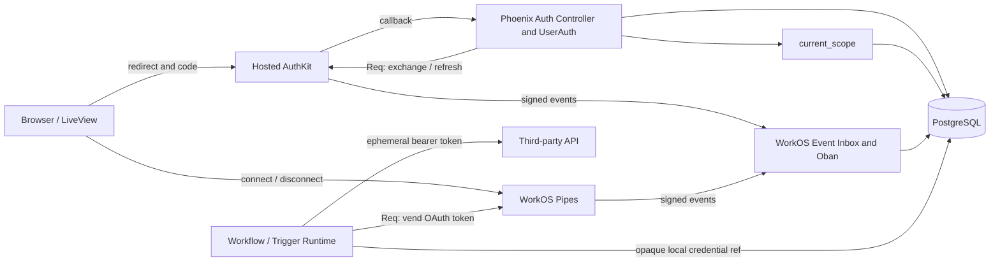
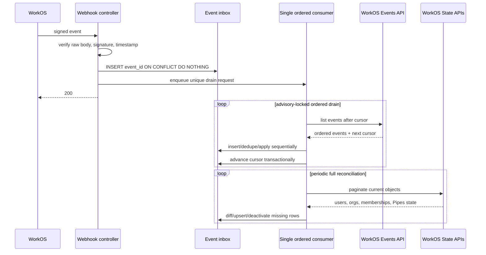
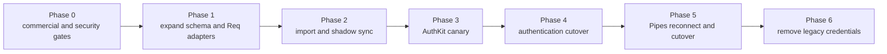

# WorkOS Authentication and Connected Accounts — Design Document

| | |
|---|---|
| **Status** | Draft |
| **Authors** | Hermitscale engineering |
| **Reviewers** | Product, Security, Platform/Operations |
| **Last updated** | 2026-07-26 |
| **Related docs** | [Node authoring kit](../node-authoring-kit.md), [Workflow expression system](workflow-expression-system.md) |

---

## 1. TL;DR

Hermitscale will use WorkOS AuthKit/User Management as the authority for login credentials, identity linking, and session validity, while preserving local `User`, `Organization`, `OrganizationMembership`, workflow ownership, and Phoenix `current_scope` as the application and tenancy model. Hosted AuthKit is the initial authentication UI; Hermitscale will exchange authorization codes and maintain an opaque server-side application session whose validity is bounded by, and refreshed against, the WorkOS session. WorkOS Pipes will separately manage third-party OAuth credentials: local connected-account rows contain only mappings, consent state, scopes, and status, while workflow graphs contain opaque local references and obtain short-lived tokens from Pipes immediately before provider calls. We will integrate the WorkOS HTTP APIs directly with the existing `Req` client because the official Elixir SDK is explicitly experimental and defaults to Tesla. Public AuthKit pricing is documented, but Pipes pricing, production SLA/entitlements, data portability, and several feature-flagged Pipes endpoints require commercial confirmation before production commitment.

---

## 2. Context & Problem

### 2.1 Background

Hermitscale is a Phoenix 1.8 application generated with `phx.gen.auth`. It currently has:

- local password, magic-link, email-confirmation, session-token, and sudo-mode behavior in `Hermitscale.Accounts` and `HermitscaleWeb.UserAuth`;
- a server-side `current_scope` containing a local user, active local organization, and membership;
- local organizations and memberships, including one personal organization per user;
- organization-owned workflows and triggers;
- a provider abstraction that resolves opaque graph credential references into runtime tokens; and
- an initial Google OAuth provider that refreshes tokens itself with `Req`.

The local organization is already the tenancy boundary. Workflow queries, triggers, and runs authorize with `Scope.organization_id!/1`; creator identity is audit metadata rather than resource ownership.

WorkOS provides two different products that touch superficially similar OAuth concepts:

1. **AuthKit/User Management authentication credentials** prove who a person is and create a WorkOS user session. WorkOS safely links multiple verified login identities to one WorkOS User using verified email semantics ([Identity Linking](https://workos.com/docs/authkit/identity-linking)).
2. **Pipes connected accounts** authorize Hermitscale to call a third-party API on a user's behalf. Pipes stores provider tokens and refreshes OAuth access tokens ([Pipes](https://workos.com/docs/pipes)).

These must not become one local concept. A user may authenticate with Google and separately connect Google Sheets with broader scopes; logging out, deleting a login credential, disconnecting Sheets, and revoking a workflow grant are different operations.

### 2.2 Problem statement

The current system would otherwise accumulate three overlapping authorities:

- local authentication credentials and sessions;
- WorkOS authentication identities and sessions; and
- bespoke per-provider OAuth token stores and refresh behavior.

That duplication creates account-takeover risk during identity linking, delayed or inconsistent session revocation, ambiguous organization membership authority, refresh-token exposure, and workflow failures that cannot be traced back to a well-defined connected account. It also makes migration and deletion behavior impossible to reason about.

The design must establish:

- one identity key across local and WorkOS records;
- one authority for authentication credentials and active sessions;
- an explicit local/WorkOS organization mapping without transferring local resource ownership;
- a separately authorized connected-account model with enforceable tenant and scope boundaries; and
- deterministic behavior when WorkOS, a provider, or synchronization is unavailable.

### 2.3 Why now

AuthKit/User Management and Pipes are the selected managed products, while Hermitscale's integration and workflow credential seams are still small enough to change. The existing node authoring kit identifies token lifetime during durable runs as an unresolved gap. Shipping more bespoke OAuth providers or persisting WorkOS-derived identity conclusions by email would make the eventual migration riskier.

---

## 3. Goals & Non-goals

### 3.1 Goals

- Every authenticated request derives `@current_scope.user` from a cryptographically valid, non-expired WorkOS session and a unique local `users.workos_user_id` mapping.
- WorkOS is the only production authority for passwords, magic auth, social login identities, MFA, authentication identity linking, and session revocation after cutover.
- Local organization IDs remain the only tenancy keys on workflows, runs, triggers, and other Hermitscale resources.
- Every mapped shared organization and membership has a unique WorkOS mapping and a local read model that fails closed on deletion, deactivation, or an unknown role.
- Workflow definitions, events, logs, and durable Runic state contain only opaque local credential references—never WorkOS API keys, provider access tokens, refresh tokens, or API-key secrets.
- A workflow can use a connected account only when provider, local organization, sharing grant, connection state, and required scopes all pass at execution time.
- WorkOS event processing is idempotent, tolerates duplicate and out-of-order webhooks, and can reconcile missed delivery through the Events API.
- Login, token vending, webhook handling, and provider calls have typed failure behavior, actionable telemetry, and testable rollback points.

### 3.2 Non-goals

- **Replacing local tenancy and workflow authorization with WorkOS RBAC or FGA.** WorkOS organization claims inform synchronization and enterprise policy, but local `current_scope` and local ownership remain authoritative for Hermitscale resources.
- **Building a custom authentication UI in the first release.** Hosted AuthKit covers advanced authentication states without reproducing them in LiveView.
- **Embedding React solely to use WorkOS Widgets.** A React island remains a future option, not the initial LiveView architecture.
- **Supporting multiple accounts for the same WorkOS user, Pipes provider, and WorkOS organization.** The current API returns `409` when that tuple already exists ([Connected account API](https://workos.com/docs/reference/pipes/connected-account)); multi-account product requirements must be resolved separately.
- **Using authentication OAuth tokens for workflow API access.** Authentication credentials and Pipes connected accounts are never interchangeable.
- **General secrets management for arbitrary user-supplied API keys.** The initial production scope is stable OAuth Pipes endpoints; API-key Pipes support depends on feature availability and product requirements.

### 3.3 Success criteria

- No local production path can create or validate a password, magic-link login, social identity, or MFA factor after cutover.
- WorkOS session revocation is reflected immediately when its event arrives and no later than the configured access-token lifetime when events are delayed.
- Duplicate delivery and out-of-order delivery tests converge on the same user, membership, session, and connection state.
- Database and Runic persistence scans find no WorkOS API key or provider access/refresh token fixtures outside encrypted session columns.
- A disconnected, reauthorization-needed, wrong-tenant, or insufficient-scope connected account cannot start a credentialed provider call.
- A WorkOS/Pipes outage does not corrupt identity, membership, workflow, or connection state and produces a typed retryable or actionable failure.

---

## 4. Overview

### 4.1 Approach

AuthKit is the authentication control plane. Hermitscale redirects users to Hosted AuthKit, exchanges the returned authorization code on the backend, verifies WorkOS access tokens, and stores the rotated session material encrypted behind an opaque browser session handle. The existing Phoenix browser pipeline and `UserAuth` hooks remain the integration point: they load the local user by `workos_user_id`, resolve the active local organization, and assign `current_scope`. A local session row is a protected cache and refresh mechanism, not an independent grant of identity; WorkOS session validity always bounds it.

Hermitscale remains the resource control plane. Local user IDs are stable foreign keys and audit identities. Local organizations own workflows. Personal organizations remain local and need no WorkOS organization. Shared organizations map one-to-one to WorkOS Organizations for enterprise authentication policy and managed membership, but their WorkOS IDs never replace local primary keys. Mapped WorkOS memberships synchronize into local `organization_memberships`, which remain the fast read model used by `current_scope`.

Pipes is a separate credential control plane. A local `connected_accounts` row maps a local user and organization consent to a WorkOS connected account. Graphs store the local row ID. The provider layer authorizes that reference and calls Pipes' stable OAuth access-token endpoint through `Req`; it compares granted scopes with node-required scopes and passes the token only to the immediate provider request. Pipes events update local connection state and dependent triggers/workflows surface reauthorization or rebinding needs.

### 4.2 System diagram



### 4.3 Key design decisions

- **WorkOS owns authentication; Hermitscale owns application identity and tenancy.** This removes duplicate credential logic without coupling local resource keys to a vendor.
- **A WorkOS User ID, not email, is the identity join key.** WorkOS performs verified identity linking; local email is a mutable projection and uniqueness guard.
- **WorkOS sessions bound local sessions.** The browser holds only an opaque random handle; the backend stores encrypted WorkOS tokens, verifies the access JWT, serializes refresh-token rotation, and ends the local session on WorkOS revocation.
- **Personal organizations stay local; shared organizations may be WorkOS-backed.** This matches the existing local ownership model while enabling organization-specific SSO/MFA/membership policy.
- **Pipes connections are local references to vendor-managed secrets.** Tokens are fetched just in time and never persisted in graphs or durable workflow state.
- **Use direct Req API adapters, not the current WorkOS Elixir SDK.** WorkOS labels that SDK experimental, warns against production use, and documents Tesla as its default HTTP client ([Elixir SDK](https://workos.com/docs/sdks/elixir)); Hermitscale requires all outbound HTTP to use Req.
- **Hosted AuthKit plus native LiveView connected-account UI.** This avoids reproducing security-sensitive sign-in states and avoids introducing a React runtime solely for Widgets.

---

## 5. Detailed Design

### 5.1 Authority and terminology

| Concept | Authority | Local representation | Lifecycle |
|---|---|---|---|
| Authentication identity/credential | WorkOS User Management | No local identity-provider credential row | Linked/removed by WorkOS identity rules |
| Authentication session | WorkOS | Encrypted `auth_sessions` cache plus opaque cookie handle | Login, refresh, revoke, logout |
| Application user | Hermitscale | `users` | Stable local foreign key and profile projection |
| Personal organization/membership | Hermitscale | `organizations`, `organization_memberships` | Created for every local user |
| Shared organization | Hermitscale resource record; WorkOS auth-policy mirror | Local row plus unique WorkOS mapping | Provisioned/reconciled |
| Mapped shared membership | WorkOS authority; Hermitscale read model | Local membership plus WorkOS mapping/status | Events/API synchronize it |
| Pipes connected account | WorkOS token authority; Hermitscale authorization metadata | `connected_accounts` | Connect, grant, reauthorize, disconnect |
| Workflow credential reference | Hermitscale | Opaque local connected-account ID in graph JSON | Bind/rebind/tombstone |

An **authentication credential** answers “who is signing in?” A **connected account** answers “which external account may this workflow call, with which scopes, for which local organization?” The same upstream provider name does not merge these concepts.

### 5.2 Components

#### 5.2.1 `Hermitscale.WorkOS.Client`

**Responsibility.** Implement the small WorkOS REST surface Hermitscale needs through `Req`.

**Owns.**

- base URL, API-key authentication, JSON handling, timeouts, retry classification, request IDs, and redaction;
- authorization URL parameters and authorization-code/refresh-token exchange;
- user, organization, membership, session, Events API, Pipes provider, connected-account, and token calls; and
- typed result normalization such as `:invalid_grant`, `:rate_limited`, `:unavailable`, `:needs_reauthorization`, and `:not_installed`.

**Does not own.** Local transactions, authorization decisions, redirect targets, graph lookup, or provider API calls.

All network calls use `Req`; no Tesla, HTTPoison, or `:httpc` dependency is introduced. Retries are limited to demonstrably safe/idempotent calls and honor `Retry-After`. Secrets and token bodies are excluded from logs.

#### 5.2.2 `Hermitscale.WorkOS.Session`

**Responsibility.** Verify WorkOS JWTs, load encrypted session material, refresh a session, switch WorkOS organization context, and revoke/logout.

The access JWT is verified on every request from cached session material. Validation includes signature against cached WorkOS JWKS, expiry, issuer/client application claims documented for the configured WorkOS application, subject equality with `users.workos_user_id`, and session ID equality with the local row. The default issuer is the application-scoped `https://api.workos.com/user_management/<client_id>` value; `WORKOS_JWT_ISSUER` supplies an exact override for a configured custom AuthKit domain. JWKS uses a bounded cache; an unknown `kid` triggers a `Req` refresh and fails closed if the key remains unknown. Implementation should use a reviewed JWT cryptography library for parsing and verification; that library performs no HTTP itself.

Refresh tokens may rotate after use, so refresh runs under a row lock and atomically replaces both access and refresh ciphertext ([Sessions](https://workos.com/docs/authkit/sessions)). Concurrent requests reuse the committed result instead of racing the same refresh token.

#### 5.2.3 `Hermitscale.Accounts`

**Responsibility.** Own stable local users, organizations, memberships, and `Scope`.

At callback, `Accounts.upsert_from_workos/1` looks up by unique `workos_user_id`. It creates a local user and personal organization transactionally for a new WorkOS user. It never silently joins a callback to an existing local account by email.

Email, verified status, name, and profile image are projections synchronized from WorkOS. WorkOS documents a User as the unified object for multiple verified credentials and refuses unsafe linking ([Identity Linking](https://workos.com/docs/authkit/identity-linking)); local code relies on that User ID, not on recreating its linking algorithm.

#### 5.2.4 `Hermitscale.WorkOS.EventInbox`

**Responsibility.** Verify webhook notifications, persist/deduplicate event envelopes, wake one ordered Events API consumer, and reconcile WorkOS state.

The webhook controller verifies `WorkOS-Signature` over the raw request body with HMAC-SHA256, validates timestamp tolerance, inserts the unique WorkOS event ID as an unprocessed notification, enqueues a unique drain request, and returns `200` quickly. WorkOS may retry six times over three days in production, may duplicate events, and does not guarantee webhook order ([Webhook syncing](https://workos.com/docs/events/data-syncing/webhooks)). Webhook receipt never applies domain state directly.

A single `WorkOSEventsConsumer` owns the persisted Events API cursor. Webhook arrivals and a periodic scheduler only wake that consumer. It obtains a PostgreSQL advisory lock, fetches one Events API page, applies events synchronously in returned order, and atomically advances the cursor after successfully applying each event/page. A unique Oban job prevents routine duplication; the database lock prevents two deployed nodes from becoming cursor owners. WorkOS recommends starting with one worker and synchronous ordered processing ([Events API syncing](https://workos.com/docs/events/data-syncing/events-api)).

The Events API query and webhook endpoint use an explicit allowlist of supported user, organization, membership, session, and Pipes event types. Both delivery paths insert into the same event inbox with a unique `event_id`, making receipt idempotent. Event application additionally uses object `updated_at` (and tombstone/event time for deletes) to reject stale writes. An unexpected event type is persisted as `ignored`, alerts, makes no domain mutation, and still advances the cursor so it cannot delay later revocations. A known supported event that fails projection blocks cursor advancement and retries until fixed or deliberately dead-lettered by an operator.

Events API history is finite: WorkOS returns events up to 90 days old and permits at most a 30-day query range per request ([Events API syncing](https://workos.com/docs/events/data-syncing/events-api)). A periodic full **State API reconciliation** paginates current Users, Organizations, memberships, sessions needed for revocation repair, and supported Pipes connection/provider state; it updates newer objects and detects local rows absent from the complete remote set. This provides recovery from cursor loss, a processing outage beyond retention, or a prior application bug. WorkOS documents State API diff/reconciliation for disaster recovery and periodic repair ([Data reconciliation](https://workos.com/docs/events/data-syncing/data-reconciliation)). After a full successful reconciliation, the consumer establishes a new cursor from a bounded recent `range_start` and drains any race-window events before declaring convergence.

#### 5.2.5 `Hermitscale.Integrations.ConnectedAccounts`

**Responsibility.** Own local authorization metadata for Pipes connections and expose connect, grant, disconnect, list, and credential-resolution operations.

The local row does not store access tokens, refresh tokens, or API-key values. It records WorkOS identifiers, local tenant/owner, provider slug, granted scopes, connection state, sharing mode, timestamps, and deletion/tombstone state.

The initial UI lists configured providers and nested connection state through the Pipes Provider API, starts authorization with `POST /data-integrations/:slug/authorize`, and disconnects through the Connected Account API. WorkOS' delete operation removes its stored tokens but explicitly does **not** revoke access at the upstream provider ([Connected account API](https://workos.com/docs/reference/pipes/connected-account)).

Production providers use Hermitscale's own provider OAuth application credentials; WorkOS-provided shared credentials are a development/testing convenience, not the production credential model ([Pipes launch guidance](https://workos.com/blog/workos-pipes-third-party-integrations)). Pipes also does not remove upstream requirements such as Google's verification for sensitive scopes ([Google OAuth access guidance](https://workos.com/blog/google-sso-token-api-access)). These are provider launch dependencies, not problems Pipes can abstract away.

#### 5.2.6 Workflow credential resolver

**Responsibility.** Resolve a graph's opaque local credential reference into one immediate, authorized provider call.

The current provider behavior resolves an access token at run start. This design changes that contract before Pipes reaches production:

1. Graph and Runic durable state carry a `CredentialRef` containing only the local `connected_accounts.id`.
2. Immediately before a provider HTTP request, the integration client calls `ConnectedAccounts.fetch_oauth_token/4` with local organization, provider, reference, and required scopes.
3. The resolver verifies:
   - the row exists and is not tombstoned;
   - `connected_account.org_id == graph.org_id`;
   - the expected provider slug matches;
   - the owner's required membership/organization grant is active;
   - the connection state is `connected`; and
   - returned scopes contain every node-required scope.
4. It calls the stable `POST /data-integrations/:slug/token` endpoint with the WorkOS user and optional WorkOS organization IDs. WorkOS refreshes OAuth tokens and returns `needs_reauthorization` or `not_installed` when unavailable ([Credentials API](https://workos.com/docs/reference/pipes/access-token)).
5. The access token exists only in the request process and is passed directly to the provider's `Req` call. It is never added to graph JSON, Runic workflow state, run events, inputs, outputs, telemetry metadata, or exception inspection.

The response includes granted scopes and `missing_scopes`. Hermitscale rejects a non-empty `missing_scopes` and independently enforces the node catalog's required-scope subset. Required scopes are not trusted merely because a user completed the OAuth screen.

### 5.3 Data model

```mermaid
erDiagram
    USERS ||--o{ AUTH_SESSIONS : has
    USERS ||--|| ORGANIZATIONS : owns_personal
    USERS ||--o{ ORGANIZATION_MEMBERSHIPS : has
    ORGANIZATIONS ||--o{ ORGANIZATION_MEMBERSHIPS : contains
    USERS ||--o{ CONNECTED_ACCOUNTS : connects
    ORGANIZATIONS ||--o{ CONNECTED_ACCOUNTS : authorizes
    ORGANIZATIONS ||--o{ WORKFLOW_GRAPHS : owns
    CONNECTED_ACCOUNTS ||--o{ WORKFLOW_CREDENTIAL_BINDINGS : referenced_by
    WORKOS_EVENTS }o--|| WORKOS_EVENT_CURSORS : advances

    USERS {
        bigint id PK
        string workos_user_id UK
        string email
        boolean email_verified
        datetime workos_updated_at
        datetime deletion_pending_at
        datetime deleted_at
    }
    AUTH_SESSIONS {
        uuid id PK
        binary token_hash UK
        bigint user_id FK
        string workos_session_id UK
        binary access_token_ciphertext
        binary refresh_token_ciphertext
        datetime access_expires_at
        datetime authenticated_at
        datetime revoked_at
    }
    ORGANIZATIONS {
        string id PK
        bigint personal_owner_user_id FK UK
        string workos_organization_id UK
        string name
        boolean personal
        string provisioning_state
        datetime workos_updated_at
    }
    ORGANIZATION_MEMBERSHIPS {
        bigint id PK
        string org_id FK
        bigint user_id FK
        string workos_membership_id UK
        string source
        string status
        string role
        datetime workos_updated_at
    }
    CONNECTED_ACCOUNTS {
        uuid id PK
        bigint owner_user_id FK
        string org_id FK
        string provider_slug
        string workos_connected_account_id UK
        string workos_organization_id
        string state
        string sharing_mode
        string_array granted_scopes
        datetime workos_updated_at
        datetime disconnected_at
    }
    WORKFLOW_CREDENTIAL_BINDINGS {
        string graph_id
        string node_or_provider_key
        uuid connected_account_id
    }
    WORKOS_EVENTS {
        string event_id PK
        string event_type
        map payload
        datetime occurred_at
        datetime processed_at
        string processing_error
    }
    WORKOS_EVENT_CURSORS {
        string stream PK
        string after
        datetime updated_at
    }
```

`WORKFLOW_CREDENTIAL_BINDINGS` is a conceptual projection of the existing references embedded in graph JSON; it may be implemented as a normalized table if impact queries and foreign-key enforcement justify it. Until normalized, connection deletion must locate graph JSON references and maintain explicit tests for that lookup.

#### Invariants and constraints

- `users.workos_user_id` is unique and non-null after migration. `email` remains case-insensitively unique for user experience and migration conflict detection, not identity linking.
- A personal organization has a unique `personal_owner_user_id` and no `workos_organization_id`; a database check enforces those implications. Each shared WorkOS-backed organization has exactly one unique mapping and no personal owner.
- Mapped memberships have unique `workos_membership_id`; `(org_id, user_id)` remains unique.
- `connected_accounts` is unique on the effective WorkOS tuple `(workos_user_id, provider_slug, workos_organization_id-or-null)`. The WorkOS create/import API documents a `409` for an existing user/integration/organization tuple ([Connected account API](https://workos.com/docs/reference/pipes/connected-account)).
- A local connection always has an `org_id`, even when the corresponding Pipes `organization_id` is null for a personal organization.
- `sharing_mode` defaults to `private`. An organization-owned workflow may use it only after an explicit `organization` grant; removing that grant invalidates the binding.
- Encrypted session columns use authenticated encryption and a versioned key ID. The browser token is high-entropy, only its hash is stored, and rotation renews the Phoenix session to prevent fixation.

### 5.4 Identity mapping and linking semantics

#### New user

1. Hosted AuthKit completes authentication and WorkOS returns an authorization code.
2. The callback validates a single-use `state`, exchanges the code server-side, and verifies the returned session.
3. Hermitscale finds `users.workos_user_id`.
4. If absent, it creates a local User plus personal Organization/membership in one database transaction.
5. It creates the encrypted local session holder and renews the Phoenix cookie session.

WorkOS email is used as profile data. If a different local row already owns that email, callback fails into a support-review state; it does not merge, reassign, or create a duplicate. This condition should only arise during migration or external tampering because WorkOS enforces unique verified user emails.

#### Existing user during migration

Existing local IDs are written to WorkOS as external identifiers, which WorkOS documents as unique within an environment ([Metadata and External IDs](https://workos.com/docs/authkit/metadata/query-by-external-identifier)). Migration stores the resulting WorkOS user ID on the same local row before enabling AuthKit for that user. Callback accepts only the pre-established WorkOS mapping. Imported social identities are subsequently linked by WorkOS using its verified-email rules, not by Hermitscale ([Auth0 migration guidance](https://workos.com/docs/migrate/auth0)).

#### Identity updates

`user.updated` changes the local profile projection when its `updated_at` is newer. It never changes a local primary key, organization ownership, or workflow creator ID. `user.deleted` immediately revokes local sessions, tombstones the local user, invalidates their connected-account grants, and starts local retention cleanup.

### 5.5 Session authority and lifecycle

#### Login

Hosted AuthKit supports sign-up, sign-in, password reset, verification, enterprise SSO routing, MFA enrollment, bot protection, branding, and custom domains ([Hosted UI](https://workos.com/docs/authkit/hosted-ui)). Hermitscale generates the authorization URL with an exact allowlisted callback, random single-use `state`, and an allowlisted local return path. Code exchange includes request IP/user-agent where supported.

The WorkOS response includes a User, access token, refresh token, and optional organization context. The local session is established only after token verification and local mapping succeed.

#### Request authentication

`fetch_current_scope_for_user/2` keeps its current role in the `:browser` pipeline, but its token source changes:

1. hash and load the opaque application session handle;
2. reject locally revoked/expired rows;
3. decrypt and verify the WorkOS access JWT;
4. refresh under lock if expired or within a short refresh margin;
5. load the local user by the verified `sub`;
6. resolve the session's active local `org_id` against an active local membership; and
7. assign `Scope.for_user(user) |> Scope.put_organization(org, membership)`.

The WorkOS access token is deliberately short-lived so dashboard/session revocation or delayed events have bounded effect. Existing requests may continue during a WorkOS outage only while a previously verified access token remains valid. A refresh-required request fails with a retryable service-unavailable response; it does not silently mint or extend a local-only session.

#### Organization switching

- Switching to the personal organization sets the local session `org_id` and uses a WorkOS token without organization context.
- Switching to a mapped shared organization first verifies the local active membership, then refreshes the WorkOS session with that `workos_organization_id`. WorkOS documents that refresh can switch organization and returns role/permission claims only if the session is authorized ([Sessions](https://workos.com/docs/authkit/sessions)).
- Only after both checks succeed is the local `org_id` committed.
- A claim/mapping mismatch denies the switch and schedules reconciliation. WorkOS claims never grant access to an unmapped local organization.

#### Fresh authentication

Sensitive settings and account deletion use WorkOS `auth_time`; refresh does not advance it. When too old, redirect to AuthKit with `max_age` and restore a single-use return state. WorkOS documents this step-up flow and the `auth_time` semantics ([Reauthentication](https://workos.com/docs/authkit/reauthentication)). This replaces the local `authenticated_at` semantics rather than maintaining a second proof of freshness.

#### Logout and revocation

Logout:

1. revokes/tombstones the local session row;
2. broadcasts to its `live_socket_id`;
3. renews and clears the Phoenix session;
4. deletes the opaque cookie; and
5. redirects through the WorkOS logout endpoint using the verified `sid`.

WorkOS instructs applications to clear their app session and use the WorkOS logout endpoint ([Sessions](https://workos.com/docs/authkit/sessions)). A `session.revoked` event performs steps 1–3 for all matching local rows; that event is officially available ([Events](https://workos.com/docs/events)).

### 5.6 Organization and membership synchronization

#### Personal organizations

Personal organizations remain entirely local. Every mapped WorkOS user receives one at local provisioning. They exist even when the WorkOS User belongs to zero WorkOS Organizations; WorkOS supports zero-to-many organization memberships ([Organization Membership](https://workos.com/docs/reference/authkit/organization-membership)).

#### Shared organizations

A shared organization's local row is created first in `provisioning` state with a stable local ID. An Oban job creates the WorkOS Organization using the local ID as external identifier and writes the returned ID. The organization is not available for SSO-policy-dependent use until mapping succeeds. Retries query by external identifier before creating again.

The local organization remains the owner of workflows and billing/product data. Deleting a WorkOS organization cannot cascade-delete Hermitscale workflows; it marks the mapping unavailable and blocks access pending operator review.

#### Shared memberships

For WorkOS-backed organizations, WorkOS is the authority for membership active/inactive/deleted state and role source. Hermitscale commands create/change/deactivate the WorkOS membership, then events converge the local read model. Local reads use the synchronized row to avoid a WorkOS request on every application query.

`organization_membership.created`, `.updated`, and `.deleted` upsert/deactivate the local membership by WorkOS ID. Unknown role slugs fail closed for privileged actions and alert. WorkOS role sources can be overwritten by SSO or Directory group assignment, so one role-assignment source per organization should be configured ([Roles and Permissions](https://workos.com/docs/authkit/roles-and-permissions)).

WorkOS JIT provisioning can create organization memberships from verified domains or SSO and is enabled by default unless configured otherwise ([JIT Provisioning](https://workos.com/docs/authkit/jit-provisioning)). Hermitscale disables it during migration and enables it only per organization after an explicit admission policy is approved. A JIT-created membership is not usable locally until its event maps to the expected organization, role, and active status. The design does not rely on the currently ambiguous scope of session revocation caused by membership deactivation; local access is revoked by the synchronized membership state and local-session invalidation.

### 5.7 Pipes connected accounts

#### Connection creation

The authenticated connected-accounts LiveView lists providers available for `@current_scope.user`, using the mapped WorkOS organization when present. A connect action posts to an authenticated controller, which:

1. validates the provider slug against server-configured providers;
2. validates local organization membership and requested sharing mode;
3. calls Pipes' authorization-URL endpoint with WorkOS user ID, optional mapped WorkOS organization ID, and a server-generated allowlisted `return_to`;
4. records a pending local intent with expiry; and
5. redirects the browser to the returned WorkOS URL.

WorkOS handles the upstream provider callback. `pipes.connected_account.connected` upserts the local row and the return page refreshes its status. The local row ID remains stable across reauthorization.

#### Cardinality and ownership

Pipes models one connected account for a user/provider/optional-organization tuple. Hermitscale mirrors that limitation. A shared-workflow connection is still granted by an individual user; the local `organization` sharing grant allows the organization runtime to use it while the owner retains the required membership. Leaving the organization, deleting the user, disconnecting, or revoking the organization grant makes the credential unavailable and dependent triggers stop.

This is intentionally not presented as an organization-owned service account. If the product needs integrations that survive the connecting user's departure, a separate service-account/organization-credential design and WorkOS capability confirmation are required.

#### Scopes

Node catalog requirements are the minimum operation scopes. The editor calculates the union needed for a workflow and shows why each scope is required. Connection/provider configuration determines what Pipes requests; runtime compares the returned `scopes` and `missing_scopes` to the node requirement on every vend. Widening requirements puts the workflow into `needs_reauthorization` until consent is updated.

#### Disconnect and provider revocation

Disconnect immediately:

- marks the local connection `disconnecting`;
- blocks new token vending;
- identifies dependent workflow bindings and disables/marks affected triggers;
- calls WorkOS delete; and
- finalizes on success or the disconnected event.

WorkOS deletion removes stored WorkOS access and refresh tokens but does not revoke the provider-side app grant. The UI must say this plainly and provide provider-specific revocation instructions or a best-effort provider revocation call where officially supported. “Disconnect from Hermitscale” and “revoke at provider” are separate completion states.

#### Pipes endpoint maturity

The initial runtime depends only on the documented OAuth authorization, provider listing, connected-account get/delete, and OAuth token endpoints. Current documentation labels the following as **Feature flagged**: data-integration management, organization-scoped provider configuration APIs, connected-account import/update, unified credential vending, and API-key upsert ([Data integration API](https://workos.com/docs/reference/pipes/data-integration), [Connected account API](https://workos.com/docs/reference/pipes/connected-account), [Credentials API](https://workos.com/docs/reference/pipes/access-token)). Production code must not assume those endpoints are enabled.

Provider configuration is performed in the WorkOS Dashboard until WorkOS contractually enables a stable management API. API-key-based workflow credentials are deferred because the unified credentials/API-key paths are feature flagged.

Pipes launched publicly in December 2025 and continued adding major capabilities in 2026 ([Pipes changelog](https://workos.com/changelog/pipes)). Its age and feature-gated API surface make production entitlement, versioning, rate-limit, and support confirmation release gates rather than assumptions.

### 5.8 Routes and Phoenix placement

The design extends existing scopes; it never duplicates `live_session` names.

#### Existing public/optional-auth scope

Under `scope "/", HermitscaleWeb`, `pipe_through [:browser]`:

- `live "/users/log-in", UserLive.Login, :new` stays inside the existing `live_session :current_user` with `on_mount: [{HermitscaleWeb.UserAuth, :mount_current_scope}]`. It renders the AuthKit redirect call to action and also supports reauthentication messaging.
- `get "/auth/sign-in", AuthController, :sign_in` is a public controller because it starts login before a user exists.
- `get "/auth/workos/callback", AuthController, :callback` is public because it establishes the session after validating WorkOS state/code.

At cutover, remove the existing `live "/users/register", UserLive.Registration, :new`, `live "/users/log-in/:token", UserLive.Confirmation, :new`, and `post "/users/log-in", UserSessionController, :create` routes. Hosted AuthKit owns registration, magic auth, password authentication, verification, and the authorization callback; the local `/users/log-in` LiveView becomes only a redirecting entry page.

#### Existing authenticated scope

Under `scope "/", HermitscaleWeb`, `pipe_through [:browser, :require_authenticated_user]`:

- `live "/users/settings", UserLive.Settings, :edit` remains inside the existing `live_session :require_authenticated_user`;
- `live "/users/settings/connected-accounts", ConnectedAccountsLive, :index` is added to that same live session because connection state and actions expose user/organization data;
- `delete "/users/log-out", AuthController, :delete` is an authenticated controller route because it requires the verified WorkOS `sid` and local session, and the browser pipeline supplies method override and CSRF protection;
- `delete "/users/account", AccountDeletionController, :delete` is an authenticated controller route that also enforces fresh WorkOS `auth_time` before starting the deletion saga;
- `post "/organizations/:id/switch", OrganizationSessionController, :update` is an authenticated controller route because it changes both local tenant context and, for mapped organizations, the WorkOS session's organization context;
- `post "/users/settings/connected-accounts/:provider/connect", ConnectedAccountController, :create` is an authenticated controller route because it produces an external redirect; and
- `delete "/users/settings/connected-accounts/:provider", ConnectedAccountController, :delete` is an authenticated controller route with CSRF protection.

At AuthKit cutover, remove the existing `live "/users/settings/confirm-email/:token", UserLive.Settings, :confirm_email` from `live_session :require_authenticated_user` and remove `post "/users/update-password", UserSessionController, :update_password` from the authenticated controller scope. The settings LiveView no longer renders local email/password changes. WorkOS owns email verification, password reset/change, fresh-authentication policy, and invalidation of the resulting WorkOS sessions; leaving either local route active would preserve a second credential authority.

Every LiveView template begins with `<Layouts.app flash={@flash} current_scope={@current_scope}>` and accesses the user through `@current_scope.user`, never `@current_user`.

#### Unauthenticated webhook scope

`post "/webhooks/workos/:endpoint_token", WorkOSWebhookController, :create` uses the minimal JSON/API pipeline and cached raw body, not `:browser` or user authentication. It authenticates WorkOS through the endpoint token, signature, and timestamp. It must not share the user-facing `/:token` trigger semantics or dispatch WorkOS payloads into customer workflows.

### 5.9 Key flows

#### 5.9.1 Authentication callback and local provisioning

```mermaid
sequenceDiagram
    actor User
    participant App as Phoenix
    participant AuthKit as WorkOS AuthKit
    participant DB as PostgreSQL

    User->>App: GET /auth/sign-in
    App->>DB: persist single-use state + return path
    App-->>User: redirect to Hosted AuthKit
    User->>AuthKit: authenticate
    AuthKit-->>App: GET /auth/workos/callback?code&state
    App->>DB: consume state
    App->>AuthKit: exchange code via Req
    AuthKit-->>App: user + access/refresh tokens
    App->>App: verify JWT and subject/session claims
    App->>DB: upsert by workos_user_id; ensure personal org
    App->>DB: store encrypted session; opaque token hash
    App-->>User: secure cookie + local redirect
```

No callback branch links by email. Mapping conflict aborts before an application session is created.

#### 5.9.2 Connected account used by a workflow

```mermaid
sequenceDiagram
    participant Run as Workflow runtime
    participant DB as PostgreSQL
    participant Pipes as WorkOS Pipes
    participant API as Third-party API

    Run->>DB: load local CredentialRef and graph organization
    DB-->>Run: connection metadata only
    Run->>Run: check tenant, grant, state, provider
    Run->>Pipes: POST provider token via Req
    Pipes-->>Run: active token + scopes or typed error
    Run->>Run: enforce required scope subset
    Run->>API: immediate request with bearer token
    API-->>Run: response
    Run->>Run: discard token; persist redacted outcome
```

`needs_reauthorization` is non-retryable until user action. WorkOS transport failures are retryable within workflow policy. A provider mutation is not automatically replayed unless that provider operation has its own idempotency contract.

#### 5.9.3 Event delivery and reconciliation



### 5.10 Account deletion

User-initiated deletion requires fresh WorkOS authentication and explicit confirmation. It is a durable saga:

1. Set local `deletion_pending_at`; reject new sessions, connections, and grants.
2. Revoke all local and WorkOS sessions and disconnect LiveViews.
3. List local connected accounts, block vending, disable dependent triggers, and delete each WorkOS connected account. Record whether provider-side revocation is still required.
4. Remove or transfer only local grants owned by the user. Shared-organization workflows remain owned by the organization; creator IDs become null/tombstoned audit identities. Personal-organization workflow retention follows the product retention policy.
5. Permanently delete the WorkOS User. WorkOS documents that this operation cannot be undone ([User API](https://workos.com/docs/reference/authkit/user)).
6. Apply `user.deleted`, redact local PII according to retention policy, and preserve non-PII referential/audit records.

If a WorkOS `user.deleted` event arrives first, the same saga starts at step 1 using the event as the idempotency key. Public WorkOS documentation confirms user deletion cascades its WorkOS organization/group memberships, but does not establish that all Pipes accounts are deleted or provider grants revoked; Hermitscale therefore performs explicit connected-account cleanup and does not rely on undocumented cascade behavior.

### 5.11 Dependencies

| Dependency | Type | Hard / soft | Notes |
|---|---|---|---|
| WorkOS AuthKit/User Management | HTTPS API + hosted UI | Hard for new login/refresh; soft for unexpired verified sessions | Authentication/session authority |
| WorkOS JWKS | HTTPS | Soft while cached key is valid | Unknown keys fail closed |
| WorkOS Events/webhooks | HTTPS | Soft | Access-token expiry and reconciler bound stale state |
| WorkOS Pipes | HTTPS API | Hard for a credentialed provider call | Workflows without connected accounts continue |
| Third-party provider API | HTTPS API | Hard per node | Existing workflow retry/idempotency policy applies |
| PostgreSQL | Database | Hard | Local users, tenants, sessions, mappings, inbox |
| Oban | PostgreSQL-backed jobs | Soft on request path | Provisioning, event processing, deletion, reconciliation |

---

## 6. Alternatives Considered

### 6.1 Keep local auth sessions after AuthKit login

**What it is.** Use AuthKit only as an identity provider at login, then mint the existing independent 14-day `users_tokens` session.

**Why it was tempting.** Minimal change to `UserAuth`, no encrypted WorkOS refresh storage, and WorkOS outages do not affect existing users.

**Why rejected.** WorkOS session revocation, inactivity timeout, organization switching, and step-up authentication would not bound the local grant. Webhook-only revocation is eventually consistent and can fail for days. It creates two session authorities and ambiguous logout.

### 6.2 Make WorkOS users/organizations the application's primary keys

**What it is.** Store WorkOS IDs directly as local primary and foreign keys and authorize from WorkOS token claims.

**Why it was tempting.** Fewer mapping columns and superficially simpler provisioning.

**Why rejected.** Hermitscale already owns organizations, workflows, and local audit/resource lifecycles. Vendor IDs in resource keys and graph references make migration off WorkOS invasive, and token organization claims cannot replace local resource checks.

### 6.3 API-driven custom AuthKit UI in LiveView

**What it is.** Build password, magic auth, verification, SSO routing, organization selection, MFA, reset, error, and bot-defense flows in HEEx/Tailwind using User Management APIs.

**Why it was tempting.** Full brand and navigation control within LiveView; no hosted-page transition.

**Why rejected for v1.** WorkOS explicitly positions Hosted UI as the fastest path and the API as the custom-UI option ([AuthKit overview](https://workos.com/docs/authkit/overview)). A custom UI makes Hermitscale responsible for every security-sensitive branch and parity change. Revisit only with a product requirement that Hosted UI branding/custom domain cannot satisfy.

### 6.4 WorkOS React Widgets

**What it is.** Embed AuthKit/Pipes Widgets as a React island.

**Why it was tempting.** The Pipes Widget already supports list, connect, reauthorize, and disconnect.

**Why rejected for v1.** WorkOS Widgets are React components ([Widgets](https://workos.com/docs/widgets)); the Pipes example imports `@workos-inc/widgets` and React providers ([Pipes Widget](https://workos.com/docs/widgets/pipes)). Hermitscale is LiveView/Tailwind with only `app.js`/`app.css`. A safe island would require React runtime, Widget/Radix CSS, token plumbing, a stable ignored DOM root, and LiveView lifecycle integration. The stable Pipes REST surface is small enough for a native server-rendered UI.

### 6.5 Official WorkOS Elixir SDK

**What it is.** Add the `workos` Hex package and use its resource modules/session helpers.

**Why it was tempting.** First-party types and endpoint helpers.

**Why rejected.** WorkOS lists Elixir under experimental libraries and says the SDK is not recommended for production stability. Its documented default HTTP client is Tesla ([Elixir SDK](https://workos.com/docs/sdks/elixir)). The current official repository does not expose the Pipes surface needed here, and its July 2026 v2 release raises its stated runtime floor beyond this project's declared Elixir `~> 1.15` ([workos-elixir releases](https://github.com/workos/workos-elixir/releases)). Direct `Req` adapters satisfy repository rules and isolate a small, testable API surface.

### 6.6 Continue bespoke provider OAuth

**What it is.** Expand the current Google refresh-token store and implement each provider locally.

**Why it was tempting.** Complete control, no Pipes runtime dependency, and no unknown Pipes commercial terms.

**Why rejected.** It keeps long-lived provider credentials and refresh logic in Hermitscale, duplicates consent/revocation UI, and scales security risk per provider. It remains the rollback adapter during migration, not the target.

---

## 7. Cross-cutting Concerns

### 7.1 Security

- **Callback CSRF and redirect safety.** Use random, single-use, expiring `state`; store return paths server-side; allow only local relative return paths; exact-match WorkOS redirect URIs.
- **Session fixation.** Renew and clear the Phoenix session on login/logout. Preserve only explicitly allowlisted return/organization data.
- **Token protection.** WorkOS API keys and encryption keys come from production secret management. Access/refresh tokens use versioned authenticated encryption at rest. Browser cookies are opaque, `HttpOnly`, `Secure`, `SameSite=Lax`, bounded, and rotated.
- **JWT verification.** Never decode without verifying. Reject unknown algorithm, issuer/application, `sub`, `sid`, expiry, or key. Cache JWKS safely and fail closed on unknown keys.
- **Webhook authenticity.** Verify exact raw bytes, HMAC-SHA256, timestamp tolerance, constant-time signature equality, endpoint token, and optionally WorkOS' published IP allowlist. Never log rejected payloads containing PII.
- **Tenant authorization.** A WorkOS `org_id` is never sufficient. Every resource lookup still uses local `Scope.organization_id!/1`. Every connection resolution checks the graph's local `org_id`.
- **Least privilege.** Node-declared scopes are enforced at vend time. Provider-specific clients retain egress host allowlists so a token cannot be sent to an arbitrary URL.
- **No secret serialization.** Credential tokens never enter graph JSON, expression bindings, Runic events, run inputs/outputs, Oban args, PubSub, logs, traces, or client payloads.
- **Fresh auth.** Destructive/sensitive operations use WorkOS `auth_time`/`max_age`, not a locally refreshed timestamp.
- **Impersonation.** If enabled later, WorkOS impersonator claims must be carried into local audit context and barred from credential connect/export/delete unless product/security explicitly allows it.

### 7.2 Privacy & data handling

WorkOS receives email, profile, authentication factors/identities, session IP/user-agent, organization/membership data, and upstream Pipes credentials/scopes. Hermitscale stores a profile projection, WorkOS IDs, encrypted session tokens, connection metadata, event payloads, and audit/retention tombstones.

Event inbox payloads are PII-bearing. Raw payload retention should be short and configurable; after successful application, retain event ID/type/timestamps and a redacted diagnostic subset unless legal/audit requirements say otherwise. Application logs use local IDs and WorkOS request/event IDs, never email or tokens by default.

Before production, Security/Legal must confirm WorkOS DPA, subprocessors, data residency, deletion timing, backup retention, incident notification, and whether Pipes credentials have distinct retention/residency terms.

### 7.3 Observability

**Logs.** Structured fields: local request ID, WorkOS request ID, operation, local user/org IDs, hashed/session ID suffix, event ID/type, provider slug, workflow/run/node IDs, status class, latency, retry count. Never log bearer/API/refresh tokens, authorization codes, full signatures, API keys, or raw event payloads.

**Metrics.**

- auth callback success/failure by reason;
- active-session verification, refresh latency/failure, and revocation lag;
- event inbox age, duplicate count, stale-event count, processing retries/dead letters, and Events API cursor lag;
- last successful full State API reconciliation, objects scanned/diffed, and reconciliation failures;
- organization/membership mapping conflict count;
- Pipes token-vend latency and errors (`not_installed`, `needs_reauthorization`, missing scope, 429, 5xx);
- connected-account state totals and disconnect/provider-revocation incomplete count; and
- credentialed workflow failures and triggers disabled by credential state.

**Traces.** Propagate the Phoenix request/run ID through local spans and record WorkOS response request IDs. Mark token exchange/vend spans as sensitive and disable body capture.

**Dashboards & alerts.** Day-one dashboards cover login/refresh, event lag, Pipes vending, and credentialed run health. Page on sustained inability to refresh active sessions, webhook plus Events API lag beyond the access-token bound, event dead-letter growth, or broad Pipes failures. Ticket—not page—individual reauthorization needs.

### 7.4 Reliability & failure modes

| Failure | Detection | Behavior | Recovery |
|---|---|---|---|
| AuthKit unavailable during login | Req timeout/5xx and synthetic login | Show retryable 503; no local session | Retry; WorkOS status/vendor escalation |
| WorkOS unavailable during refresh | Refresh metric/Req error | Unexpired verified token continues; expired session fails closed without deleting it | Retry with bounded backoff; resume after service returns |
| JWKS unavailable | Key refresh error | Use valid cached matching key; unknown `kid` fails closed | Refresh cache; operator alert |
| Session revoked event delayed | Event lag metric | Session valid only until short access-token expiry | Events API reconcile; next refresh rejects |
| Duplicate/out-of-order event | Unique conflict or stale timestamp | Ignore duplicate/stale mutation | Normal; metrics only |
| Webhook receiver unavailable | WorkOS retry/dashboard | Events API reconciler covers gap | Restore endpoint and drain cursor |
| Events cursor lost or consumer outage exceeds 90-day retention | Cursor age/invalid cursor and reconciliation SLO | Pause cursor projection; continue fail-closed auth/connection checks | Full State API diff, establish bounded recent cursor, drain race window |
| Local/WorkOS user mapping conflict | Callback constraint error | No session; quarantine mapping | Manual support resolution |
| Organization provisioning partial failure | `provisioning` age | Org unavailable for WorkOS-backed auth policy | Idempotent retry by external ID |
| Membership disagreement | Claim/local mismatch | Deny org switch/access; keep personal org | Reconcile WorkOS object/events |
| Pipes unavailable | Token-vend error | Credentialed call fails typed retryable; unrelated workflows continue | Workflow backoff; retry after recovery |
| Provider token revoked | `needs_reauthorization` response/event | Block call; disable/flag dependent trigger | User reauthorizes |
| Missing scopes | Runtime subset failure | Block before provider API call | Reauthorize or change workflow |
| Disconnect WorkOS failure | Saga retry | Local vending stays blocked | Oban retries; operator queue |
| Provider revocation not completed | Cleanup status | WorkOS tokens deleted, upstream grant may remain | User instructions or provider-specific revocation |
| Bad deploy | auth/Pipes canary metrics | Feature flag returns users/refs to prior adapter where reversible | Roll back release; follow §9 |

### 7.5 Performance & scale

JWT verification and local scope hydration remain local on the normal request path. WorkOS network calls occur only on login, refresh margin, organization-context switch, explicit account management, event reconciliation, and credential vending.

Initial credential vending is one Pipes request per immediate provider operation. This prioritizes correct rotation and non-persistence over latency. A future in-memory encrypted token cache may be considered only after measurement, keyed by connection/scope and expiring before token expiry; it must not survive process restart or bypass connection-state invalidation.

Webhook ingestion may scale horizontally because it performs signature verification, one conflict-tolerant insert, and one unique drain enqueue before responding. WorkOS projection does not fan out: exactly one advisory-locked cursor consumer applies Events API pages serially and advances the cursor. Only unrelated side effects may fan out to other Oban jobs after the ordered projection transaction commits.

### 7.6 Cost

As of 2026-07-26, WorkOS publicly lists AuthKit as free through 1 million monthly active users and $2,500/month per additional 1 million. It lists custom domains at $99/month and initial SSO/Directory Sync connections at $125 per connection/month with volume discounts ([Pricing](https://workos.com/pricing)). Production billing information is required even when usage is under the free AuthKit threshold ([Environments](https://workos.com/docs/authkit/environments)).

The public pricing page does not publish a Pipes price, token-vend charge, connection limit, or included quota. No estimate is recorded until WorkOS provides written pricing and rate/SLA terms. Runtime cost also includes PostgreSQL session/event storage, Oban load, encryption/key management, and an additional WorkOS network request per credentialed provider operation.

---

## 8. Operations

### 8.1 Deployment

Each environment uses a separate WorkOS environment/application, API key, client ID, redirect allowlist, webhook endpoint/secret, and encryption key set. Staging permits local HTTP redirects; production web redirects require HTTPS ([Environments](https://workos.com/docs/authkit/environments)).

Runtime configuration fails startup if production secrets are absent. WorkOS API keys, webhook secrets, and token-encryption keys rotate independently with overlap windows. Pipes providers/scopes are provisioned in the Dashboard and exported into a reviewed environment manifest until stable management endpoints are contractually available.

The ordered Events API consumer is scheduled at least once per minute and is also woken by webhook receipt. A full State API reconciliation runs daily, on cursor rejection/loss, and on operator request; it records a generation ID so deletion detection occurs only after a complete successful scan. Cursor and state-reconciliation jobs are unique, and the cursor consumer additionally holds the database advisory lock.

Normal deployment uses the repository pipeline and ends with `mix precommit`. Database changes land expand-first; code reads both old/new auth modes during migration.

### 8.2 Rollout plan

1. **Contract gate.** Resolve §10.2 commercial, feature availability, security, and portability questions.
2. **Foundation.** Add mappings, encrypted sessions, event inbox/cursor, Req client, JWT verifier, and telemetry without changing login.
3. **Shadow synchronization.** Import users/organizations, consume events, reconcile mappings, and measure conflicts while local auth remains active.
4. **Auth canary.** Enable Hosted AuthKit for staff/test tenants, then percentage cohorts. Existing local sessions remain bounded by a short migration window.
5. **Auth cutover.** Default to WorkOS; retain local credential material only for rollback; remove local registration/magic/password/email-change routes from user navigation.
6. **Pipes canary.** Configure Google in the WorkOS Dashboard; connect new test accounts; run read-only nodes; then writes with provider idempotency validation.
7. **Pipes cutover.** New connections use Pipes; existing credential refs use a backend discriminator until migrated/reconnected.
8. **Decommission.** After the rollback window and successful export drill, remove local password/magic/session token code and old refresh-token storage.

Each phase requires error-rate, event-lag, conflict, and support-volume thresholds before promotion.

### 8.3 Testing strategy

- Unit tests for authorization URL/state, JWT claim validation, JWKS rotation, encryption/key rotation, refresh locking, scope subset checks, typed WorkOS errors, webhook HMAC/tolerance, stale events, allowlisted/ignored event types, and tombstones.
- Data-case tests for unique mappings, callback conflict quarantine, personal organization creation, shared membership synchronization, account-deletion saga, and graph connection-impact lookup.
- Controller tests for callback CSRF, open redirects, secure cookie renewal, authenticated connect/delete, and raw webhook bodies.
- LiveView tests use stable element IDs for sign-in, connection states, scope explanations, reconnect, disconnect, and dependent-workflow warnings.
- Integration tests against WorkOS staging for Hosted AuthKit, refresh rotation, logout, session revocation, organization switch, provider authorization, token vend, reauthorization, disconnect, webhook duplicates, and Events API replay.
- Failure injection for WorkOS timeout/429/5xx, JWKS key rollover, refresh and advisory-lock contention, cursor loss, outage beyond Events API retention, interrupted State API generations, Oban retry, provider revocation, and out-of-order delete/update.
- Security tests verify no tokens in logs, Ecto rows outside encrypted fields, Oban args, Runic events/snapshots, LiveView payloads, or exception pages.
- Migration rehearsal from a production-shaped snapshot plus rollback and WorkOS-offboarding export drills.

### 8.4 Ownership & on-call

- **Accounts/Auth:** local mapping, sessions, AuthKit flows, organizations/memberships, deletion.
- **Integrations/Workflow runtime:** connected accounts, scope enforcement, token vending, provider adapters, trigger effects.
- **Platform/Operations:** WorkOS configuration, secrets, encryption keys, event reconciler, dashboards, incident response.
- **Security/Privacy:** threat model, cryptographic review, DPA/residency/retention, deletion verification.

Runbooks are required before canary for auth outage, JWKS rollover, event backlog, mapping conflict, Pipes outage, mass reauthorization, key rotation, and rollback.

---

## 9. Migration / Rollback

### 9.1 Migration plan



#### Authentication data

WorkOS supports importing email, verification status, profiles, and supported password hashes; its migration guide explicitly describes importing existing hashes and recommends coordinating imports above 200,000 users/organizations ([Migrate from other services](https://workos.com/docs/migrate/other-services)). Hermitscale's bcrypt hashes are retained locally through rollback and imported with each local ID as WorkOS external identifier.

Before canary:

- every eligible local user has exactly one WorkOS ID;
- duplicate/case-conflicting emails are resolved manually;
- imported verification status is audited;
- organization/membership mappings reconcile; and
- test users validate password, hosted reset, social linking, MFA, logout, and deletion.

Local sessions are not converted into WorkOS sessions. Canary users reauthenticate through AuthKit. At global cutover, remaining local sessions either expire during a short grace period or are revoked with explicit communication.

After cutover, password/email changes happen through WorkOS-supported flows. Local hashes and login tokens become rollback-only, receive no new writes, and are deleted after the irreversible checkpoint is approved.

#### Pipes data

The codebase's current graph references remain stable local IDs. Each credential row gains a backend type (`legacy_google` or `workos_pipes`) so the resolver can switch without rewriting graphs.

Because connected-account import/update APIs are currently feature flagged, the default migration is user reauthorization through Pipes. If production already contains provider refresh tokens, importing them requires WorkOS confirmation, a controlled one-time path, and explicit rollback handling; it is not assumed available from public docs.

Activation is blocked for workflows whose connection has not migrated. The UI lists affected workflows and supports rebinding. Read-only Google workflows canary before write operations.

### 9.2 Rollback

| Phase | Rollback |
|---|---|
| Schema/adapters | Deploy prior code; additive tables/columns remain unused |
| Shadow sync | Stop webhook/Event workers; local auth remains authoritative |
| Auth canary | Disable cohort flag; users with unchanged local credentials return to local auth |
| Auth global cutover, before credential deletion | Re-enable local auth; revoke WorkOS-created local sessions; WorkOS-only new users require local password setup/magic link |
| After local hash/token deletion | Not a clean rollback; restore requires backup plus forced credential reset and MFA re-enrollment |
| Pipes canary/cutover | Resolver backend flag returns legacy refs to legacy store; Pipes-only connections must reconnect through legacy OAuth |
| After legacy provider-token deletion | Not a clean rollback; users must reconnect |

Destructive decommission phases require a tested backup restore, explicit approval, and user communication. WorkOS User deletion and organization-membership deletion are permanent operations in its API; local rollback cannot recreate authentication credentials or provider consent.

### 9.3 Migration off WorkOS

Local IDs, organizations, workflows, graph credential IDs, and authorization policies remain vendor-neutral. All WorkOS calls sit behind `Hermitscale.WorkOS.Client`, session, event, and connected-account ports.

An offboarding export can enumerate public User Management users, organizations, memberships, connection metadata, and local event/read models. Public WorkOS documentation does **not** promise export of password hashes, passkeys, MFA seeds, authentication identity secrets, Pipes refresh tokens, or API-key values. The exit plan therefore assumes:

- users reset passwords or enroll new credentials/MFA;
- social/SSO applications are reconfigured and identities relinked by the replacement;
- all Pipes accounts reconnect to the replacement credential manager; and
- a dual-run window keeps local workflow refs mapped to old/new backends until reauthorization completes.

WorkOS must provide written data-export/deletion assistance and timing before decommissioning local rollback material.

---

## 10. Risks & Open Questions

### 10.1 Risks

| Risk | Likelihood | Impact | Mitigation |
|---|---|---|---|
| Pipes commercial terms or limits are unsuitable | M | H | Contract gate before production; keep provider port/legacy rollback |
| Experimental/feature-flagged Pipes surface changes | M | H | Depend only on documented stable OAuth endpoints; contract tests and written entitlement |
| WorkOS session material encryption is implemented incorrectly | L | H | Security review, vetted AEAD/JWT libraries, versioned keys, rotation drills |
| Local and WorkOS memberships drift | M | H | WorkOS-backed source marker, idempotent events, Events API reconciliation, fail-closed org switch |
| Local email conflict during import causes wrong-account mapping | M | H | External-ID prelink, unique WorkOS ID, quarantine; never callback-link by email |
| A user's shared-workflow connection disappears when they leave | M | M/H | Explicit grant semantics, dependency UI, disable triggers, product decision on service accounts |
| Access token leaks through durable Runic state | M until refactor | H | Block Pipes production until ref-only/JIT-vend contract and persistence scan pass |
| Provider disconnect leaves upstream authorization active | H | M | Plain-language UI, revocation instructions/API where supported, incomplete-revocation audit state |
| WorkOS outage blocks refresh or credentialed workflows | M | H | Short bounded retries, unexpired-session grace, typed failures, provider-port rollback |
| Vendor exit requires mass credential reset/reconnect | M | H | Local stable IDs, export drills, contract terms, dual-run migration plan |
| One-account-per-provider tuple conflicts with product needs | M | M/H | Decide before editor UX; do not fake multi-account locally |

### 10.2 Open questions

- **Pipes pricing and quotas.** What is the production price, included connected-account/token-vend volume, rate limit, support tier, and SLA? Owner: Product/Procurement.
- **Endpoint availability.** Which feature-flagged Pipes endpoints will be enabled and supported in production, and on what versioning/deprecation policy? Owner: Platform with WorkOS.
- **Data portability.** Can WorkOS export password hashes, passkeys, MFA enrollment data, identity links, and Pipes refresh/API-key credentials during termination? What deletion certificate/timeline is available? Owner: Security/Legal.
- **Residency and privacy.** Which regions, subprocessors, backup retention, DPA, HIPAA/SOC scope, and incident terms apply separately to AuthKit and Pipes? Owner: Security/Legal.
- **Connected-account product cardinality.** Must one Hermitscale user connect multiple Google/GitHub accounts in the same organization? Current documented cardinality does not support it. Owner: Product.
- **Organization-owned credentials.** Must active workflows survive the connecting user's departure? If yes, define service-account/administrator handoff semantics and confirm a supported Pipes model. Owner: Product/Security.
- **Sharing consent.** May any organization member bind and grant their account to an organization workflow, or only owners/admins? Who may execute/rebind/disconnect it? Owner: Product/Security.
- **Role source.** Which shared organizations use WorkOS membership/role authority, and is SSO or Directory Sync the single role source? Owner: Product/Enterprise.
- **Email/profile settings.** Which self-service profile fields must be available in Hermitscale, and can Hosted AuthKit satisfy them without a custom API-driven settings flow? Owner: Product.
- **Session policy.** What access-token duration, maximum session length, inactivity timeout, and reauthentication age satisfy UX and revocation objectives? Owner: Security/Product.
- **Encryption key custody.** Which production KMS/secret system provides envelope keys and audit/rotation support for backend WorkOS session tokens? Owner: Platform/Security.
- **Event retention.** How long may raw WorkOS event PII remain in the inbox, and which fields must survive user deletion for audit/legal purposes? Owner: Privacy/Security.
- **Existing credential inventory.** Are there production refresh tokens to migrate, or can every current user reconnect through Pipes? Owner: Engineering/Product.
- **Provider-side revocation.** Which initial providers have a reliable revocation endpoint, and what user-facing instructions are required for the others? Owner: Integrations/Security.

---

## 11. Appendices

### Appendix A — Glossary

| Term | Meaning |
|---|---|
| **Application user** | Stable local `Hermitscale.Accounts.User`, used for foreign keys and audit identity. |
| **Authentication credential** | Password, magic auth, passkey, social identity, SSO identity, or MFA factor managed by WorkOS to prove identity. |
| **WorkOS User** | WorkOS' unified user object that links safely verified authentication identities. |
| **WorkOS session** | WorkOS-authoritative authentication session represented by access/refresh tokens and `sid`. |
| **Application session** | Opaque Hermitscale browser handle and encrypted backend cache for one WorkOS session; not an independent identity grant. |
| **Personal organization** | Local single-user tenant created by Hermitscale, with no WorkOS Organization. |
| **Mapped shared organization** | Local resource tenant paired one-to-one with a WorkOS Organization for authentication policy/membership. |
| **Connected account** | Pipes-managed authorization to call a third-party provider API on a user's behalf. |
| **Credential reference** | Opaque local ID stored in workflow configuration; never a token. |
| **Organization grant** | Explicit local consent allowing an organization workflow runtime to use a user-connected account. |
| **Reauthorization needed** | Pipes state indicating the provider credential is unusable until the user consents again. |

### Appendix B — Official WorkOS references

- [AuthKit overview](https://workos.com/docs/authkit/overview)
- [Hosted AuthKit UI](https://workos.com/docs/authkit/hosted-ui)
- [Identity linking](https://workos.com/docs/authkit/identity-linking)
- [Sessions](https://workos.com/docs/authkit/sessions)
- [Reauthentication](https://workos.com/docs/authkit/reauthentication)
- [User API](https://workos.com/docs/reference/authkit/user)
- [Organization Membership API](https://workos.com/docs/reference/authkit/organization-membership)
- [Roles and Permissions](https://workos.com/docs/authkit/roles-and-permissions)
- [JIT Provisioning](https://workos.com/docs/authkit/jit-provisioning)
- [Metadata and External IDs](https://workos.com/docs/authkit/metadata/query-by-external-identifier)
- [Events](https://workos.com/docs/events)
- [Events data syncing](https://workos.com/docs/events/data-syncing)
- [Events API syncing, ordering, and retention](https://workos.com/docs/events/data-syncing/events-api)
- [State API data reconciliation](https://workos.com/docs/events/data-syncing/data-reconciliation)
- [Webhook syncing and delivery semantics](https://workos.com/docs/events/data-syncing/webhooks)
- [Pipes guide](https://workos.com/docs/pipes)
- [Pipes changelog](https://workos.com/changelog/pipes)
- [Pipes launch and production provider credentials](https://workos.com/blog/workos-pipes-third-party-integrations)
- [Google OAuth access and verification guidance](https://workos.com/blog/google-sso-token-api-access)
- [Pipes providers](https://workos.com/docs/pipes/providers)
- [Pipes Provider API](https://workos.com/docs/reference/pipes/provider)
- [Pipes Data Integration API](https://workos.com/docs/reference/pipes/data-integration)
- [Pipes Connected Account API](https://workos.com/docs/reference/pipes/connected-account)
- [Pipes Credentials API](https://workos.com/docs/reference/pipes/access-token)
- [WorkOS Widgets](https://workos.com/docs/widgets)
- [Pipes Widget](https://workos.com/docs/widgets/pipes)
- [Elixir SDK documentation](https://workos.com/docs/sdks/elixir)
- [Official experimental Elixir SDK repository](https://github.com/workos/workos-elixir)
- [workos-elixir releases](https://github.com/workos/workos-elixir/releases)
- [Migration from other services](https://workos.com/docs/migrate/other-services)
- [WorkOS pricing](https://workos.com/pricing)
- [Staging and production environments](https://workos.com/docs/authkit/environments)
