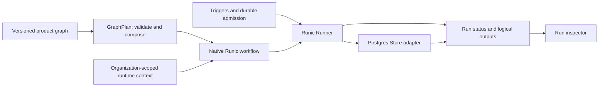

# Runic upgrade and Hermitscale redesign assessment

Research snapshot: October 11, 2026. This report combines three independent source audits and isolated execution experiments. It proposes a direction; it does not upgrade the dependency or refactor application code.

## Recommendation

**A deeper upstream Runic integration now has a working compatibility prototype: the full application passes `mix precommit` on unmodified main with 300 tests and zero failures.** Three application files adapt native collection composition, expression identity bindings, downstream Reduce connections and runtime replay. This demonstrates a route to removing our vendor patches for the currently tested feature set. It does not justify a drop-in replacement for existing durable histories. Mapped reducer runtime context and some multi-input semantics remain unresolved. See the [main application validation](runic-main-application-validation.md) and its reviewable experiment patch.

Open [PR #43](https://github.com/zblanco/runic/pull/43) makes the proposed run observation interface substantially better and includes a useful cross-input failure fix from PR #42. It does not redesign collection ownership or fix mapped reducer context. Its immediate eager rule path also has a policy/deadline gap confirmed by our experiment.

The best direction is a staged compatibility refactor: use public native composition for collections, retain the product semantics in a small compiler interface, keep the existing Runner and Postgres adapter, and delete patches individually after behavioral parity. Adopt PR #43's observation model conditionally rather than making an unmerged branch the foundation of all durable run records.

## Exact comparison targets

| Target | What was inspected |
|---|---|
| Current Hermitscale | Working tree, including existing unrelated uncommitted changes; `{:runic, path: "vendor/runic"}` in [mix.exs](/Users/galdirie/code/hermitscale/mix.exs:72) |
| Vendor provenance | Reports `0.1.0-alpha.8`; retained blobs match May 29 upstream source state, with a concentrated custom collection redesign. See the [patch audit](runic-patch-compatibility.md). |
| Current upstream main | [`6e6373832c00aa9ec5d19faeae945b61e2db50b1`](https://github.com/zblanco/runic/tree/6e6373832c00aa9ec5d19faeae945b61e2db50b1), latest inspected merge dated October 10 |
| Published package | `0.1.0-alpha.11`, published September 17. It includes Identity/Connection but lacks October's SingleOutput and TaskScope changes. Main retains the same version string. See [release API](https://hex.pm/api/packages/runic/releases/0.1.0-alpha.11) and [feature audit](runic-upstream-features.md). |
| PR #43 | Open proposal at [`d1cd8c6863e89d9742bcd54af44c95097064ce4d`](https://github.com/zblanco/runic/tree/d1cd8c6863e89d9742bcd54af44c95097064ce4d); includes unmerged PR #42 at `6bc6478`, so its diff and benefits are not solely execution observation |

A recommendation to install `alpha.11` alone would miss much of the runtime behavior assessed here. Upgrade experiments should pin a commit, graph revision, and application code version.

## Does it solve the patched problems?

| Concern | Evidence and verdict |
|---|---|
| Equal collection values must execute once per occurrence | **Upstream now provides this.** On `[2, 2, 3]`, the original unpatched baseline ran the mapper twice even though its reduce happened to return the correct sum. Vendor and current main ran it three times. Typed Fact occurrence identities distinguish equal payloads; checking aggregate totals alone would have missed the original defect. |
| Multi-step map body feeding a collector | **Substantially supported upstream.** Public Map pipelines and Reduce attachment work in the tested cases. Ordinary nodes can track collection ancestry through an intervening transformation and FactRef. The raw structural topology probe also succeeded on main through the shared SingleOutput lifecycle. This gives a route to deleting much of our engine bookkeeping. |
| Ordered folds and equal mapped outputs | **Passed native-path probes.** Vendor and main preserved source order for a noncommutative fold and retained three equal mapped outputs. This does not prove arbitrary branched/nested/multi-batch regions. |
| Reduced output feeding a multi-parent Join | **Passed native-path probe.** Both returned `{10, 3}` for reduced sum plus sibling count. Keep a product-level fixture proving current output names, cardinality, expressions, and policies. |
| Replay partway through collection processing | **Passed event replay against an authored workflow base.** This is not proof that a bare Map/Reduce construction log reconstructs everything. Upstream itself retains a warning about full Map/Reduce build-log reconstruction. |
| Empty mapped collection | **Unchanged in the tested path:** no reduced result, rather than the seed. This matches our current tests. The new lifecycle guide explicitly does not redesign empty batches. |
| Mapped reducer using `context(:weight)` | **Unresolved regression.** Vendor returned `60`; main and PR #43 raised `BadArityError`. The macro generates a reducer with a context argument, while mapped FanIn finalization invokes it with two arguments. Eager reduce context support does not establish mapped support. |
| Our constructor/attachment/query interfaces | **Not upstream equivalents.** `FanOut.new/1`, `attach_fan_out/3`, `attach_fan_in/4`, and custom region/trace/scope APIs are absent. Compiler lowering must change; upstream improvements do not make our code compatible automatically. |
| Failure in one input suppressing another input's retained Join | **PR #43's included PR #42 fixes the executed case.** Vendor/main lost the good input's Join; PR #43 preserved it. This concerns root-scoped failure suppression, not a general batch ownership solution. |
| Two identical input commands on a retained workflow | **PR #43's observed execution path improves this.** Legacy `react_until_satisfied` ran each batch's mapper but exposed only one reduced `[10]` production; two `execute/3` calls allocated distinct input Fact IDs and retained `[10, 10]`. This proves repeated-command separation in that path, not concurrent/nested collection ownership. |

Detailed source locations, provenance diffs, commands, probe results, and limitations are in the [independent patch audit](runic-patch-compatibility.md). Relevant upstream foundations include [Fact identity](https://github.com/zblanco/runic/blob/6e6373832c00aa9ec5d19faeae945b61e2db50b1/lib/workflow/fact.ex), [ordinary component collection tracking](https://github.com/zblanco/runic/blob/6e6373832c00aa9ec5d19faeae945b61e2db50b1/guides/custom-components.md#L153-L165), and [mapped finalization](https://github.com/zblanco/runic/blob/6e6373832c00aa9ec5d19faeae945b61e2db50b1/lib/workflow/fan_in.ex).

## Features worth using

1. **Named ports and durable connections.** Replace positional wiring and direct path projection with authored Connection data where appropriate. This benefits reusable integration subflows and makes the editor's intent easier to validate. It does not replace Liquid computation or every `$node` reference. See [Connection](https://github.com/zblanco/runic/blob/6e6373832c00aa9ec5d19faeae945b61e2db50b1/lib/workflow/connection.ex) and [Definition](https://github.com/zblanco/runic/blob/6e6373832c00aa9ec5d19faeae945b61e2db50b1/lib/workflow/definition.ex).
2. **SingleOutput for selected integration nodes.** Native execution handles ancestry, collection tracking, hooks, and lifecycle events. Explicit `Result.failure(reason)` preserves structured provider errors for retry classification. Pure math/identity nodes can stay native Steps; ordinary Step error tuples remain successful data. See the [custom component contract](https://github.com/zblanco/runic/blob/6e6373832c00aa9ec5d19faeae945b61e2db50b1/guides/custom-components.md).
3. **Persistence acknowledgement and runtime recovery fixes.** Pending events are retained after returned Store failures; status/checkpoint APIs report errors, and runtime context is applied before recovered work. Hermitscale should distinguish computed completion from durably saved completion. No automatic outage retry cadence or exactly-once external effects follows from this. See [persistence regression tests](https://github.com/zblanco/runic/blob/6e6373832c00aa9ec5d19faeae945b61e2db50b1/test/runner/persistence_failure_test.exs).
4. **Retry classification, admission status, and owned cancellation.** Structured transient/permanent failure policies and caller-owned preview lifetimes are useful. Background business runs should keep their own lifetime. Cancellation cannot undo an already completed HTTP effect. See [SchedulerPolicy](https://github.com/zblanco/runic/blob/6e6373832c00aa9ec5d19faeae945b61e2db50b1/lib/workflow/scheduler_policy.ex) and [Runner](https://github.com/zblanco/runic/blob/6e6373832c00aa9ec5d19faeae945b61e2db50b1/lib/runic/runner.ex).
5. **Manual step/continue for debugging.** Expose native inspection and stepwise admission, making clear that a scheduler unit can contain a Promise with several logical nodes. A manual dispatch mode is not a durable approval timer.

Several powerful capabilities already exist in our vendor: Runner/Store, runtime context, Rules, accumulators, FSM/Aggregate/Saga/ProcessManager, ChainBatching, FlowBatch, and GenStage. Their deeper adoption may be valuable, but it is not evidence that they were newly introduced. Default Runner dispatch also still prepares the full frontier; the new compact dispatch API is opt-in and does not establish bounded total memory.

Use rules and reusable workflow definitions first. Treat durable stateful processes as a separate product design. The Saga macro currently executes all transactions inside one accumulator invocation, does not explicitly reverse declaration order for compensation, and swallows compensation exceptions. ProcessManager timeout blocks are parsed but not wired into execution. These are source-backed reasons to avoid using those constructs as the foundation for reliable provider compensation or durable waiting today; details are in the [feature audit](runic-upstream-features.md).

## What an idiomatic Hermitscale would look like

This is a proposed responsibility map, not new modules to add mechanically. Hermitscale already supervises and uses Runic.Runner. Its Triggers.Scheduler schedules due product events and Oban admissions; it should remain.

**The compiler becomes a deep module.** Its interface returns an executable definition plus the logical-node mapping and output contract. Callers need not know generated prepare nodes, FanOut names, collector hashes, or output aliases. Internally it resolves versioned catalog nodes, retains sandboxed expression dependencies, normalizes product inputs, and delegates topology to Runic.

For a representative `source → map → HTTP step → transform → reduce → downstream join`, preserve the normalization step, build a native Map containing the per-item pipeline, attach a complete `Runic.reduce(..., map: map_name)` through supported composition, and join its designated output to the sibling. Stop extracting `.fan_in` and calling our attachment helpers. Preserve scalar/list/nil normalization, source-order reduction, scoped credentials, per-node policies, `$node` causal references, and terminal outputs. This is the compatibility experiment to execute before deleting compiler region logic.

Keep the existing node author interface where it earns its depth: type/version, parameter schema, expression declarations, provider requirements, and `work(params, input, deps)`. Use a shared catalog component with Component + SingleOutput only where explicit configuration, ports, failure, metadata, and reconstruction deserve a representation. Avoid forcing every simple function into an elaborate custom protocol.

Runic should own readiness, causal Facts, execution attempts, Join/FanIn coordination, event application, dispatch, and policy execution. Hermitscale should own graph revisions, tenant authorization, safe expressions, credential references, provider idempotency/rate limits, trigger schedules, Postgres transactions, and user-facing status.

The complete [architecture assessment](runic-idiomatic-architecture.md) provides deletion/retention decisions, graph examples, UI consequences, and acceptance tests.

## How PR #43 changes the design

Its proposed `Workflow.execute/3` returns both workflow and Execution observation. Managed `Runner.start_execution/4` returns a correlation ID; `execution/3`, `await_execution/4`, and `forget_execution/3` support inspection and retention. Outcome identities distinguish input occurrences, activations, and attempts. Active work, readiness, admission, failures/uncertainty, and persistence become separate observations. See [execution observation guide at the examined PR head](https://github.com/zblanco/runic/blob/d1cd8c6863e89d9742bcd54af44c95097064ce4d/guides/execution-observation.md).

**Design implication:** our run inspector could project those observations rather than infer all status from `is_runnable?` or completion hooks. Treat product Run ID and engine Execution ID separately. Preserve accepted completion order for audit and use causal ordering when selecting results. Keep durable run history in Postgres.

Readiness conditions before relying on it:

- Observations are process-local and are not reconstructed after stop/cancel/resume. Persist the required product projection separately.
- `Execution.outputs` includes completed Runnable results, including node-specific markers; it excludes Join/reduce Facts produced during application. Keep explicit logical output selection from the workflow.
- Quiescence is not business success or persistence acknowledgement. Earlier closed observations retain their persistence snapshot; current acknowledgement comes from Worker persistence status.
- One observed scope progresses per Worker; legacy `run` mixed with observed execution is outside the contract. Avoid that mixture in the product interface.
- Outcome list recording has quadratic growth. Qualify realistic collection sizes before making this the high-volume trace representation.
- **Confirmed additional blocker:** immediate eager rule predicates bypass deadline/retry policy. Our expired-deadline probe still ran the predicate; a predicate RuntimeError escaped `execute` after one attempt despite `max_retries: 1`. Fix/prove this upstream before exposing those guarantees for rule-heavy executions.
- The branch adds persisted event types which older Runic versions cannot replay. The PR and its PR #42 dependency need separate upgrade/rollback qualification.

The PR helps answer “what happened in this execution?” It does not yet supply a durable business-process engine, general batch ownership, or external effect exactly-once guarantees.

## Migration decision and validation

The narrow isolated compiler experiment is now complete and passes the full application suite on main. The next step is production-quality adapter design and qualification of durable-run versioning, existing histories, and repeated/concurrent inputs. Retain the passing occurrence, order, expression, empty-input, downstream-join, policy and replay checks as migration gates. Repair or report the mapped context defect upstream. Qualify PR #42/#43 separately.

Before routing existing runs to the new engine, freeze the definition and application callback version used by each Run. Current resume recompiles the editable graph. Typed identities and event changes are not compatible merely because our binary columns can decode their terms. Drain old runs or retain a versioned legacy recovery route; do not claim a general history migration.

Adopt named ports/output contracts and selected SingleOutput provider nodes after collection parity. Add rules/reusable workflows after execution-policy qualification. Benchmark scheduler options against provider quotas and payload sizes before choosing more elaborate execution strategies.

Executed validation:

| Check | Result |
|---|---|
| Current application snapshot, `mix precommit` | **298 tests, zero failures**; run in an isolated copy with its own test partition to preserve unrelated work |
| Same application with vendor replaced by pinned main; compiler/primitives/edge tests | **30 tests, 22 failures**; missing `FanOut.new/1`, plus undefined attachment warnings. This proves a direct replacement is insufficient, not that native upstream composition is broken. |
| Main follow-up, full library suite | **55 doctests, 1,660 tests, zero failures, 13 existing skips**; clean main only, no PR code. See the [independent main validation](runic-main-library-validation.md). |
| Main follow-up, adapted application `mix precommit` | **300 tests, zero failures**; original 298 plus two occurrence/replay checks, using three application-file adaptations and unchanged main. See the [application validation and patch](runic-main-application-validation.md). |
| Library parity probes | Compared original baseline, vendor, main, and PR #43 for the cases above. Evidence and scope are documented in the patch audit. |
| PR #43 focused execution/deadline/outcome/runner/suppression/stable admission suite | **57 tests, zero failures**, on local Elixir 1.18.4 / OTP 28 |
| Additional PR #43 eager predicate probe | Reproduced expired-deadline execution and missing retry/error containment despite that passing suite |

No production dependency, application code, configuration, routes, or existing edits were changed. The main follow-up now includes a complete upstream suite and a successful isolated Hermitscale compiler/recovery adaptation. Production workload benchmarks and legacy-history migration were not performed or claimed.

## Independent reports

- [Patch provenance and compatibility](runic-patch-compatibility.md)
- [Upstream feature and maturity assessment](runic-upstream-features.md)
- [Idiomatic architecture and PR #43 redesign](runic-idiomatic-architecture.md)
- [Independent main library validation](runic-main-library-validation.md)
- [Main application validation and compatibility experiment](runic-main-application-validation.md)
