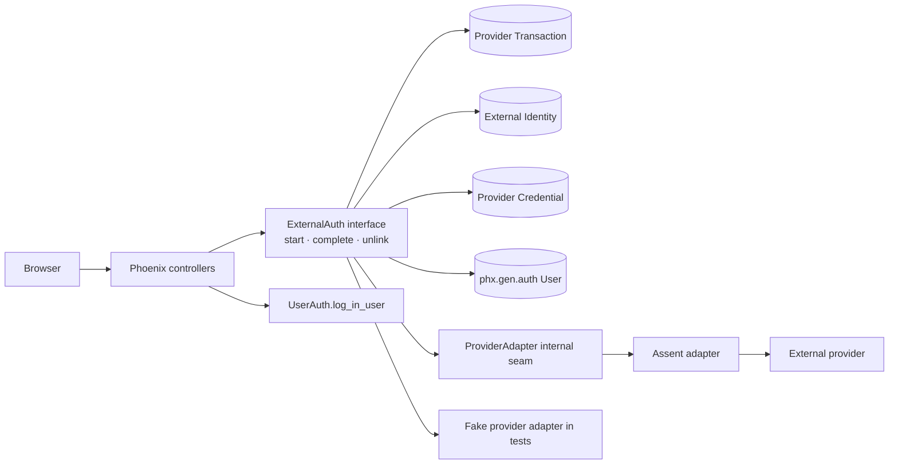

# Social Authentication Libraries and Architecture

| | |
|---|---|
| **Status** | Research recommendation |
| **Reviewed** | 2026-07-26 |
| **Scope** | Greenfield social authentication, account linking, and unlinking integrated with Phoenix 1.8 `phx.gen.auth` |
| **Primary recommendation** | Assent behind `Hermitscale.Accounts.ExternalAuth` |

---

## 1. Executive conclusion

Use [Assent 0.3.1](https://hex.pm/packages/assent) as the protocol implementation, but do not make Assent's strategy modules, session maps, token maps, or errors part of application code outside one adapter.

The application-owned module should be:

```text
Hermitscale.Accounts.ExternalAuth
```

Its interface should have three entry points:

```elixir
start(current_scope, provider, intent, opts)
complete(current_scope, provider, browser_token, callback_params)
unlink(current_scope, external_identity_id)
```

This is a deep module: callers learn three operations while its implementation hides OAuth/OIDC configuration, state, PKCE, nonce, Provider Transaction persistence, provider normalization, External Identity resolution, first-user provisioning, credential handling, replay prevention, and provider-error translation. That depth gives controllers leverage and keeps security-sensitive change local.

Keep the generated `phx.gen.auth` `User`, scope, session-token machinery, and `HermitscaleWeb.UserAuth.log_in_user/3`. The provider callback returns a local User; only then does the controller invoke `UserAuth.log_in_user/3`. A library must not become a second principal or session system.

The non-negotiable identity rule is:

> Resolve an account by External Identity, never by email.

For OIDC, the stable key is the validated `iss` plus `sub` pair. OpenID Connect says that this pair is the only claims combination a relying party can rely on as a stable unique user identifier ([OIDC Core §5.7](https://openid.net/specs/openid-connect-core-1_0.html#ClaimStability)). A verified email can provision a new User when the address is unused. It must not silently attach a new External Identity to an existing User with the same email.

Assent is the best default because it combines:

- one functional request/callback shape across OAuth 1.0, OAuth 2.0, OIDC, and many built-in providers ([Assent features](https://assent.hexdocs.pm/Assent.html#module-features));
- Authorization Code flow, state handling, optional PKCE, and OIDC token validation ([OAuth2 strategy](https://assent.hexdocs.pm/Assent.Strategy.OAuth2.html), [OIDC strategy](https://assent.hexdocs.pm/Assent.Strategy.OIDC.html));
- a Req adapter by default when Req is present, matching this repository's HTTP-client choice ([Assent HTTP adapter](https://assent.hexdocs.pm/Assent.HTTPAdapter.html));
- a small enough protocol interface to place behind an application-owned seam.

The adapter must explicitly enable PKCE and, for OIDC, nonce. Assent's OAuth2 `code_verifier` defaults to `false`, and OIDC nonce is opt-in ([Assent OAuth2 configuration](https://assent.hexdocs.pm/Assent.Strategy.OAuth2.html#module-configuration), [Assent OIDC nonce](https://assent.hexdocs.pm/Assent.Strategy.OIDC.html#module-nonce)).

Choose Oidcc instead only if every target provider is OIDC and advanced OIDC support outweighs provider breadth, the Req preference, and the extra worker/runtime surface.

The subsequent domain synthesis refines the persistence model without changing this
library recommendation: External Identity is the stable provider-subject binding,
while External Login Method and OAuth Connection are independent optional
capabilities. See the [domain glossary](../../CONTEXT.md) and
[proposed ADR](../adr/0001-capability-based-external-authentication.md).

## 2. Domain language

These terms must remain distinct in schemas, functions, logs, and UI copy.

| Term | Meaning | Not the same as |
|---|---|---|
| **User** | The local `phx.gen.auth` principal. Local sessions and authorization refer to this record. | A provider profile or token |
| **External Identity** | A durable, validated provider-subject binding to exactly one User. | Email, display name, or Provider Credential |
| **Provider Transaction** | A short-lived, one-use authentication attempt containing the intent and protocol correlation material. | A login session or External Identity |
| **Provider Credential** | Optional stored access/refresh-token material used to call a provider after authentication. | Proof of who the User is |

“Social account” is acceptable UI copy, but it is too ambiguous for the implementation.

## 3. Standards floor

The architecture is not complete merely because a provider redirects back successfully.

### 3.1 Authorization flow

Use Authorization Code flow. The current OAuth Security Best Current Practice recommends PKCE even for confidential web clients, requires transaction-specific browser binding, recommends the `S256` challenge method, and discourages implicit flow ([RFC 9700 §§2.1–2.1.2](https://www.rfc-editor.org/rfc/rfc9700.html#section-2.1)). RFC 7636 likewise says a capable client must use `S256` ([RFC 7636 §4.2](https://www.rfc-editor.org/rfc/rfc7636.html#section-4.2)).

Every Provider Transaction therefore needs:

- high-entropy `state`, bound to the browser;
- PKCE verifier and `S256` challenge where the provider supports Authorization Code;
- high-entropy nonce for OIDC, verified against the ID Token;
- an exact, pre-registered redirect URI;
- a provider/issuer binding to prevent authorization-server mix-up;
- a short expiry and atomic one-use consumption.

OIDC defines nonce as the value associating a client session with an ID Token and mitigating replay; clients must compare the returned claim with the sent value ([OIDC Core §2](https://openid.net/specs/openid-connect-core-1_0.html#IDToken)).

### 3.2 Identity

For OIDC:

```text
External Identity key = canonical issuer (`iss`) + subject (`sub`)
```

`sub` is case-sensitive, locally unique, and never reassigned within its issuer. The issuer and subject together are the guaranteed unique identifier ([OIDC Core §§2 and 5.7](https://openid.net/specs/openid-connect-core-1_0.html#ClaimStability)).

For provider-specific OAuth without OIDC:

```text
External Identity key = configured provider authority + stable provider user id
```

The adapter must define the authority from trusted configuration, not from an unchecked callback field. For example, a GitHub Enterprise host and public GitHub are different authorities.

Email, name, avatar, locale, and username are mutable profile claims. They may update cached display metadata; they do not select a User.

### 3.3 Credentials

Do not persist provider tokens if authentication is the only use case. Assent returns token material alongside normalized user data, but the application can discard it after resolving the External Identity ([Assent OAuth2 callback type](https://assent.hexdocs.pm/Assent.Strategy.OAuth2.html#t:on_callback/0)).

If later product behavior requires provider API access, store a separate Provider Credential encrypted at rest, request minimum scopes, support key rotation, and never log its contents. Any bearer can use a disclosed bearer token, so it must be protected in storage and transport ([RFC 6750 §1](https://www.rfc-editor.org/rfc/rfc6750.html#section-1)).

## 4. Library evaluation

Versions and release dates below are the current Hex records on 2026-07-26. Release recency is a maintenance signal, not a security or quality verdict.

| Choice | Current version | Strengths | Costs and architectural fit | Verdict |
|---|---:|---|---|---|
| [Assent](https://hex.pm/packages/assent) | 0.3.1 (2025-06-20) | OAuth 1.0, OAuth 2.0, OIDC, many built-in providers; functional request/callback phases; normalized claims; configurable HTTP adapter; Req default | Pre-1.0; PKCE and OIDC nonce require explicit configuration; the application still owns transaction storage, identity policy, and credentials | **Use behind an adapter** |
| [Oidcc](https://hex.pm/packages/oidcc) + [oidcc_plug](https://hex.pm/packages/oidcc_plug) | 3.7.2 / 0.4.0 | Deep OIDC implementation; discovery/JWK refresh; token validation; Plug package handles state, nonce, PKCE, and callback checks | OIDC only; a provider configuration worker per issuer; Plug package owns more session behavior; Oidcc's documented HTTP utility is based on `:httpc`, not the repository's Req preference | **Strong OIDC-only alternative** |
| [Ueberauth](https://hex.pm/packages/ueberauth) + strategies | 0.10.8 (2024-02-27) | Mature Plug convention; common normalized auth struct; many provider packages; built-in CSRF protection | The primary seam is `Plug.Conn`; request strategies may redirect/halt and callback results live in conn assigns; provider strategy versions and dependencies vary independently | **Do not use as the application seam** |
| [oauth2](https://hex.pm/packages/oauth2) | 2.1.1 (2026-06-03) | Current generic OAuth2 client; several grant types; custom strategies | OAuth authorization plumbing, not OIDC authentication policy; the application would rebuild state/PKCE/claim validation; requires Tesla ([dependency record](https://hex.pm/packages/oauth2/dependencies)) | **Too low-level for sign-in** |
| [openid_connect](https://hex.pm/packages/openid_connect) | 1.0.1 (2026-01-07) | Current functional OIDC primitives; discovery, token verification, userinfo; Finch/JOSE stack | Caller supplies state and assembles more of the transaction flow; OIDC only; less depth than Oidcc and less provider breadth than Assent | **Viable, not preferred** |
| [PowAssent](https://hex.pm/packages/pow_assent) | 0.4.18 (2024-02-17) | Existing provider integration built on Assent | It is explicitly an extension for Pow and would introduce a second authentication framework | **Reject for `phx.gen.auth`** |
| [AshAuthentication](https://hex.pm/packages/ash_authentication) | 4.14.1 (2026-06-15) | Broad authentication framework; its OAuth2 strategy wraps Assent | Adopting it changes the resource/principal model rather than complementing generated auth | **Reject unless the app adopts Ash** |

### 4.1 Assent

Assent's request phase returns an authorization URL and `session_params`; the callback phase receives those parameters and returns normalized user data plus token data. The session parameters contain state and, when enabled, PKCE material ([Assent OAuth2 overview](https://assent.hexdocs.pm/Assent.Strategy.OAuth2.html#module-configuration)). For OIDC, they can also contain nonce; Assent dynamically fetches discovery data and validates the ID Token according to OIDC Core ([Assent OIDC callback](https://assent.hexdocs.pm/Assent.Strategy.OIDC.html#callback/3)).

That division is a good implementation fit:

- the adapter calls Assent;
- Provider Transaction stores Assent's opaque `session_params` server-side;
- controllers see only the deep module's URL, browser token, outcome, and normalized errors;
- no Assent map becomes an application contract.

Assent supports built-in strategies for providers including Apple, Azure AD, Discord, Facebook, GitHub, GitLab, Google, Slack, Twitch, and others ([complete provider list](https://assent.hexdocs.pm/Assent.html#module-features)). Its HTTP behavior is a five-argument request interface and defaults to `Assent.HTTPAdapter.Req` when Req is available ([HTTP adapter behavior](https://assent.hexdocs.pm/Assent.HTTPAdapter.html)).

Risks to contain:

- Pin a compatible `0.3.x` release and read the changelog on upgrade; 0.3.0 contained breaking changes ([Assent changelog](https://assent.hexdocs.pm/CHANGELOG.html)).
- Assert `state: true` and `code_verifier: true` in adapter configuration rather than relying on defaults.
- Assert `nonce: true` for every OIDC strategy.
- Contract-test each enabled provider's subject, issuer/authority, verified-email semantics, denial errors, and credential shape.
- Treat provider-normalized claims as untrusted input until the adapter checks types and size limits.

### 4.2 Oidcc and oidcc_plug

Oidcc is the stronger specialized implementation when the provider set is entirely OIDC. Its high-level interface creates redirect URLs, retrieves and validates tokens, retrieves userinfo, refreshes tokens, introspects tokens, and creates logout URLs ([Oidcc high-level interface](https://oidcc.hexdocs.pm/oidcc.html)). Its provider worker continuously refreshes discovery configuration and JWKs and offers concurrent ETS reads ([provider configuration worker](https://oidcc.hexdocs.pm/oidcc_provider_configuration_worker.html)).

Oidcc accepts state, nonce, a PKCE verifier, and a `require_pkce` option ([authorization options](https://oidcc.hexdocs.pm/oidcc_authorization.html)). `oidcc_plug` goes further: its authorization Plug creates state, nonce, and PKCE values and stores browser checks in the Plug session; its callback Plug deletes the session state and validates the callback before exposing the result ([Authorize docs](https://hexdocs.pm/oidcc_plug/Oidcc.Plug.Authorize.html), [AuthorizationCallback docs](https://hexdocs.pm/oidcc_plug/Oidcc.Plug.AuthorizationCallback.html)).

Those are good protocol properties, but they place more behavior in a Plug/session and supervised-worker implementation. They also do not cover provider-specific OAuth services that are not OIDC. Select Oidcc only after confirming the provider matrix is OIDC-only and accepting its operational shape.

The one published Oidcc advisory affected older 3.0–3.2 prerelease ranges, not 3.7.2 ([Hex advisory record](https://hex.pm/packages/oidcc/advisories)).

### 4.3 Ueberauth

Ueberauth is a Plug-first framework. Strategies receive and return `Plug.Conn`, may halt or redirect during the request phase, and decorate callback conns with `:ueberauth_auth` or `:ueberauth_failure` ([Ueberauth strategy behavior](https://ueberauth.hexdocs.pm/Ueberauth.Strategy.html)). That is convenient for a small controller-only integration, but it puts the library's web lifecycle at the application seam.

Its providers are separate packages. For example, [ueberauth_google](https://hex.pm/packages/ueberauth_google) and [ueberauth_github](https://hex.pm/packages/ueberauth_github) have independent releases and transitive stacks. Every provider therefore needs an individual protocol and maintenance review.

Ueberauth can be wrapped, but the wrapper would spend much of its implementation translating conn mutation back into application data. Assent starts closer to the desired interface and keeps Phoenix transport concerns in controllers.

### 4.4 oauth2 and openid_connect

The `oauth2` package is useful for OAuth-protected API clients. Its documented interface builds clients, authorization URLs, token exchanges, and resource requests ([OAuth2 docs](https://oauth2.hexdocs.pm/OAuth2.html), [client docs](https://oauth2.hexdocs.pm/OAuth2.Client.html)). It does not by itself define OIDC issuer, audience, nonce, signature, and subject validation. Using it directly for authentication would move security-sensitive assembly into the application and add Tesla despite the repository's Req convention.

`openid_connect` provides OIDC discovery, authorization URI generation, token fetching/verification, userinfo, refresh, and logout functions ([OpenIDConnect docs](https://openid-connect.hexdocs.pm/OpenIDConnect.html)). It is a credible lower-level implementation, but its caller owns more state and flow orchestration than with the proposed Assent adapter.

## 5. Recommended deep module

### 5.1 Seam placement



`Hermitscale.Accounts.ExternalAuth` is the application seam. Phoenix controllers depend on its interface, not on Assent. The module's implementation owns protocol orchestration and local account policy together because splitting them would force callers to coordinate security-sensitive ordering.

The deletion test shows why the module earns its keep: removing it would spread provider selection, state storage, replay handling, claim normalization, User selection, link-conflict policy, credential storage, and error translation across controllers and tests.

### 5.2 Public interface

Illustrative types:

```elixir
defmodule Hermitscale.Accounts.ExternalAuth do
  alias Hermitscale.Accounts.{ExternalIdentity, Scope, User}

  @type provider :: atom()
  @type intent :: :sign_in | :link
  @type browser_token :: binary()

  @type error ::
          :unknown_provider
          | :invalid_return_to
          | :already_authenticated
          | :authentication_required
          | :recent_authentication_required
          | :authentication_expired
          | :provider_denied
          | :provider_unavailable
          | :invalid_provider_response
          | :verified_email_required
          | :account_link_required
          | :identity_conflict
          | :cannot_unlink_last_login
          | :not_found

  @spec start(Scope.t() | nil, provider(), intent(), keyword()) ::
          {:ok, Authorization.t()} | {:error, error()}

  @spec complete(Scope.t() | nil, provider(), browser_token(), map()) ::
          {:ok, Outcome.t()} | {:error, error()}

  @spec unlink(Scope.t(), ExternalIdentity.id()) ::
          {:ok, Unlinked.t()} | {:error, error()}
end
```

The returned values are application structs:

```elixir
%Authorization{
  url: "https://provider.example/authorize?...",
  browser_token: "...opaque...",
  expires_at: ~U[...]
}

%Outcome{
  intent: :sign_in | :link,
  user: %User{},
  external_identity: %ExternalIdentity{},
  return_to: "/users/settings"
}

%Unlinked{
  external_identity_id: "...",
  revocation: :not_needed | :scheduled
}
```

They deliberately omit Assent's strategy module, `session_params`, raw provider claims, and token map.

#### `start/4`

Parameters:

- `current_scope` is first, matching the Accounts context convention. It is `nil` only for anonymous sign-in.
- `provider` is an atom from a compile-time/application configuration allowlist. Never call `String.to_atom/1` on a route parameter.
- `intent` is `:sign_in` or `:link`.
- supported options are intentionally narrow: `return_to: local_path`.

Invariants:

- `:sign_in` starts anonymously; an already-authenticated browser uses `:link` instead of silently switching accounts.
- `:link` requires `current_scope.user` and recent/sudo authentication.
- `return_to` must be a validated local path or a named destination. It can never be an arbitrary URL.
- the provider config fixes strategy, authority/issuer, client ID, exact redirect URI, scopes, PKCE policy, and nonce policy.
- one browser session has one active opaque browser token in the minimum design. Starting another attempt replaces it; old Provider Transactions expire harmlessly.

The implementation returns a URL only after it has successfully persisted a Provider Transaction. The controller stores `browser_token` in the signed Phoenix session, then performs an external redirect.

#### `complete/4`

Parameters:

- `current_scope` is the scope at callback time.
- `provider` is revalidated against the configured allowlist and the stored transaction.
- `browser_token` is the opaque value removed from the Phoenix session.
- `callback_params` are untrusted provider query/form parameters.

Invariants:

- a callback can consume exactly one unexpired Provider Transaction;
- state, browser binding, provider, redirect URI, intent, and link target must all match;
- a link target comes only from the stored authenticated User id, never callback params;
- a changed local browser principal invalidates the attempt;
- only adapter-validated issuer/authority and subject values can reach identity resolution;
- completion never auto-links on email;
- sign-in returns a local User but does not create a Phoenix session.

#### `unlink/2`

Parameters:

- `current_scope` must contain the owning User and recent/sudo authentication;
- `external_identity_id` is an opaque application id, not a provider subject.

Invariants:

- only the owning User can unlink;
- removing the identity cannot leave the User without a usable login method;
- local unlinking is atomic;
- no provider network call occurs while a database transaction is open;
- if a Provider Credential exists, local access is disabled immediately and remote revocation is scheduled from an encrypted outbox record.

Listing External Identities is a settings read model and need not enlarge this flow interface. The Accounts settings query can preload a User's External Identities while all mutations still cross this seam.

### 5.3 Usage and ordering

Illustrative controller usage:

```elixir
with {:ok, authorization} <-
       ExternalAuth.start(conn.assigns.current_scope, provider, :sign_in,
         return_to: ~p"/"
       ) do
  conn
  |> put_session(:external_auth_browser_token, authorization.browser_token)
  |> redirect(external: authorization.url)
end
```

At callback time, delete the browser token before completing the one-use attempt:

```elixir
browser_token = get_session(conn, :external_auth_browser_token)
conn = delete_session(conn, :external_auth_browser_token)

case ExternalAuth.complete(conn.assigns.current_scope, provider, browser_token, conn.params) do
  {:ok, %{intent: :sign_in, user: user, return_to: return_to}} ->
    conn
    |> put_session(:user_return_to, return_to)
    |> HermitscaleWeb.UserAuth.log_in_user(user)

  {:ok, %{intent: :link, return_to: return_to}} ->
    redirect(conn, to: return_to)

  {:error, reason} ->
    # Render safe application copy; log only the normalized internal reason.
end
```

Required ordering:

1. `start/4` persists the Provider Transaction.
2. The controller stores the returned browser token.
3. The browser visits the provider.
4. The callback removes the browser token from the local session.
5. `complete/4` atomically consumes the Provider Transaction before exchanging the authorization code.
6. On a successful `:sign_in` outcome, and only then, the controller calls `UserAuth.log_in_user/3`.
7. A `:link` outcome preserves the existing local session.

Consuming before the provider exchange makes replay semantics simple and fail-closed. A provider outage or local persistence failure requires a fresh attempt. That usability cost is preferable to a lease/retry state machine for the first implementation; it can be revisited if production evidence shows material callback failures.

## 6. Persistence model

### 6.1 External Identity

Suggested fields:

| Field | Purpose |
|---|---|
| `id` | Local opaque id |
| `user_id` | Required owning User |
| `provider` | Configured provider key for display/routing |
| `authority` | Canonical validated OIDC issuer or OAuth provider authority |
| `subject` | Stable provider subject/user id |
| `email_at_provider` | Last observed profile value; never an identity key |
| `profile` | Small allowlisted metadata snapshot, not an arbitrary provider response |
| `last_authenticated_at` | Audit and settings display |
| timestamps | Local lifecycle |

Database invariants:

- unique `(authority, subject)`;
- foreign key to one User;
- bounded lengths on authority, subject, email, and metadata;
- no uniqueness rule on mutable provider email;
- optionally enforce one identity per configured provider per User only if product policy requires it. Do not bake that restriction in without a product need.

### 6.2 Provider Transaction

Suggested fields:

| Field | Purpose |
|---|---|
| `id` | Opaque local id |
| `provider` | Provider config snapshot key |
| `intent` | `sign_in` or `link` |
| `user_id` | Required for link; absent for sign-in |
| `state_digest` | Lookup/compare without storing raw state |
| `browser_digest` | Binds callback to the initiating browser |
| `session_payload` | Encrypted Assent `session_params`, including PKCE/nonce material |
| `redirect_uri` | Exact callback snapshot |
| `return_to` | Validated local path |
| `expires_at` | Short lifetime, normally 5–10 minutes |
| `consumed_at` | One-use marker |

Consumption must be one atomic statement or locked transaction equivalent:

```text
consume where state/provider/browser match
  and consumed_at is null
  and expires_at is in the future
```

Failure returns the single public error `:authentication_expired`; internal telemetry may distinguish missing, expired, replayed, and browser-mismatch reasons without giving an attacker an oracle.

### 6.3 Provider Credential

Create this table only when a product use case needs provider API access.

Suggested fields:

| Field | Purpose |
|---|---|
| `external_identity_id` | One current credential set per External Identity |
| `access_token_ciphertext` | Encrypted token |
| `refresh_token_ciphertext` | Optional encrypted refresh token |
| `expires_at` | Access-token expiry |
| `scopes` | Normalized granted scopes |
| `token_type` | Expected bearer/token type |
| `key_version` | Encryption-key rotation |
| timestamps | Rotation/audit |

Never expose this schema through the `ExternalAuth` outcome. Downstream provider-API behavior should receive a credential handle and resolve/decrypt it only at the call site that needs it.

## 7. Completion policy

After the adapter validates the callback and returns a normalized authority, subject, claims, and optional credential, `complete/4` applies this table inside one local database transaction:

| Intent and local state | Result |
|---|---|
| External Identity already exists; sign-in | Return its User; refresh safe profile metadata |
| External Identity already belongs to the link target | Idempotent link success |
| External Identity belongs to another User | `:identity_conflict` |
| No External Identity; link with valid stored target | Insert binding to that User |
| No External Identity; sign-in with unused verified email | Atomically create confirmed User, personal organization/membership, and External Identity |
| No External Identity; sign-in and verified email already belongs to a User | `:account_link_required`; ask the person to authenticate that User and then link |
| No External Identity; missing or unverified email | `:verified_email_required`; do not invent or trust an email |

The new-User path must share the generated User changeset and the application's User-provisioning implementation, but User creation, personal organization/membership creation, and External Identity insertion must commit atomically. Do not call a separately committing registration flow and attach the identity afterward.

Database uniqueness, not a prior read alone, decides races. Two attempts for the same authority/subject cannot bind it to two Users. If two first-sign-in attempts race on email, the email uniqueness constraint converts the loser to `:account_link_required` without partial rows.

## 8. Hidden implementation and adapters

### 8.1 Internal ProviderAdapter seam

Provider APIs are true external dependencies. Define an internal interface such as:

```elixir
@callback authorization(provider_config(), transaction_seed()) ::
            {:ok, %{url: binary(), session_payload: map(), state: binary()}}
            | {:error, provider_error()}

@callback callback(provider_config(), callback_params(), session_payload()) ::
            {:ok, ProviderPrincipal.t()}
            | {:error, provider_error()}

@callback revoke(provider_config(), ProviderCredential.t()) ::
            :ok | {:error, provider_error()}
```

Use two adapters:

- `AssentProviderAdapter` in production;
- `FakeProviderAdapter` in `ExternalAuth` tests.

This is a real internal seam: the production adapter crosses a true external network dependency and the fake makes deterministic interface tests possible. Keep adapter selection inside the implementation; do not add it to `start/4` or `complete/4` parameters.

`ProviderPrincipal` is an internal normalized struct:

```elixir
%ProviderPrincipal{
  authority: "https://accounts.example",
  subject: "stable-subject",
  verified_email: "person@example.com",
  profile: %{name: "Person", avatar_url: "..."},
  credential: nil | %ProviderCredentialInput{}
}
```

### 8.2 No repository seam

Postgres/Ecto is local-substitutable with the SQL sandbox. Keep Ecto queries and transactions hidden directly inside `ExternalAuth`; do not create repository behaviors merely to mock them. Tests should cross the same public interface as controllers.

### 8.3 Assent HTTP seam

Adapter contract tests can additionally replace Assent's HTTP adapter. Assent documents a `request/5` behavior and ships Req, Finch, and `:httpc` implementations ([Assent.HTTPAdapter](https://assent.hexdocs.pm/Assent.HTTPAdapter.html)). Use Req in production and a deterministic HTTP adapter for protocol fixtures.

## 9. Error interface

Normalize library/provider errors before they cross the module seam.

| Public error | Meaning | Caller behavior |
|---|---|---|
| `:unknown_provider` | Route/config key is not enabled | 404 or generic unavailable message |
| `:invalid_return_to` | Destination was not a safe local path | Reject start |
| `:already_authenticated` | Sign-in attempted from an authenticated browser | Direct to settings/link flow |
| `:authentication_required` | Link/unlink lacks a current User | Redirect to login |
| `:recent_authentication_required` | Link/unlink lacks sudo freshness | Reauthenticate |
| `:authentication_expired` | Missing, expired, replayed, or mismatched Provider Transaction | Start again |
| `:provider_denied` | Person denied/cancelled provider consent | Return to login/settings |
| `:provider_unavailable` | Timeout, discovery, token, or userinfo outage | Start again; optionally show retry copy |
| `:invalid_provider_response` | Signature, issuer, audience, nonce, subject, or response shape invalid | Generic failure; security log |
| `:verified_email_required` | New User cannot be safely provisioned | Offer local verified-email registration |
| `:account_link_required` | Email belongs to an existing User but identity is unlinked | Authenticate locally, then link |
| `:identity_conflict` | External Identity belongs to another User | Generic conflict; support path |
| `:cannot_unlink_last_login` | Unlink would lock the User out | Explain required alternative login |
| `:not_found` | Identity absent or not owned | 404 without ownership disclosure |

Do not return raw Assent exceptions, OAuth error descriptions, tokens, ID Tokens, provider bodies, or callback parameters. Log a correlation id and normalized reason; redact protocol secrets.

## 10. Phoenix and phx.gen.auth integration

### 10.1 Route placement

Use controller routes because the provider redirects across origins and the callback is an ordinary HTTP endpoint.

- **Sign-in start:** place it in `scope "/", HermitscaleWeb` with the `:browser` pipeline. It must work anonymously and needs the Phoenix session, CSRF/browser headers, and `current_scope`. A separate start scope may also use `:redirect_if_user_is_authenticated`; do not apply that plug to the callback.
- **Callback:** place it in the existing public `scope "/", HermitscaleWeb` with `pipe_through :browser`. It cannot require a logged-in User because it also completes sign-in. The stored Provider Transaction distinguishes `:sign_in` from `:link`.
- **Link start and unlink:** place controller routes in the existing authenticated scope with `pipe_through [:browser, :require_authenticated_user]`. `ExternalAuth` additionally enforces recent/sudo authentication and binds link intent to `current_scope.user`.
- **Settings UI:** keep any LiveView UI in the existing `live_session :require_authenticated_user` with the generated authentication `on_mount`. Do not create a duplicate live-session name. Settings already need the current User and should derive it from `@current_scope.user`.

Controller routes are not placed inside a `live_session`; a `live_session` applies only to LiveView routes. This split preserves generated router-level authentication instead of reimplementing it in provider code.

### 10.2 Session integration

`complete/4` does not write Phoenix session tokens. On `:sign_in`, the controller passes the returned User to `HermitscaleWeb.UserAuth.log_in_user/3`, preserving generated session renewal, remember-me behavior, live-socket handling, and `current_scope` reconstruction.

On `:link`, do not call `log_in_user/3`; retain the existing User session. On `unlink`, retain the session unless product policy explicitly requires signing out other sessions.

The generated auth code is application-owned and intended to be extended rather than replaced ([Phoenix `phx.gen.auth` guide](https://hexdocs.pm/phoenix/mix_phx_gen_auth.html), [task docs](https://hexdocs.pm/phoenix/Mix.Tasks.Phx.Gen.Auth.html)).

## 11. Test strategy

The `ExternalAuth` interface is the main test surface.

### 11.1 Interface tests with FakeProviderAdapter and SQL sandbox

Cover:

- sign-in start creates an expiring Provider Transaction and returns only opaque values;
- unknown providers and unsafe return destinations are rejected;
- state, provider, browser, expiry, and one-use checks;
- callback replay and concurrent callback attempts;
- existing External Identity sign-in;
- first-time User + personal organization + identity atomic provisioning;
- verified-email collision returns `:account_link_required` and never attaches;
- missing/unverified email returns `:verified_email_required`;
- link requires authenticated, recent User;
- same-User link is idempotent;
- other-User link returns `:identity_conflict`;
- concurrent transactions for the same authority/subject honor the unique constraint;
- unlink ownership and last-login-method checks;
- credential deletion plus encrypted revocation-outbox creation;
- raw tokens and provider bodies never appear in public errors or inspected outcomes.

Use the real Repo and Ecto SQL sandbox. Assert observable results through `start/4`, `complete/4`, and `unlink/2`; do not test private query modules.

### 11.2 AssentProviderAdapter contract tests

Use a fake `Assent.HTTPAdapter` or local fixture server to cover every enabled provider:

- the request has an exact redirect URI, state, PKCE `S256`, and OIDC nonce;
- callback state/nonce/signature/issuer/audience failures are rejected;
- stable provider subject and authority are normalized correctly;
- email is only marked verified when provider semantics establish that fact;
- provider denial, malformed response, rate limit, and timeout map to the correct internal error;
- token and refresh-token shapes are normalized without logging.

These tests isolate library-version and provider-shape drift while the deeper interface tests remain stable.

### 11.3 Phoenix tests

Controller tests should stay small:

- start stores the browser token and externally redirects;
- callback removes the browser token;
- sign-in success delegates the returned User to `UserAuth.log_in_user/3`;
- link success preserves the existing session;
- public errors render safe copy and destinations.

LiveView settings tests should use stable DOM ids for provider buttons and linked-identity rows, following the repository's LiveView test convention. Real provider smoke tests belong in a manually triggered environment, not the deterministic test suite.

## 12. Trade-offs and decision triggers

### What this design optimizes

- **Depth:** three operations hide the full protocol and account lifecycle.
- **Leverage:** controllers and tests use the same outcomes for every provider.
- **Locality:** provider upgrades, security policy, claim normalization, and link rules change in one implementation.
- **Testability:** the true external dependency sits behind one internal ProviderAdapter seam.
- **Preservation:** `phx.gen.auth` remains the sole User/session system.

### Accepted costs

- Assent 0.3 is pre-1.0 and its secure options are not all defaults.
- A server-side Provider Transaction table adds schema and cleanup work.
- Consuming a callback before remote exchange means transient failure requires a new attempt.
- Not auto-linking by email adds one authentication step for existing Users. That friction prevents account takeover through provider/email mismatch.
- Optional credential revocation needs an encrypted outbox/background path.

### Reconsider Assent when

- all enabled providers are OIDC and advanced conformance/features are central: evaluate Oidcc;
- an enabled provider is unsupported or its Assent strategy cannot establish a stable subject: write one provider adapter or reconsider the provider;
- callback failure rates justify a claimed/leased Provider Transaction state machine;
- the app deliberately adopts Ash or Pow as its principal/authentication framework;
- the provider matrix or library security posture changes.

Do not reconsider the application seam merely because the protocol implementation changes. That insulation is the point of the module.

## 13. Implementation sequence

1. Add External Identity and Provider Transaction schemas with database constraints and encrypted transient payload support.
2. Write `ExternalAuth` interface tests against `FakeProviderAdapter`.
3. Implement `start/4`, one-use `complete/4`, local identity policy, and `unlink/2`.
4. Add `AssentProviderAdapter` using Req, explicit PKCE, and explicit OIDC nonce.
5. Add adapter contract fixtures per enabled provider.
6. Add public callback and authenticated link/unlink controller routes in the scopes described above.
7. Connect successful sign-in outcomes to generated `UserAuth.log_in_user/3`.
8. Add the settings read model/UI.
9. Add Provider Credential storage and revocation only when a concrete provider-API use case exists.

## 14. Primary sources

### Standards

- [OAuth 2.0 Security Best Current Practice, RFC 9700](https://www.rfc-editor.org/rfc/rfc9700.html)
- [Proof Key for Code Exchange, RFC 7636](https://www.rfc-editor.org/rfc/rfc7636.html)
- [OAuth 2.0 Bearer Token Usage, RFC 6750](https://www.rfc-editor.org/rfc/rfc6750.html)
- [OpenID Connect Core 1.0 incorporating errata set 2](https://openid.net/specs/openid-connect-core-1_0.html)

### Libraries

- [Assent package](https://hex.pm/packages/assent), [documentation](https://assent.hexdocs.pm/Assent.html), [OAuth2 strategy](https://assent.hexdocs.pm/Assent.Strategy.OAuth2.html), [OIDC strategy](https://assent.hexdocs.pm/Assent.Strategy.OIDC.html), [HTTP adapter](https://assent.hexdocs.pm/Assent.HTTPAdapter.html), [changelog](https://assent.hexdocs.pm/CHANGELOG.html)
- [Oidcc package](https://hex.pm/packages/oidcc), [high-level interface](https://oidcc.hexdocs.pm/oidcc.html), [provider worker](https://oidcc.hexdocs.pm/oidcc_provider_configuration_worker.html), [authorization options](https://oidcc.hexdocs.pm/oidcc_authorization.html)
- [oidcc_plug package](https://hex.pm/packages/oidcc_plug), [Authorize](https://hexdocs.pm/oidcc_plug/Oidcc.Plug.Authorize.html), [AuthorizationCallback](https://hexdocs.pm/oidcc_plug/Oidcc.Plug.AuthorizationCallback.html)
- [Ueberauth package](https://hex.pm/packages/ueberauth), [strategy behavior](https://ueberauth.hexdocs.pm/Ueberauth.Strategy.html), [Google strategy](https://hex.pm/packages/ueberauth_google), [GitHub strategy](https://hex.pm/packages/ueberauth_github)
- [oauth2 package](https://hex.pm/packages/oauth2), [documentation](https://oauth2.hexdocs.pm/OAuth2.html), [dependencies](https://hex.pm/packages/oauth2/dependencies)
- [openid_connect package](https://hex.pm/packages/openid_connect), [documentation](https://openid-connect.hexdocs.pm/OpenIDConnect.html)
- [PowAssent package](https://hex.pm/packages/pow_assent)
- [AshAuthentication package](https://hex.pm/packages/ash_authentication)

### Phoenix

- [`phx.gen.auth` guide](https://hexdocs.pm/phoenix/mix_phx_gen_auth.html)
- [`Mix.Tasks.Phx.Gen.Auth`](https://hexdocs.pm/phoenix/Mix.Tasks.Phx.Gen.Auth.html)
- [Phoenix scopes guide](https://hexdocs.pm/phoenix/scopes.html)
